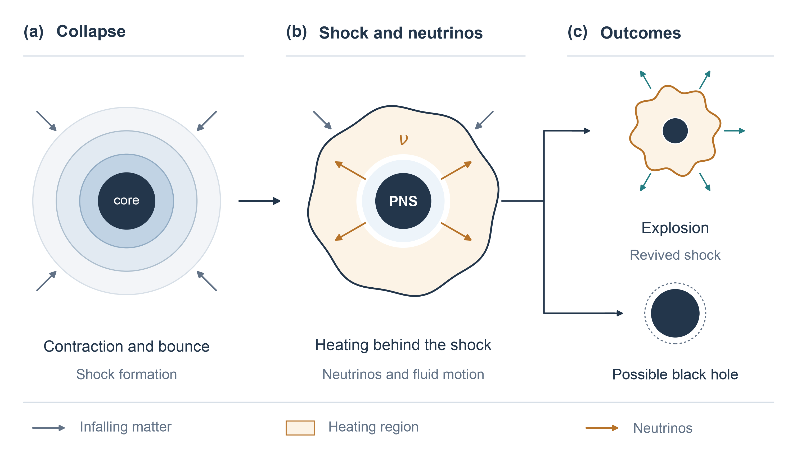
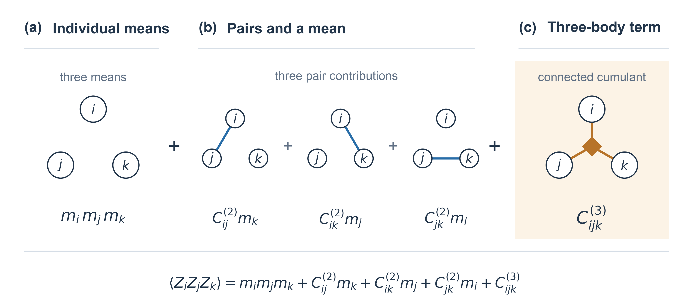
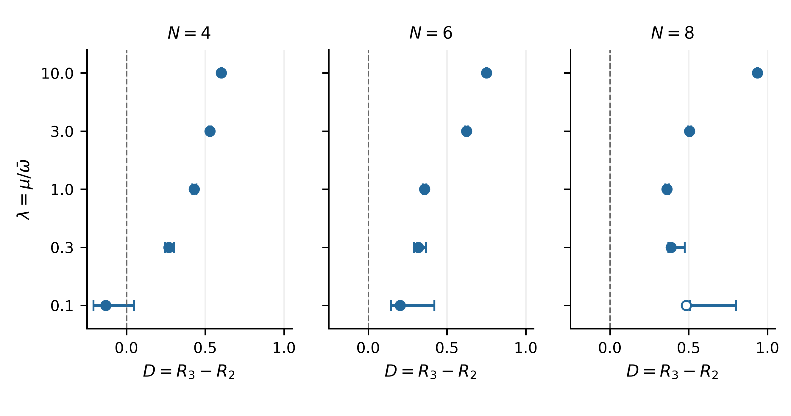
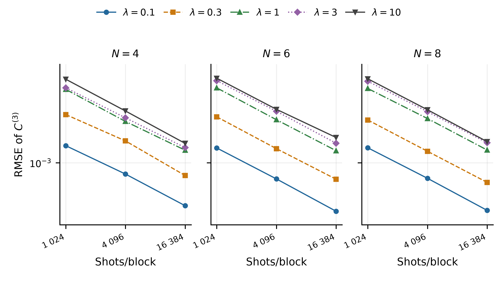
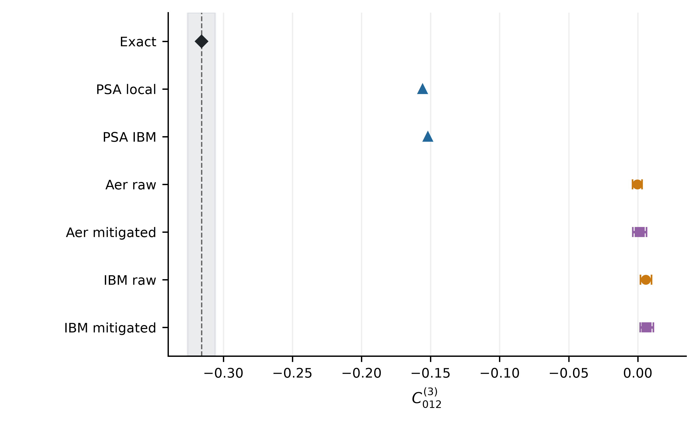

# Beyond mean field: does the phase-space approximation capture three-body neutrino correlations?

_Além do campo médio: a aproximação de espaço de fase captura as correlações de três corpos entre neutrinos?_

**Giovanna Fátima de Britto Vieira¹, Marco Ruas Sales Peixoto¹, Leonardo Villas Boas Fischel¹**

¹Instituto de Tecnologia e Liderança – Inteli, São Paulo – SP – Brazil

Advisors: Jose Erinaldo da Fonseca and Bryan Kano Ferreira

## Resumo

O sabor dos neutrinos em supernovas pode influenciar a explosão e a produção de elementos pesados. Contudo, simular esta evolução quântica em sistemas grandes exige aproximações frente ao número alto de neutrinos no sistema. Este trabalho avaliou a aproximação de espaço de fase nos cumulantes de dois e três corpos de um modelo de dois sabores, com referências exata e de campo médio, e circuitos trotterizados ideais e ruidosos. Os intervalos indicaram maior erro normalizado dos trios em 14 de 15 configurações principais. Mais medições reduziram o erro dos circuitos ideais. No caso ruidoso principal, a mitigação de leitura não recuperou o cumulante exato no simulador nem na IBM. Conclusões confirmatórias exigem revisão estatística e avaliação de limiares de ruído.

**Palavras-chave:** Neutrinos. Oscilações coletivas. Correlações de três corpos. Computação quântica. Aproximação de espaço de fase.

## Abstract

The flavor of neutrinos in supernovae can influence the explosion and heavy-element production. Simulating this quantum evolution in large systems requires approximations, given the large numbers of neutrinos in the system. This work assessed the phase-space approximation for two- and three-body cumulants in a two-flavor model, with exact and mean-field references, and ideal and noisy Trotterized circuits. The intervals indicated larger normalized triple errors in 14 of 15 main configurations. More measurements reduced ideal-circuit error. In the primary noisy case, readout mitigation recovered the exact cumulant neither in simulation nor on IBM hardware. Confirmatory conclusions require statistical review and noise-threshold evaluation.

**Keywords:** Neutrinos. Collective oscillations. Three-body correlations. Quantum computing. Phase-space approximation.

## Introduction

### Astrophysical context and motivation

Stars with initial masses above approximately eight solar masses can undergo gravitational core collapse. In a typical scenario, an iron-rich core loses support, contracts, and undergoes a bounce, generating a shock. This shock can stall through energy losses from nuclear dissociation and neutrino emission. Neutrino absorption and fluid motion can revive it during accretion, meaning matter falling onto the remnant (Figure 1) [Janka 2012, Abi et al. 2020].

_Figure 1 - Stellar core collapse, not to scale. (a) Core contraction and bounce. (b) Stalled shock and neutrino heating around the proto-neutron star (PNS). (c) Explosion or black-hole formation, including after an explosion. Source: original illustration based on Janka (2012)._

Neutrinos are electrically neutral elementary particles that interact weakly with matter. A typical supernova emits about $10^{58}$ neutrinos, with characteristic energies of $10\,\mathrm{MeV}$, over approximately ten seconds, carrying more than 99% of the gravitational energy released by the collapsed core [Abi et al. 2020]. Their flavor states are superpositions of mass states, whose propagation phases change detection probabilities, producing oscillations [Duan et al. 2010].

Flavor evolution can alter heating behind the shock and the neutron-to-proton composition relevant to nucleosynthesis. Its effects depend on stellar configuration, as shown by Nagakura (2023) and Akaho et al. (2026); the relationship between neutron-rich matter and heavy-element formation is discussed by Cowan et al. (2021). Events from SN 1987A and detection prospects at DUNE, Hyper-Kamiokande, and JUNO reinforce the importance of predicting emitted flavors [Vissani et al. 2010, Baum et al. 2022, Sarmah et al. 2026]. Near the core, coherent interactions between neutrinos couple their evolution, generating collective oscillations and the many-body problem discussed next [Duan et al. 2010].

### Problem, gap, and objective

Collective dynamics is a quantum many-body problem whose exact cost grows exponentially with the number of neutrinos. The mean-field approximation reduces this cost by neglecting connected correlations between particles, but its deviations from exact evolution track the development of entanglement and depend on initial conditions [Cervia et al. 2019]. The phase-space approximation (PSA) incorporates effects beyond mean field through an ensemble of trajectories with random initial conditions [Lacroix et al. 2022]. Its validations for neutrinos, including systems of four to twelve neutrinos with half in each flavor, examined flavor averages, collective pair correlations, and reduced entropies [Lacroix et al. 2024, Mangin-Brinet et al. 2026]. In qubit registers, PSA lost accuracy for multi-qubit observables and at strong coupling [de Correc et al. 2026]; for neutrinos, three-body cumulants have already been measured on hardware, without comparison with PSA [Illa and Savage 2023]. In the literature examined, no comparison was identified between PSA connected three-body cumulants and exact evolution for neutrinos, performed pair by pair and triple by triple, that simultaneously controls system size, interaction strength, and sampling, discretization, and measurement uncertainties.

The accuracy of third-order cumulants matters because, for a Hamiltonian with pair interactions, the evolution hierarchy couples one-particle observables to two-body correlations, whose equations depend on third-order moments. Deviations in the description of triples may therefore affect lower-order observables during evolution [Lacroix et al. 2024, Riccio and Balantekin 2026]. The reported long-time limitations of PSA motivate examining this relationship, without attributing all flavor deviations to a single cumulant component in advance [Lacroix et al. 2022].

For four to eight neutrinos, exact calculations are accessible on classical computers. The quantum stage seeks to determine how accurately circuits distinguish PSA deviations. In larger systems, without accessible exact solutions, these circuits could provide a reference for validating approximations. Small systems allow this possibility to be assessed by separating discretization, sampling, and noise errors, without presupposing a computational advantage or extrapolating the results to larger systems.

This work therefore asks in which regimes of interaction strength, system size, and evolution time PSA reproduces connected two- and three-body correlations and, when deviations occur, under which noise conditions and measurement counts quantum circuits can distinguish them from exact results.

To this end, connected two- and three-body cumulants from PSA were assessed against exact calculations, with mean field as an additional reference, to establish the approximation's validity regimes. Python was used for systems of four to sixteen neutrinos and Qiskit for circuits of four to eight, in a two-flavor model with factorized pure-flavor initial states. The ratio $\mu/\bar{\omega}$ ranged from 0.1 to 10, where $\mu$ denotes the effective neutrino–neutrino interaction scale and $\bar{\omega}$ the mean vacuum oscillation frequency. The supernova context motivates the model; conclusions are restricted to the simplified configurations examined.

Increasing interaction strength increases the coefficients of the terms coupling the hierarchy's orders, motivating the expectation that triples are more sensitive to effects beyond mean-field trajectories. This is a conjecture dependent on the initial state and time window, not a consequence of PSA setting higher cumulants to zero. Hypothesis **H1** is that PSA reproduces individual flavor probabilities and two-body cumulants more accurately than three-body cumulants. When the reference permits normalization, the normalized error for triples tends to grow with interaction strength. Hypothesis **H2** predicts that mitigation increases the noise threshold at which PSA can be distinguished from exact evolution at the same total measurement budget. Their assessment criteria are described in Section 6.

Section 2 presents the physical and computational foundations of the study: the collective Hamiltonian, connected cumulants, mean field, PSA, Trotterization, and the treatment of measurements and noise. Section 3 reviews related work and positions the contribution. Sections 4 to 6 describe the methodology, experiments and parameters, and evaluation metrics, and Section 7 presents the experimental results.

## Theoretical background

### Flavor oscillations and the collective Hamiltonian

In two flavors, the states $|\nu_e\rangle$ and $|\nu_x\rangle$, where $\nu_x$ represents an effective combination of $\nu_\mu$ and $\nu_\tau$, are related to the mass states by a mixing angle $\theta$ [Duan et al. 2010]. An isolated neutrino is a two-level system and can be described as a spin-1/2 in an effective field. With $\hbar=c=1$, in the flavor basis,

$$
H_i=\frac{\omega_i}{2}\,\mathbf{B}\cdot\boldsymbol{\sigma}_i,\qquad
\omega_i=\frac{\Delta m^2}{2E_i},\qquad
\mathbf{B}=(\sin2\theta,0,-\cos2\theta),
\tag{1}
$$

where $\boldsymbol{\sigma}_i=(X_i,Y_i,Z_i)$ collects the Pauli matrices of neutrino $i$, $\Delta m^2$ is the difference between the squared masses, and $E_i$ is the energy. The reduced state is $\rho_i=\tfrac12(\mathbb{1}+\mathbf{P}_i\cdot\boldsymbol{\sigma})$, with polarization vector $\mathbf{P}_i=\langle\boldsymbol{\sigma}_i\rangle$. In vacuum, $\mathbf{P}_i$ precesses around $\mathbf{B}$ with frequency $\omega_i$, and the electron-flavor probability is $P_{e,i}=(1+m_i)/2$, with $m_i=\langle Z_i\rangle$ [Duan et al. 2010, Cervia et al. 2019]. Identifying $|\nu_e\rangle=|0\rangle$ and $|\nu_x\rangle=|1\rangle$ maps each neutrino to a qubit, and measuring $Z_i$ in the computational basis distinguishes the two flavors.

In dense environments, coherent forward scattering between neutrinos, mediated by the neutral current, generates a potential with flavor off-diagonal terms that exchange the flavor of two neutrinos [Duan et al. 2010]. In second quantization, this interaction takes the form of a scalar product between the flavor "spins" of distinct particles [Balantekin and Pehlivan 2007]. For $N$ neutrinos with discretized momenta,

$$
H=\frac{1}{2}\sum_{i=0}^{N-1}\omega_i\,\mathbf{B}\cdot\boldsymbol{\sigma}_i
+\frac{\mu}{4N}\sum_{i<j}g_{ij}\,\boldsymbol{\sigma}_i\cdot\boldsymbol{\sigma}_j,
\tag{2}
$$

where $\mu$ is an effective interaction scale proportional to $\sqrt{2}G_Fn_\nu$, with $G_F$ the Fermi constant and $n_\nu$ the neutrino density, and $g_{ij}$ incorporates the angular dependence $1-\cos\vartheta_{ij}$ between propagation directions. The $1/N$ factor keeps the interaction energy per neutrino finite. The term $\boldsymbol{\sigma}_i\cdot\boldsymbol{\sigma}_j=Z_iZ_j+2(\sigma_i^+\sigma_j^-+\sigma_i^-\sigma_j^+)$ combines a diagonal contribution and the flavor exchange $|01\rangle\leftrightarrow|10\rangle$. With uniform $g_{ij}$, Equation (2) corresponds to the single-angle approximation, an integrable Gaudin-type model whose invariants constrain the dynamics [Pehlivan et al. 2011, Cervia et al. 2019].

The state space of $N$ neutrinos has dimension $2^N$, which limits exact evolution of large systems when symmetries are not exploited [Cervia et al. 2019]. The dynamics conserves energy and the total projection $\sum_i\mathbf{B}\cdot\boldsymbol{\sigma}_i$, but not total flavor $\sum_i Z_i$ when $\theta\neq0$. Equation (2) omits matter, antineutrinos, collisions, transport, and contributions beyond forward scattering; it therefore describes a simplified closed system motivated by the supernova environment.

### Connected correlations and entanglement

A pure state of $N$ neutrinos is separable when it can be written as a product of individual states; otherwise, it is entangled. If the global state is pure, the entanglement of one neutrino with the rest of the system can be quantified by the von Neumann entropy of $\rho_i$, which vanishes only when $|\mathbf{P}_i|=1$ [Cervia et al. 2019]. Starting from a product state, the interaction term in Equation (2) generates entanglement during evolution, whereas the vacuum term alone preserves factorization.

Correlations between measurement outcomes in the flavor basis are described by connected cumulants, which isolate the part of a joint moment not explained by lower-order moments [Riccio and Balantekin 2026]. For distinct particles,

$$
\begin{aligned}
C^{(2)}_{ij}(t)&=\langle Z_i Z_j\rangle_t-m_i(t)m_j(t),\\
C^{(3)}_{ijk}(t)&=\langle Z_i Z_j Z_k\rangle_t-m_i(t)m_j(t)m_k(t)\\
&\quad-C^{(2)}_{ij}(t)m_k(t)-C^{(2)}_{ik}(t)m_j(t)-C^{(2)}_{jk}(t)m_i(t).
\end{aligned}
\tag{3}
$$

Figure 2 represents this decomposition. Setting $C^{(3)}_{ijk}$ to zero is not equivalent to setting $\langle Z_iZ_jZ_k\rangle$ to zero, because contributions from means and pairs remain. For a product state, all cumulants of distinct particles vanish. Illa and Savage (2023) used the same definition to measure two- and three-body correlations on hardware.

_Figure 2 - Decomposition of the moment $\langle Z_iZ_jZ_k\rangle$. (a) Product of individual means $m_i m_j m_k$. (b) Three contributions consisting of a pair cumulant times the mean of the remaining particle. (c) Connected cumulant $C^{(3)}_{ijk}$, highlighted as the part remaining after subtracting the preceding terms. Circles identify distinct particles $i$, $j$, and $k$; one link denotes a pair contribution, and the three-linked diamond denotes the triple cumulant without representing another particle. This statistical notation represents neither additional Hamiltonian interactions nor an entanglement certificate. All terms are evaluated at the same time. Source: original illustration based on the cumulant expansion of Riccio and Balantekin (2026).\_

Because $Z_i$, $Z_iZ_j$, and $Z_iZ_jZ_k$ are diagonal in the computational basis, these cumulants depend only on the distribution of measurement outcomes and do not, by themselves, certify entanglement. A separable mixed state can have the same cumulants as an entangled state: an equal-weight mixture of $|000\rangle$ and $|111\rangle$ has the same $C^{(2)}$ and $C^{(3)}$ as the GHZ state $(|000\rangle+|111\rangle)/\sqrt2$. In exact evolution from a product state, where the global state remains pure, $C^{(2)}_{ij}\neq0$ implies that neutrinos $i$ and $j$ are entangled with the rest of the system, without identifying with which particles. Third-order cumulants matter mainly because of their role in the dynamics, discussed next.

### Mean field and the BBGKY hierarchy

The mean-field approximation replaces, in the interaction term, each partner's operator with its average, $\boldsymbol{\sigma}_i\cdot\boldsymbol{\sigma}_j\approx\boldsymbol{\sigma}_i\cdot\mathbf{P}_j+\mathbf{P}_i\cdot\boldsymbol{\sigma}_j-\mathbf{P}_i\cdot\mathbf{P}_j$ [Balantekin and Pehlivan 2007, Cervia et al. 2019]. Each polarization vector then precesses in a field combining the vacuum term and the average of the others:

$$
\frac{d\mathbf{P}_i}{dt}=\Big[\omega_i\,\mathbf{B}+\frac{\mu}{2N}\sum_{j\neq i}g_{ij}\,\mathbf{P}_j\Big]\times\mathbf{P}_i .
\tag{4}
$$

The problem reduces to $3N$ coupled equations. A product state remains a product state, with $|\mathbf{P}_i|=1$, so the approximation generates neither entanglement nor connected correlations. The interaction is retained through the field of the averages; only correlations are discarded. For a factorized initial state, the derivative of $\mathbf{P}_i$ coincides with the exact one at the initial time, and deviations appear as correlations grow [Lacroix et al. 2022].

In exact evolution, the Ehrenfest equations do not close. For component $b$ of the polarization vector,

$$
\frac{dP_i^{b}}{dt}=\Big(\Big[\omega_i\mathbf{B}+\frac{\mu}{2N}\sum_{j\neq i}g_{ij}\mathbf{P}_j\Big]\times\mathbf{P}_i\Big)^{b}
+\frac{\mu}{2N}\sum_{j\neq i}g_{ij}\,\epsilon_{bac}\,C^{ac}_{ji},
\qquad C^{ac}_{ji}=\langle\sigma_j^a\sigma_i^c\rangle-P_j^aP_i^c,
\tag{5}
$$

where $\epsilon_{bac}$ is the Levi-Civita symbol and repeated indices $a$ and $c$ are summed. Mean field corresponds to setting the two-body cumulants $C^{ac}_{ji}$ to zero. In turn, the equations for these cumulants depend on three-body cumulants, and so on, forming a Bogoliubov–Born–Green–Kirkwood–Yvon (BBGKY) hierarchy [Volpe et al. 2013, Lacroix and Ayik 2014]. An order-$m$ closure sets cumulants of order $m+1$ to zero: mean field corresponds to $m=1$, and the second-order closure of Riccio and Balantekin (2026) sets all components of the three-body cumulants to zero, while retaining the mean and pair contributions to products of three operators. This work measures only the $zzz$ component of these cumulants, accessible through flavor-basis measurements. In Equation (5), each pair contributes with coefficient $\mu/(2N)$, summed over the $N-1$ partners; the weight of the correlation terms therefore grows with interaction strength, which motivates hypothesis H1 without demonstrating it.

### Phase-space approximation

PSA turns quantum evolution into a statistical problem [Lacroix et al. 2022, Lacroix et al. 2024]. Classical initial conditions $\mathbf{s}_i^{(\ell)}(0)$ are sampled so that their means and fluctuations reproduce those of the initial quantum state. Each trajectory $\ell$ evolves independently according to Equation (4), with $\mathbf{P}_i$ replaced by $\mathbf{s}_i^{(\ell)}$, and observables are estimated by ensemble averages:

$$
\langle Z_iZ_j\cdots\rangle_t\approx\frac{1}{N_{\mathrm{traj}}}\sum_{\ell=1}^{N_{\mathrm{traj}}}s^{z,(\ell)}_i(t)\,s^{z,(\ell)}_j(t)\cdots .
\tag{6}
$$

Randomness is restricted to the initial time. The idea comes from stochastic mean field in nuclear physics [Lacroix and Ayik 2014] and shares the structure of the truncated Wigner approximation (TWA), which is exact at leading order in quantum fluctuations [Polkovnikov 2010]. The cost per trajectory is polynomial in $N$, in contrast with the $2^N$ amplitudes of exact evolution, and the statistical error of the averages decreases as $1/\sqrt{N_{\mathrm{traj}}}$.

For product states with one neutrino per beam, Lacroix et al. (2024) proposed a bivalued sampling: the component of $\mathbf{s}_i$ along the initial flavor is fixed, and the two transverse components independently take the values $\pm1$ with equal probability,

$$
\mathbf{s}_i^{(\ell)}(0)=\mathbf{n}_i+x_i^{(\ell)}\mathbf{u}_i+y_i^{(\ell)}\mathbf{v}_i,\qquad x_i^{(\ell)},\,y_i^{(\ell)}\in\{-1,+1\},
\tag{7}
$$

where $\mathbf{n}_i=\pm\hat{z}$ indicates the initial flavor and $\mathbf{u}_i$, $\mathbf{v}_i$ complete an orthonormal basis. This choice reproduces $\overline{\mathbf{s}_i}=\mathbf{n}_i$ and $\overline{s_i^a s_i^b}=\delta_{ab}$, like the quantum moments of $\boldsymbol{\sigma}_i$, and starts the ensemble without cumulants between distinct particles. The same prescription appears in the discrete version of TWA (DTWA) for spin-1/2 systems [Schachenmayer et al. 2015]; the coincidence for product states is an observation of this work, not an equivalence established by the PSA authors.

Although each trajectory remains a product of classical vectors, the ensemble develops correlations between particles, because trajectories with different initial conditions separate during evolution. According to Lacroix et al. (2024), PSA is equivalent to an untruncated BBGKY hierarchy that differs from the exact one only at the two-body level. Unlike the second-order closure, PSA does not impose $C^{(3)}=0$, and triples are the first level at which the two approaches differ by construction. PSA cumulants are classical correlations of the trajectory ensemble; their agreement with exact cumulants is what this work examines.

### Digital quantum simulation and Trotterization

In digital quantum simulation, the evolution operator $U(t)=e^{-iHt}$ is approximated by a sequence of one- and two-qubit gates [Lloyd 1996, Nielsen and Chuang 2010]. With the qubit mapping introduced at the beginning of this section, Equation (2) splits into one-body terms, $H_{\mathrm{v}}=\sum_i\tfrac{\omega_i}{2}\mathbf{B}\cdot\boldsymbol{\sigma}_i$, and pair terms, $H_{ij}=\tfrac{\mu g_{ij}}{4N}\boldsymbol{\sigma}_i\cdot\boldsymbol{\sigma}_j$. Each factor of $e^{-iH_{\mathrm{v}}\delta}$ is a single-qubit rotation around $\mathbf{B}$. Because $X_iX_j$, $Y_iY_j$, and $Z_iZ_j$ commute, $e^{-iH_{ij}\delta}$ is a single two-qubit gate, equivalent to a partial flavor swap, since $\boldsymbol{\sigma}_i\cdot\boldsymbol{\sigma}_j=2\,\mathrm{SWAP}_{ij}-\mathbb{1}$; generic two-qubit gates require at most three CNOTs [Vatan and Williams 2004]. Because all pairs interact, the number of two-qubit gates per step grows as $N^2$; on processors with limited connectivity, routing SWAP operations or swap networks are added [Hall et al. 2021, Amitrano et al. 2023].

Because the terms do not commute, the exponential of the sum is approximated by products of exponentials over $r$ steps of duration $\delta=t/r$. For $H=\sum_{\gamma=1}^{\Gamma}H_\gamma$, the symmetric second-order Suzuki formula is

$$
S_2(\delta)=e^{-iH_1\delta/2}\cdots e^{-iH_\Gamma\delta/2}\,e^{-iH_\Gamma\delta/2}\cdots e^{-iH_1\delta/2},
\qquad U(t)\approx S_2(t/r)^r,
\tag{8}
$$

with error $O(\delta^3)$ per step and $O(t^3/r^2)$ over the full interval, bounded by nested commutators of the terms [Childs et al. 2021]. Pair terms sharing a particle have commutators involving three-body operators, which makes controlling the discretization error relevant for triple cumulants. Increasing $r$ reduces this error but deepens the circuit and increases exposure to noise.

### Measurement, noise, and readout mitigation

Projective measurement in the computational basis produces bit strings $\mathbf{b}$ with probability $p(\mathbf{b})=|\langle\mathbf{b}|\psi\rangle|^2$ [Nielsen and Chuang 2010]. For a set of qubits $S$, the expectation value of $Z_S=\prod_{i\in S}Z_i$ is estimated from the parity of the measured bits over $m$ shots,

$$
\widehat{\langle Z_S\rangle}=\frac{1}{m}\sum_{s=1}^{m}(-1)^{\sum_{i\in S}b_i^{(s)}},\qquad
\mathrm{Var}\big[\widehat{\langle Z_S\rangle}\big]=\frac{1-\langle Z_S\rangle^2}{m},
\tag{9}
$$

so the same counts provide $m_i$, $\langle Z_iZ_j\rangle$, and $\langle Z_iZ_jZ_k\rangle$, and the statistical error decreases as $1/\sqrt{m}$. Because the cumulants in Equation (3) combine moments estimated from the same samples, their uncertainties depend on the covariances between those moments [Hall et al. 2021, Cai et al. 2023].

Current processors operate without error correction, in the so-called NISQ era, in which noise limits the useful circuit depth [Preskill 2018]. A common gate-error model is the depolarizing channel, $\mathcal{E}(\rho)=(1-p)\rho+p\,\mathbb{1}/2^n$ for $n$ qubits, which multiplies the expectation value of any nontrivial Pauli operator by $1-p$ [Nielsen and Chuang 2010]. At readout, each bit may be flipped; with symmetric probability $p_r$, independent across qubits, $\langle Z_S\rangle_{\mathrm{meas}}=(1-2p_r)^{|S|}\langle Z_S\rangle$, and the same factor $(1-2p_r)^3$ attenuates $C^{(3)}$. Higher-order correlations are therefore attenuated more strongly, and three-body cumulants are among the observables most sensitive to noise.

Error mitigation seeks to reduce estimator bias through post-processing, without error correction [Cai et al. 2023]. In readout mitigation, the relationship between the ideal and measured distributions is described by a response matrix, $\vec{p}_{\mathrm{meas}}=A\,\vec{p}$. Assuming independent errors across qubits, $A$ factorizes into single-qubit matrices estimated from calibration circuits, and the correction applies its inverse to the measured frequencies [Bravyi et al. 2021]:

$$
A_j=\begin{pmatrix}1-\epsilon_j&\eta_j\\ \epsilon_j&1-\eta_j\end{pmatrix},\qquad
\hat{\vec{p}}=\big(A_{N-1}^{-1}\otimes\cdots\otimes A_0^{-1}\big)\,\vec{p}_{\mathrm{meas}},
\tag{10}
$$

where $\epsilon_j$ and $\eta_j$ are the probabilities of reading 1 after preparing 0 and of reading 0 after preparing 1 on qubit $j$. The result may contain negative quasiprobabilities, which still yield unbiased expectation-value estimates. In return, inversion increases variance, the more so the worse the conditioning of $A$, and calibration consumes part of the measurement budget [Bravyi et al. 2021, Cai et al. 2023]. Readout mitigation does not correct gate errors; techniques such as zero-noise extrapolation and probabilistic error cancellation address those errors at a sampling cost that grows exponentially with accumulated noise [Cai et al. 2023].

## Literature review

### The many-body problem and the limits of mean field

The many-body description of collective oscillations starts from the forward-scattering Hamiltonian written with flavor-spin operators, whose single-angle version is integrable [Balantekin and Pehlivan 2007, Pehlivan et al. 2011]. With exact solutions for up to nine neutrinos, Cervia et al. (2019) related differences between mean-field and exact evolution to the development of entanglement, with strong dependence on initial conditions. Patwardhan et al. (2021) associated maximal entanglement with neutrinos near spectral splits. Rrapaj (2020) compared multi-angle exact solutions with mean field, including connected pair correlations, and indicated that the expected disagreement is largest when the net flavor polarization vanishes, the situation of the half-and-half initial state adopted here.

There are, however, limits to extrapolating these results. Martin et al. (2022) showed, in a two-beam model, that mean field recovers one-body observables in the limit of many neutrinos at fixed ratios, although it still differs from the exact solution with 128 neutrinos. Shalgar and Tamborra (2023) argued that closed systems with few neutrinos are not sufficient to validate or invalidate mean field in open astrophysical sources. These works justify the focus on correlations, which mean field neglects by construction, and the restriction of conclusions to small closed systems.

### Methods beyond mean field

Tensor networks have extended many-body evolution to larger systems [Roggero 2021, Cervia et al. 2022], but they are poorly suited to all-to-all interactions and lost accuracy for large systems in the reported comparisons [Mangin-Brinet et al. 2026, Kiss et al. 2026]. PSA offers a polynomial-cost alternative. Lacroix et al. (2022) applied it to a two-beam model: the method reproduced means, fluctuations, and one- and two-neutrino entropies, but not the long-time oscillations of the fluctuations. The multi-beam extension used a setup similar to this work, with four, eight, and twelve neutrinos, half in each flavor, and interactions between all pairs [Lacroix et al. 2024]. In that study, individual flavor averages were overdamped at long times, whereas the collective correlation $C_{ZZ}$, which sums the covariances of all pairs, and the average one-neutrino entropy were well reproduced. Pairwise covariances, three-body cumulants, and the dependence on interaction strength were not assessed. The three-flavor version was compared with exact solutions of up to eight neutrinos, reproducing flavor populations and entropies [Mangin-Brinet et al. 2026].

Outside neutrino physics, de Correc et al. (2026) applied PSA to qubit registers in Ising models, including all-to-all interactions, and observed a loss of accuracy in two-qubit correlations and in entropies of larger subsystems, especially at strong coupling. This result qualitatively anticipates hypothesis H1, but involves neither connected three-body cumulants nor the neutrino Hamiltonian.

Along the BBGKY line, Volpe et al. (2013) derived extended equations for neutrinos by neglecting three-body terms, and Riccio and Balantekin (2026) developed a systematic second-order closure that sets three-body cumulants to zero and treats about one hundred neutrinos at polynomial cost; in that preprint, the comparison with exact evolution was restricted to four neutrinos in three flavors. Because PSA is equivalent, according to its authors, to an untruncated hierarchy, three-body cumulants are the point at which the two approaches differ by construction. Roggero et al. (2022) used a Gaussian semiclassical approximation for fast oscillations and suggested TWA as an extension, without applying it.

### Quantum simulation of collective oscillations

Hall et al. (2021) simulated four neutrinos on an IBM processor using swap networks and applied readout mitigation and zero-noise extrapolation to extract entanglement measures; mitigation performed worse on the real processor than on the noisy simulator. Amitrano et al. (2023) analyzed the cost of second-order Trotter formulas for all-to-all interactions and showed that the full connectivity of trapped ions reduces circuit depth, with runs of up to eight neutrinos.

Illa and Savage (2023) measured connected two- and three-body correlations in systems of up to twelve neutrinos, with the same cumulant definition as Equation (3) and the same half-and-half initial state. With 240 shots on the trapped-ion processor and 1,200 on the emulator, most three-body cumulants were compatible with zero, indicating that the measurement budget limits the resolution of these observables. Kiss et al. (2026) used IBM processors with up to 112 qubits to study thermalization and compared the results with PSA, but only for single-qubit observables. Balantekin et al. (2023) bring these developments together in a review of quantum information and quantum simulation in neutrino physics.

### Synthesis and positioning

_Table 1 - Related work and compared observables. MF: mean field; "collective": sum of the covariances of all pairs; "zeroed": cumulant set to zero by the closure. Source: original compilation._

| Work                         | Methods                 |    Flavors     | Maximum $N$ |   $P_e$   | $C^{(2)}$  | $C^{(3)}$ | Platform     |
| ---------------------------- | ----------------------- | :------------: | ----------: | :-------: | :--------: | :-------: | ------------ |
| Cervia et al. (2019)         | Exact, MF               |       2        |           9 |    Yes    |     —      |     —     | Classical    |
| Rrapaj (2020)                | Exact, MF               |       2        |          20 |    Yes    |   Pairs    |     —     | Classical    |
| Lacroix et al. (2022)        | Exact, MF, PSA          |       2        |         100 |    Yes    | Collective |     —     | Classical    |
| Lacroix et al. (2024)        | Exact, PSA              |       2        |          12 |    Yes    | Collective |     —     | Classical    |
| Mangin-Brinet et al. (2026)  | Exact, MF, PSA          |       3        |           8 |    Yes    |     —      |     —     | Classical    |
| de Correc et al. (2026)      | Exact, MF, PSA          | Qubits (Ising) |          10 |    Yes    |  Average   |     —     | Classical    |
| Riccio and Balantekin (2026) | BBGKY, MF, exact        |    2 and 3     |   4 (exact) |    Yes    |    Yes     |  Zeroed   | Classical    |
| Hall et al. (2021)           | Circuit                 |       2        |           4 |    Yes    |     —      |     —     | IBM          |
| Amitrano et al. (2023)       | Circuit                 |       2        |           8 |    Yes    |     —      |     —     | Trapped ions |
| Illa and Savage (2023)       | Exact, circuit          |       2        |          12 |    Yes    |    Yes     |    Yes    | Trapped ions |
| Kiss et al. (2026)           | Circuit, PSA            |       2        |         112 | One qubit |     —      |     —     | IBM          |
| This work                    | Exact, MF, PSA, circuit |       2        |          16 |    Yes    |   Pairs    |  Triples  | Aer, IBM     |

Table 1 shows that three-body cumulants appear only in hardware measurements without comparison with approximations [Illa and Savage 2023] or set to zero by construction in a hierarchy closure [Riccio and Balantekin 2026]. PSA validations for neutrinos used averages, collective correlations, and entropies. Comparisons between PSA and exact evolution as a function of $N$, and hardware measurements of three-body cumulants, already exist separately. In the literature located, however, no work was identified that compares PSA connected three-body cumulants with exact evolution. The contribution of this work is that comparison, pair by pair and triple by triple, simultaneously controlling system size, the ratio $\mu/\bar{\omega}$, and sampling, discretization, and measurement uncertainties, and assessing whether quantum circuits with noise and readout mitigation distinguish PSA deviations.

## Methodology

Mean field, PSA, and circuits are compared against exact evolution. The [protocol](PROTOCOLO_EXPERIMENTOS.md) records configurations, seeds, and checks.

Each neutrino corresponds to a qubit, with $|\nu_e\rangle=|0\rangle$ and $|\nu_x\rangle=|1\rangle$. In the dimensionless form of Equation (2), with $\hbar=1$, $\tau=\bar{\omega}t$, $\lambda=\mu/\bar{\omega}$, and $\widetilde{\omega}_i=\omega_i/\bar{\omega}$,

$$
\frac{H}{\bar{\omega}}=\frac{1}{2}\sum_{i=0}^{N-1}\widetilde{\omega}_i\,\mathbf{B}\cdot\boldsymbol{\sigma}_i
+\frac{\lambda}{4N}\sum_{i<j}g_{ij}\,\boldsymbol{\sigma}_i\cdot\boldsymbol{\sigma}_j.
$$

where $\mathbf{B}=(\sin2\theta,0,-\cos2\theta)$, $\boldsymbol{\sigma}_i$ denotes Pauli operators, and $g_{ij}$ defines coupling. Each pair appears once. The model excludes transport, collisions, and hydrodynamics; a fixed window in $\tau$ corresponds to $\mu t=\lambda\tau$.

The reference uses `expm_multiply` (SciPy), checked by dense exponentiation for a small system. Mean field and PSA use RK4. PSA samples independent transverse components as $\pm1$, with the longitudinal component fixed by flavor [Lacroix et al. 2024].

Circuits use symmetric second-order Trotter decomposition. Comparing Qiskit with the emulator checks implementation; comparison with exact evolution isolates discretization from sampling and noise.

The observables are the probabilities $P_{e,i}$ and the cumulants $C^{(2)}_{ij}$ and $C^{(3)}_{ijk}$ of Equation (3), defined in the theoretical background; analysis is restricted to $Z$, $ZZ$, and $ZZZ$.

Checks cover published reproduction, zero interaction, integration, sampling, and Trotter error. Failures require documented amendments, without excluding unfavorable results.

## Experiments and parameters

The grid contains fifteen main configurations and ten extension configurations (Table 2), with a fixed association between frequency and initial flavor.

_Table 2 - Parameters of the original classical grid._

| Parameter              | Definition                                                                       |
| ---------------------- | -------------------------------------------------------------------------------- |
| Sizes and interaction  | $N=4,6,8$; extension: $12,16$. $\lambda=0.1,0.3,1,3,10$.                         |
| Frequencies and mixing | $\widetilde{\omega}_i=0.7+0.6i/(N-1)$, $i=0,\ldots,N-1$; $\theta=0.2$ rad.       |
| Couplings              | $g_{ij}=1$ for $i\ne j$; $g_{ii}=0$.                                             |
| Initial state          | First half of indices in $\nu_e$; second half in $\nu_x$.                        |
| Time and integration   | $0\leq\tau\leq10$, 201 times; 12 RK4 substeps per interval.                      |
| Observables            | All distinct individuals, pairs, and triples.                                    |
| PSA and seeds          | 20 independent blocks of 4,096 trajectories (81,920 total); seeds 10,001–10,020. |

Reproduction of Lacroix et al. (2024) uses Figure 2(c) of that study, in a configuration distinct from Table 2, with eight neutrinos and 10,000 trajectories. Coordinates were extracted from the figure; parameters and conversions appear in the [reference documentation](data/benchmarks/lacroix2024/README.md).

Convergence at $N=4,8$ and $\lambda=0.1,1,10$ varies trajectories, RK4 substeps, and Trotter steps. Table 4 bounds maximum absolute deviations, refinement from 8 to 12 substeps, and the largest standard error across seeds, over times and triples.

Ideal circuits use $N=4,6,8$ and twenty blocks of 1,024, 4,096, or 16,384 shots per time. The noisy stage is restricted to $N=4$, triple $(0,1,2)$, and $\tau=1,2,4$, retaining the five interactions and three budgets. The original discretization totals 112 Trotter steps.

_Table 3 - Noise profiles defined for the Aer simulator._

| Profile  | Depolarization: one qubit | Depolarization: two qubits | Readout error |
| -------- | ------------------------: | -------------------------: | ------------: |
| Ideal    |                         0 |                          0 |             0 |
| Mild     |                    0.0001 |                      0.001 |          0.01 |
| Moderate |                     0.001 |                       0.01 |          0.03 |

Aer uses density-matrix simulation, the `rz`, `sx`, `x`, `cx` basis, and optimization level 1. The synthetic profiles in Table 3 apply depolarization to `sx`, `x`, `cx` and independent symmetric readout flips.

Mitigation inverts the tensor product of response matrices calibrated with $|0000\rangle$ and $|1111\rangle$, retaining negative quasiprobabilities. Per block, it assigns $3m/4$ shots to signal and $m/8$ to each calibration; the raw method uses $m$ for signal. Both receive $M=20m$. This correction does not remove gate errors.

The primary case uses $N=4$, $\lambda=3$, $\tau=2$, moderate noise, and $m=16,384$, with an additional execution on `ibm_kingston`.

Amendment v3 followed detection of an omitted sampling check and its failure in three of six configurations. It added twenty blocks of 4,096 trajectories per configuration, passing under the same limit. Reanalysis preserved the original failure.

After the Trotter check failed, v4 used 29 points and 448 steps at $N=4$, $\lambda=10$, $\tau=4$; at $\lambda=10$, $\tau=2$, PSA increased from 12 to 24 RK4 substeps. The primary case was unchanged. Different depths limit comparisons across interaction strengths.

## Evaluation metrics

For $T$ times and $n_q$ particle sets, let $O^{\mathrm{ex}}_{q,\alpha}$ be the reference and $\widehat O_{q,\alpha}$ the estimate of $P_e$, $C^{(2)}$, or $C^{(3)}$. Define

$$
\begin{aligned}
E_q&=\sqrt{\frac{1}{Tn_q}\sum_{\ell=1}^{T}\sum_{\alpha=1}^{n_q}
\left[\widehat{O}_{q,\alpha}(\tau_\ell)-O^{\mathrm{ex}}_{q,\alpha}(\tau_\ell)\right]^2},\\
S_q&=\sqrt{\frac{1}{Tn_q}\sum_{\ell=1}^{T}\sum_{\alpha=1}^{n_q}
\left[O^{\mathrm{ex}}_{q,\alpha}(\tau_\ell)\right]^2}.
\end{aligned}
$$

Use $R_q=E_q/S_q$ for $S_q\geq10^{-4}$ and only absolute error below this floor. For H1, $D=R_3-R_2$ receives 2,000 bootstrap replicates of independent blocks. Moments are pooled before cumulants, preserving temporal dependence; the 2.5th and 97.5th percentiles define the 95% interval.

Circuits use 2,000 multinomial replicates of aggregated counts, reestimating calibration and independently resampling PSA blocks, without bias correction. For $C^{(3)}$, let $I_{\mathrm{PSA}}$ denote the circuit-minus-PSA interval and $[L,U]$ the circuit-minus-exact interval. Resolution requires

$$
0\notin I_{\mathrm{PSA}}
\quad\text{and}\quad
[L-r,U+r]\subseteq[-\delta,\delta],
\qquad \delta=0.01,
$$

where $r$ adds the ideal-minus-exact deviation to $10^{-5}$. A nonfinite calibration condition number or one above 10 makes the case unresolved.

For H2, $p_{\max}(M)$ is the largest evaluated noise level satisfying the criterion at budget $M$. Comparing thresholds with and without mitigation requires a fixed noise family, sweep, and relevance margin; the current grid does not estimate this difference.

_Table 4 - Tolerances and selected checks. Maxima over each control's configurations; dashes indicate values not reproduced in this summary._

| Control                                     |            Limit |             Observed |
| ------------------------------------------- | ---------------: | -------------------: |
| Published reproduction: exact               | $2\times10^{-2}$ |  $1.41\times10^{-3}$ |
| Published reproduction: PSA                 | $6\times10^{-2}$ |  $2.99\times10^{-2}$ |
| Independent exact reference                 |       $10^{-10}$ |                    — |
| Qiskit versus emulator                      |       $10^{-10}$ | $2.80\times10^{-12}$ |
| RK4 refinement: $P_e$                       |        $10^{-6}$ |                    — |
| RK4 refinement: cumulants                   |        $10^{-5}$ |                    — |
| Supplementary PSA standard error: $C^{(3)}$ |        $10^{-2}$ |  $5.11\times10^{-3}$ |
| Ideal Trotter: $C^{(3)}$                    |        $10^{-3}$ |                    — |

## Experimental results

### Validation and PSA accuracy

The eleven local phases, including $N=12,16$, passed the checks after amendments (Table 4). Published-reproduction deviations include figure-extraction uncertainty.

The 95% interval for $D$ was positive in 14 of 15 main configurations (Figure 3). At $N=4$, $\lambda=0.1$, its sign remained unresolved: $D=-0.132$, interval $[-0.209,0.048]$. At $N=4$, $\lambda=3$, estimates were $R_2=0.419$, $R_3=0.948$, and $D=0.529$, interval $[0.524,0.535]$.

_Figure 3 - $D=R_3-R_2$ for $0\leq\tau\leq10$: estimates from twenty PSA blocks and 95% percentile intervals from 2,000 replicates. The open circle marks the estimate outside its own interval. Source: original plot from the results package._

All ten extension intervals were positive. However, five estimates fell outside their own intervals: $N=8$, $\lambda=0.1$, and $N=12,16$, $\lambda=0.1$ and $0.3$. These and the aggregated slopes for $N=8,12,16$ require review of bootstrap bias. A global conclusion about H1 requires criteria for aggregation, relevance, and multiplicity.

Larger triple errors do not grow monotonically with interaction strength: at $N=8$, $D$ falls from $0.485$ to $0.363$ between $\lambda=0.1$ and $1$, before increasing.

### Measurement budget

In ideal circuits, $C^{(3)}$ RMSE decreased with each budget increase in all fifteen configurations. From 1,024 to 16,384 shots per block, reduction factors of 3.75–4.19 (Figure 4) approach the factor of four expected from $1/\sqrt{m}$ dependence. Three budgets do not establish a scaling law or assess gate errors.

_Figure 4 - Triple RMSE relative to exact evolution, aggregated over times and triples. Each point uses twenty blocks of $m$ shots per time; lines connect budgets, without confidence intervals. Source: original plot from the results package._

### Noise, mitigation, and hardware

In the primary case, the exact cumulant was $-0.315784$; PSA estimated $-0.155768$ from local blocks and $-0.151947$ from IBM-associated blocks, distinct samples. Noisy circuits remained close to zero with and without mitigation (Table 5 and Figure 5).

_Table 5 - Primary case: estimates of $C^{(3)}$ and 95% intervals for circuit minus exact, widened by the numerical residual. Each method receives $M=327,680$ shots; calibration is included in the mitigated budget._

| Environment | Method    |    Estimate | 95% CI of difference  |
| ----------- | --------- | ----------: | --------------------- |
| Aer         | Raw       | $-0.000305$ | $[0.312040,0.318866]$ |
| Aer         | Mitigated |  $0.001301$ | $[0.312190,0.322029]$ |
| IBM         | Raw       |  $0.005847$ | $[0.317702,0.325733]$ |
| IBM         | Mitigated |  $0.006376$ | $[0.317486,0.327007]$ |

_Figure 5 - Primary case: band of $\pm0.01$ around the exact value; circuit intervals widened by the residual and translated to $C^{(3)}$. PSA has no individual interval; circles and squares represent raw and mitigated methods. Source: original plot from the results package._

All four circuit-minus-PSA intervals exclude zero, but no circuit-minus-exact interval fits within $[-0.01,0.01]$. Mitigation did not recover the cumulant within this margin. The pointwise decision is inconclusive and does not test the H2 noise threshold.

IBM completed twenty blocks, four qubits, eighty jobs, and 655,360 shots including calibrations in 72.87 minutes. The report retains provisional scientific status despite completion of all jobs; detailed timings are in the results package.

Conclusions are restricted to the model, initial state, and components studied. The [repository](https://github.com/leonardovbf/correlacoes-tres-neutrinos) provides code, protocols, workloads, the reference dataset, and auditable results. The complete trajectory and count archive in `results/`, required for full reanalysis, is not included in the package.

## References

Abi, B. et al. (2020). Deep Underground Neutrino Experiment (DUNE), Far Detector Technical Design Report, Volume II: DUNE Physics. Technical Report FERMILAB-PUB-20-025-ND, DUNE Collaboration. <https://arxiv.org/abs/2002.03005>.

Akaho, R., Nagakura, H., Iwakami, W., Furusawa, S., Harada, A., Okawa, H., Matsufuru, H., Sumiyoshi, K., and Yamada, S. (2026). Bifurcated Impact of Neutrino Fast Flavor Conversion on Core-Collapse Supernovae Informed by Multiangle Neutrino Radiation Hydrodynamics. _Physical Review Letters_, 136(19):191002. <https://doi.org/10.1103/fksy-1jtw>.

Amitrano, V., Roggero, A., Luchi, P., Turro, F., Vespucci, L., and Pederiva, F. (2023). Trapped-ion quantum simulation of collective neutrino oscillations. _Physical Review D_, 107(2):023007. <https://doi.org/10.1103/PhysRevD.107.023007>.

Balantekin, A. B. and Pehlivan, Y. (2007). Neutrino–neutrino interactions and flavour mixing in dense matter. _Journal of Physics G: Nuclear and Particle Physics_, 34(1):47--65. <https://doi.org/10.1088/0954-3899/34/1/004>.

Balantekin, A. B., Cervia, M. J., Patwardhan, A. V., Rrapaj, E., and Siwach, P. (2023). Quantum information and quantum simulation of neutrino physics. _The European Physical Journal A_, 59(8):186. <https://doi.org/10.1140/epja/s10050-023-01092-7>.

Baum, S., Capozzi, F., and Horiuchi, S. (2022). Rocks, water, and noble liquids: Unfolding the flavor contents of supernova neutrinos. _Physical Review D_, 106(12):123008. <https://doi.org/10.1103/PhysRevD.106.123008>.

Bravyi, S., Sheldon, S., Kandala, A., Mckay, D. C., and Gambetta, J. M. (2021). Mitigating measurement errors in multiqubit experiments. _Physical Review A_, 103(4):042605. <https://doi.org/10.1103/PhysRevA.103.042605>.

Cai, Z., Babbush, R., Benjamin, S. C., Endo, S., Huggins, W. J., Li, Y., McClean, J. R., and O'Brien, T. E. (2023). Quantum error mitigation. _Reviews of Modern Physics_, 95(4):045005. <https://doi.org/10.1103/RevModPhys.95.045005>.

Cervia, M. J., Siwach, P., Patwardhan, A. V., Balantekin, A. B., Coppersmith, S. N., and Johnson, C. W. (2022). Collective neutrino oscillations with tensor networks using a time-dependent variational principle. _Physical Review D_, 105(12):123025. <https://doi.org/10.1103/PhysRevD.105.123025>.

Cervia, M. J., Patwardhan, A. V., Balantekin, A. B., Coppersmith, S. N., and Johnson, C. W. (2019). Entanglement and collective flavor oscillations in a dense neutrino gas. _Physical Review D_, 100(8):083001. <https://doi.org/10.1103/PhysRevD.100.083001>.

Childs, A. M., Su, Y., Tran, M. C., Wiebe, N., and Zhu, S. (2021). Theory of Trotter Error with Commutator Scaling. _Physical Review X_, 11(1):011020. <https://doi.org/10.1103/PhysRevX.11.011020>.

Cowan, J. J., Sneden, C., Lawler, J. E., Aprahamian, A., Wiescher, M., Langanke, K., Martínez-Pinedo, G., and Thielemann, F.-K. (2021). Origin of the heaviest elements: The rapid neutron-capture process. _Reviews of Modern Physics_, 93(1):015002. <https://doi.org/10.1103/RevModPhys.93.015002>.

de Correc, C., Lacroix, D., and Bertrand, C. (2026). Emulation of large-scale qubit registers with a phase-space approach. _APS Open Science_, 1:000017. <https://doi.org/10.1103/swn6-s387>.

Duan, H., Fuller, G. M., and Qian, Y.-Z. (2010). Collective Neutrino Oscillations. _Annual Review of Nuclear and Particle Science_, 60(1):569--594. <https://doi.org/10.1146/annurev.nucl.012809.104524>.

Hall, B., Roggero, A., Baroni, A., and Carlson, J. (2021). Simulation of collective neutrino oscillations on a quantum computer. _Physical Review D_, 104(6):063009. <https://doi.org/10.1103/PhysRevD.104.063009>.

Illa, M. and Savage, M. J. (2023). Multi-Neutrino Entanglement and Correlations in Dense Neutrino Systems. _Physical Review Letters_, 130:221003. <https://doi.org/10.1103/PhysRevLett.130.221003>.

Janka, H.-T. (2012). Explosion Mechanisms of Core-Collapse Supernovae. _Annual Review of Nuclear and Particle Science_, 62:407--451. <https://doi.org/10.1146/annurev-nucl-102711-094901>.

Kiss, O., Tavernelli, I., Tacchino, F., Lacroix, D., and Roggero, A. (2026). Neutrino thermalization via randomization on a quantum processor. _Communications Physics_, 9(1):282. <https://doi.org/10.1038/s42005-026-02697-2>.

Lacroix, D. and Ayik, S. (2014). Stochastic quantum dynamics beyond mean field. _The European Physical Journal A_, 50(6):95. <https://doi.org/10.1140/epja/i2014-14095-8>.

Lacroix, D., Balantekin, A. B., Cervia, M. J., Patwardhan, A. V., and Siwach, P. (2022). Role of non-Gaussian quantum fluctuations in neutrino entanglement. _Physical Review D_, 106(12):123006. <https://doi.org/10.1103/PhysRevD.106.123006>.

Lacroix, D., Bauge, A., Yilmaz, B., Mangin-Brinet, M., Roggero, A., and Balantekin, A. B. (2024). Phase-space methods for neutrino oscillations: Extension to multibeams. _Physical Review D_, 110:103027. <https://doi.org/10.1103/PhysRevD.110.103027>.

Lloyd, S. (1996). Universal Quantum Simulators. _Science_, 273(5278):1073--1078. <https://doi.org/10.1126/science.273.5278.1073>.

Mangin-Brinet, M., Bauge, A., and Lacroix, D. (2026). Three-flavor neutrino oscillations using the phase space approach. _Physical Review D_, 113:036026. <https://doi.org/10.1103/yr2g-1g2g>.

Martin, J. D., Roggero, A., Duan, H., Carlson, J., and Cirigliano, V. (2022). Classical and quantum evolution in a simple coherent neutrino problem. _Physical Review D_, 105(8):083020. <https://doi.org/10.1103/PhysRevD.105.083020>.

Nagakura, H. (2023). Roles of Fast Neutrino-Flavor Conversion on the Neutrino-Heating Mechanism of Core-Collapse Supernova. _Physical Review Letters_, 130(21):211401. <https://doi.org/10.1103/PhysRevLett.130.211401>.

Nielsen, M. A. and Chuang, I. L. (2010). _Quantum Computation and Quantum Information: 10th Anniversary Edition_. Cambridge University Press, Cambridge. <https://doi.org/10.1017/CBO9780511976667>.

Patwardhan, A. V., Cervia, M. J., and Balantekin, A. B. (2021). Spectral splits and entanglement entropy in collective neutrino oscillations. _Physical Review D_, 104(12):123035. <https://doi.org/10.1103/PhysRevD.104.123035>.

Pehlivan, Y., Balantekin, A. B., Kajino, T., and Yoshida, T. (2011). Invariants of collective neutrino oscillations. _Physical Review D_, 84(6):065008. <https://doi.org/10.1103/PhysRevD.84.065008>.

Polkovnikov, A. (2010). Phase space representation of quantum dynamics. _Annals of Physics_, 325(8):1790--1852. <https://doi.org/10.1016/j.aop.2010.02.006>.

Preskill, J. (2018). Quantum Computing in the NISQ era and beyond. _Quantum_, 2:79. <https://doi.org/10.22331/q-2018-08-06-79>.

Riccio, M. and Balantekin, A. B. (2026). Improved Approximations for Collective Neutrino Oscillations. Preprint, version 2. <https://doi.org/10.48550/arXiv.2607.28619>.

Roggero, A. (2021). Entanglement and many-body effects in collective neutrino oscillations. _Physical Review D_, 104(10):103016. <https://doi.org/10.1103/PhysRevD.104.103016>.

Roggero, A., Rrapaj, E., and Xiong, Z. (2022). Entanglement and correlations in fast collective neutrino flavor oscillations. _Physical Review D_, 106(4):043022. <https://doi.org/10.1103/PhysRevD.106.043022>.

Rrapaj, E. (2020). Exact solution of multiangle quantum many-body collective neutrino-flavor oscillations. _Physical Review C_, 101(6):065805. <https://doi.org/10.1103/PhysRevC.101.065805>.

Sarmah, P., Chakraborty, S., Medhi, A., Bose, D., and Devi, M. M. (2026). Neutrino mass ordering from the next Galactic supernova at DUNE, HK, and JUNO. Preprint. <https://arxiv.org/abs/2606.06580>.

Schachenmayer, J., Pikovski, A., and Rey, A. M. (2015). Many-Body Quantum Spin Dynamics with Monte Carlo Trajectories on a Discrete Phase Space. _Physical Review X_, 5(1):011022. <https://doi.org/10.1103/PhysRevX.5.011022>.

Shalgar, S. and Tamborra, I. (2023). Do we have enough evidence to invalidate the mean-field approximation adopted to model collective neutrino oscillations? _Physical Review D_, 107(12):123004. <https://doi.org/10.1103/PhysRevD.107.123004>.

Vatan, F. and Williams, C. (2004). Optimal quantum circuits for general two-qubit gates. _Physical Review A_, 69(3):032315. <https://doi.org/10.1103/PhysRevA.69.032315>.

Vissani, F., Costantini, M. L., Fulgione, W., Ianni, A., and Pagliaroli, G. (2010). What is the issue with SN1987A neutrinos? Preprint. <https://arxiv.org/abs/1008.4726>.

Volpe, C., Väänänen, D., and Espinoza, C. (2013). Extended evolution equations for neutrino propagation in astrophysical and cosmological environments. _Physical Review D_, 87(11):113010. <https://doi.org/10.1103/PhysRevD.87.113010>.
