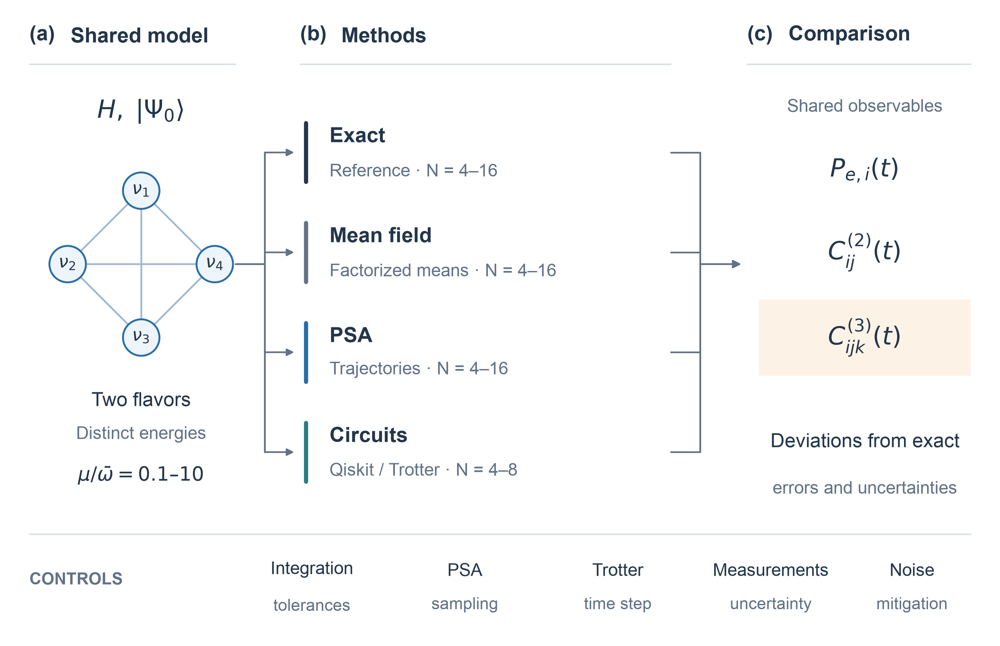

# Beyond mean field: does the phase-space approximation capture three-body neutrino correlations?

_Além do campo médio: a aproximação de espaço de fase captura as correlações de três corpos entre neutrinos?_

## Resumo

O sabor dos neutrinos em supernovas pode influenciar a explosão e a produção de elementos pesados. Simular sua evolução quântica exige aproximações para sistemas grandes. A precisão da aproximação de espaço de fase para correlações de três corpos requer avaliação. Este trabalho busca avaliar essa precisão em um modelo de dois sabores, com cálculos exatos e campo médio como referências. Circuitos trotterizados serão avaliados em condições ideais e com ruído. Serão quantificados erros nas probabilidades de sabor e nos cumulantes conectados de dois e três corpos. Espera-se delimitar o domínio de validade da aproximação e a precisão necessária para que circuitos quânticos distingam suas previsões dos resultados exatos.

**Palavras-chave:** Neutrinos. Oscilações coletivas. Correlações de três corpos. Computação quântica. Aproximação de espaço de fase.

## Abstract

The flavor of neutrinos in supernovae can influence the explosion and heavy-element production. Simulating their quantum evolution requires approximations for large systems. The accuracy of the phase-space approximation for three-body correlations requires assessment. This work aims to assess this accuracy in a two-flavor model, using exact calculations and mean field as references. Trotterized circuits will be assessed under ideal and noisy conditions. Errors in flavor probabilities and connected two- and three-body cumulants will be quantified. The expected contribution is to establish the approximation's range of validity and the precision required for quantum circuits to distinguish its predictions from exact results.

**Keywords:** Neutrinos. Collective oscillations. Three-body correlations. Quantum computing. Phase-space approximation.

## Introduction

### Astrophysical context and motivation

Stars with initial masses above approximately eight solar masses can undergo gravitational core collapse. In a typical scenario, an iron-rich core loses support, contracts, and undergoes a bounce, generating a shock. This shock can stall through energy losses from nuclear dissociation and neutrino emission. Neutrino absorption and fluid motion can revive it during accretion, meaning matter falling onto the remnant (Figure 1) (JANKA, 2012; ABI et al., 2020).

*Figure 1 - Stellar core collapse, not to scale. (a) Core contraction and bounce. (b) Stalled shock and neutrino heating around the proto-neutron star (PNS). (c) Explosion or black-hole formation, including after an explosion. Source: original illustration based on Janka (2012).*

Neutrinos are electrically neutral elementary particles that interact weakly with matter. A typical supernova emits about $10^{58}$ neutrinos, with characteristic energies of $10\,\mathrm{MeV}$, over approximately ten seconds, carrying more than 99% of the gravitational energy released by the collapsed core (ABI et al., 2020). Their flavor states are superpositions of mass states, whose propagation phases change detection probabilities, producing oscillations (DUAN; FULLER; QIAN, 2010).

Flavor evolution can alter heating behind the shock and the neutron-to-proton composition relevant to nucleosynthesis. Its effects depend on stellar configuration, as shown by Nagakura (2023) and Akaho et al. (2026); the relationship between neutron-rich matter and heavy-element formation is discussed by Cowan et al. (2021). Events from SN 1987A and detection prospects at DUNE, Hyper-Kamiokande, and JUNO reinforce the importance of predicting emitted flavors (VISSANI et al., 2010; BAUM; CAPOZZI; HORIUCHI, 2022; SARMAH et al., 2026). Near the core, coherent interactions between neutrinos couple their evolution, generating collective oscillations and the many-body problem discussed next (DUAN; FULLER; QIAN, 2010).

### State of the art and research gap

The collective dynamics described above constitutes a quantum many-body problem in which correlations and entanglement can develop between neutrinos, with entanglement associated with the nonseparability of the joint quantum state. In the general two-flavor representation, a pure state of $N$ neutrinos has $2^N$ complex amplitudes. This growth limits exact evolution of large systems on classical computers when no specific symmetries or compression schemes are exploited (DUAN; FULLER; QIAN, 2010; CERVIA et al., 2019).

One strategy to reduce this cost is the mean-field approximation, which replaces the effects of other particles with an effective field determined by their averages. By factorizing expectation values of operators acting on distinct particles, this description neglects connected correlations and, for initially factorized states, does not track the generation of entanglement between neutrinos. [Cervia et al. (2019)](https://doi.org/10.1103/PhysRevD.100.083001) related differences between exact and mean-field evolution to the development of entanglement, with a dependence on initial conditions. In a three-flavor model, [Mangin-Brinet, Bauge, and Lacroix (2026)](https://doi.org/10.1103/yr2g-1g2g) also observed short-time deviations in the configurations examined. The validity of the approximation must therefore be assessed in terms of the model, initial conditions, and dynamical regime.

The phase-space approximation (PSA) seeks to incorporate effects beyond mean field through an ensemble of independent trajectories. Initial conditions are sampled to reproduce selected quantum moments, and each trajectory evolves according to mean-field equations; observables are estimated by statistical averages over the ensemble. [Lacroix et al. (2022)](https://doi.org/10.1103/PhysRevD.106.123006) obtained good agreement with mean values and entropies of one- and two-neutrino reduced states, calculated from their respective density matrices, in a two-beam model, although they did not reproduce long-time oscillations of fluctuations. The extension to multiple beams also compared collective two-body correlations through the covariance-based observable $C_{ZZ}$. This collective validation is not equivalent to assessing every pair individually and does not establish the accuracy of third-order cumulants ([LACROIX et al., 2024](https://doi.org/10.1103/PhysRevD.110.103027)). The extension to three flavors was subsequently compared with exact solutions for up to eight neutrinos ([MANGIN-BRINET; BAUGE; LACROIX, 2026](https://doi.org/10.1103/yr2g-1g2g)).

Another approach beyond mean field truncates the Bogoliubov–Born–Green–Kirkwood–Yvon (BBGKY) hierarchy, which relates the evolution of one-particle observables to higher-order correlations. In the preprint by [Riccio and Balantekin (2026)](https://arxiv.org/abs/2607.28619), the second-order closure retains pair contributions and sets connected three-body cumulants to zero to close the equations. This condition does not necessarily set the expectation value of a product of three operators to zero, because contributions constructed from individual means and pairs remain. PSA incorporates higher moments without imposing the same closure; its accuracy for third-order cumulants must be examined directly ([LACROIX et al., 2022](https://doi.org/10.1103/PhysRevD.106.123006)).

Quantum simulations offer a complementary route to investigate these correlations. [Hall et al. (2021)](https://doi.org/10.1103/PhysRevD.104.063009) demonstrated simulations of small neutrino systems on noisy devices, using error mitigation, namely techniques to reduce the effects of noise on observable estimates, to extract entanglement measures. [Illa and Savage (2023)](https://doi.org/10.1103/PhysRevLett.130.221003) investigated systems of up to twelve neutrinos on the Quantinuum H1-1 trapped-ion processor, including two- and three-body correlations and multipartite entanglement indicators. At a larger scale, [Kiss et al. (2026)](https://doi.org/10.1038/s42005-026-02697-2) studied thermalization with random circuits on IBM processors using more than one hundred qubits. Their performance was assessed through thermalization observables; the fidelity of specific cumulants during evolution requires separate validation.

Within the literature examined, no systematic comparison of PSA three-body cumulants with exact evolution was identified that controls system size, interaction strength, and computational and measurement uncertainties. Agreement in flavor averages, collective pair correlations, or reduced entropies does not guarantee accurate third-order cumulants. Addressing this gap requires consistent observables and a separation of approximation error, finite sampling, time discretization, and noise.

The accuracy of third-order cumulants matters because, for a Hamiltonian with pair interactions, the evolution hierarchy couples one-particle observables to two-body correlations, whose equations depend on third-order moments. Deviations in the description of triples may therefore affect lower-order observables during evolution ([LACROIX et al., 2024](https://doi.org/10.1103/PhysRevD.110.103027); [RICCIO; BALANTEKIN, 2026](https://arxiv.org/abs/2607.28619)). The reported long-time limitations of PSA motivate examining this relationship, without attributing all flavor deviations to a single cumulant component in advance ([LACROIX et al., 2022](https://doi.org/10.1103/PhysRevD.106.123006)).

For four to eight neutrinos, exact calculations are accessible on classical computers. The quantum stage seeks to determine how accurately circuits distinguish PSA deviations. In larger systems, without accessible exact solutions, these circuits could provide a reference for validating approximations. Small systems allow this possibility to be assessed by separating discretization, sampling, and noise errors, without presupposing a computational advantage or extrapolating the results to larger systems.

This work therefore asks in which regimes of interaction strength, system size, and evolution time PSA reproduces connected two- and three-body correlations and, when deviations occur, under which noise conditions and measurement counts quantum circuits can distinguish them from exact results.

To this end, the study proposes to assess connected two- and three-body cumulants from PSA against exact calculations, with mean field as an additional reference, establishing the approximation's validity regimes. Python will be used for systems of four to approximately sixteen neutrinos and Qiskit for circuits of four to eight, in a two-flavor model with factorized pure-flavor initial states. The ratio $\mu/\bar{\omega}$ will range from 0.1 to 10, where $\mu$ denotes the neutrino–neutrino interaction scale and $\bar{\omega}$ the mean vacuum oscillation frequency. The supernova context motivates the model; conclusions will remain restricted to the simplified configurations examined.

Increasing interaction strength increases the coefficients of the terms coupling the hierarchy's orders, motivating the expectation that triples are more sensitive to effects beyond mean-field trajectories. This is a conjecture dependent on the initial state and time window, not a consequence of PSA setting higher cumulants to zero. Hypothesis **H1** is that PSA reproduces individual flavor probabilities and two-body cumulants more accurately than three-body cumulants. When the reference permits normalization, the normalized error for triples tends to grow with interaction strength. Hypothesis **H2** predicts that mitigation increases the noise threshold at which PSA can be distinguished from exact evolution at the same total measurement budget. Their falsification criteria will be specified in the research design.

Section 2 presents the model, observables, comparison stages, and hypothesis assessment criteria. Section 3 describes the planned presentation of results. The present text sets out the research design; experimental results will be incorporated after the protocol has been executed and validated.

## Research design

### Model and initial states

A two-flavor model with distinct energies and interactions between all neutrino pairs will be implemented in Python, using the same Hamiltonian and physical initial states for exact, mean-field, and PSA evolution. The electron and effective nonelectron flavors will be represented by the states $|0\rangle=|\nu_e\rangle$ and $|1\rangle=|\nu_x\rangle$ of a qubit, the basic unit of quantum information. Initial states will be products of pure flavor states. The main comparison will use even-sized systems with half the neutrinos in each flavor; frequencies, couplings, and flavor assignments will be recorded for each scenario. Other configurations will be treated separately, given the dependence of deviations on the initial state (CERVIA et al., 2019).

A published configuration will be reproduced before parameter scans, checking flavor, frequency, and coupling conventions, including Hamiltonian normalization. Comparisons will use common windows of dimensionless time $\bar{\omega}t$, also reporting $\mu t$, which varies when interaction strength changes. The range from four to sixteen neutrinos defines the main study; an extension to twenty or twenty-two will depend on timing and memory measurements for exact calculations. Dependence on $N$ will be investigated without presupposing a scaling law that has not yet been justified.

### Observables and connected correlations

To make the meaning of correlations explicit, consider the flavor operator $Z_i = |\nu_e\rangle_i\langle\nu_e| - |\nu_x\rangle_i\langle\nu_x|$, equivalent to the Pauli matrix $\sigma_z$ on qubit $i$, where $\nu_x$ is the effective nonelectron flavor. Its mean is $m_i(t)=\langle Z_i\rangle_t$, and the electron-flavor probability is $P_{e,i}(t)=[1+m_i(t)]/2$. For distinct particles, these operators commute, and second- and third-order cumulants are defined as

$$
C^{(2)}_{ij}(t)=\langle Z_i Z_j\rangle_t-m_i(t)m_j(t)
$$

and

$$
\begin{aligned}
C^{(3)}_{ijk}(t)={}&\langle Z_i Z_j Z_k\rangle_t-m_i(t)m_j(t)m_k(t)\\
&-C^{(2)}_{ij}(t)m_k(t)-C^{(2)}_{ik}(t)m_j(t)-C^{(2)}_{jk}(t)m_i(t).
\end{aligned}
$$

Figure 2 represents this decomposition: a three-particle moment combines products of means, pair contributions, and a connected three-body term. Neglecting $C^{(3)}_{ijk}$ in a closure is therefore not equivalent to neglecting $\langle Z_i Z_j Z_k\rangle$. This identity is a particular case of the cumulant expansion discussed by Riccio and Balantekin (2026). The main analysis will use the $Z$, $ZZ$, and $ZZZ$ components, with particle sets specified in the protocol; other components will require separate assessment.

*Figure 2 - Decomposition of the moment $\langle Z_iZ_jZ_k\rangle$. (a) Product of individual means $m_i m_j m_k$. (b) Three contributions consisting of a pair cumulant times the mean of the remaining particle. (c) Connected cumulant $C^{(3)}_{ijk}$, highlighted as the part remaining after subtracting the preceding terms. Circles identify distinct particles $i$, $j$, and $k$; one link denotes a pair contribution, and the three-linked diamond denotes the triple cumulant without representing another particle. This statistical notation represents neither additional Hamiltonian interactions nor an entanglement certificate. All terms are evaluated at the same time. Source: original illustration based on the cumulant expansion of Riccio and Balantekin (2026).*

### Method comparison and error control

Figure 3 organizes the proposed protocol. For each system size, interaction strength, and initial state, the same Hamiltonian and observable definitions will be used for exact, mean-field, PSA, and circuit evolution. Initial conditions sampled by PSA must reproduce the moments prescribed by the method for the chosen physical state. Systems of four to eight neutrinos will be shared by all four methods; classical comparisons will extend to approximately sixteen neutrinos. This organization combines the systematic exact-reference comparisons of Lacroix et al. (2024) with the distinction between exact evolution, Trotterization, and measurements used by Hall et al. (2021) and Illa and Savage (2023).

*Figure 3 - Proposed comparison protocol. (a) A Hamiltonian $H$ and initial state $|\Psi_0\rangle$ shared by the methods, in the two-flavor model with distinct energies and $\mu/\bar{\omega}$ between 0.1 and 10. The four-node network illustrates interactions between all pairs; it represents neither processor connectivity nor a limit on system size. (b) Exact, mean-field, and PSA evolution for four to approximately sixteen neutrinos; circuits for the subset of four to eight, under ideal and noisy conditions. (c) Comparison of probabilities and cumulants against exact evolution, highlighting $C^{(3)}_{ijk}$. The bottom row groups integration, sampling, Trotter, measurement, and noise controls. Comparisons with and without mitigation will use the same total measurement budget; hardware execution will depend on availability. Source: original illustration informed by the comparisons of Lacroix et al. (2024), Hall et al. (2021), and Illa and Savage (2023).*

Before interpreting physical differences, convergence will be checked by refining time integration, increasing the number of PSA trajectories, and reducing the Trotter step in ideal simulation. Noisy assessments will follow this validation. Cumulant uncertainties must account for the fact that means and products may be estimated from the same measurements or trajectories, preserving their covariances during error propagation or resampling.

### Errors, uncertainties, and assessment of H1

The same observables, flavor basis, and normalization will be used in every method. Absolute error will be reported over time and summarized by the root mean square of deviations (RMSE). Normalized error will be the ratio between this measure and the root mean square of the exact reference, calculated over the same time grid and observable set. For each order $r$, this ratio will be denoted by $E_r=\mathrm{RMSE}_r/R_r$. The same definition will be applied to flavor probabilities.

Normalization will be used only when $R_r>\varepsilon_r$, with $\varepsilon_r=\max(10\delta_r,10^{-6})$. Here, $\delta_r$ is the largest absolute change in the reference observed under numerical refinement. The dimensionless floor $10^{-6}$ is an operational choice to avoid near-zero denominators; sensitivity of classification to a factor-of-ten change in this floor will be reported. Cases below the threshold will retain absolute errors and will not enter normalized comparisons. This rule will not be changed after confirmatory results have been observed.

To assess H1, differences between errors for triples, pairs, and probabilities will be compared within the same scenarios and windows. The trend with interaction strength will be estimated at fixed $N$, initial state, frequencies, and relative couplings; its direction will be assessed using a trend measure recorded in advance. The hypothesis will be contradicted if errors for triples are smaller than or equivalent to those of the other quantities within the specified margin, or if the increasing trend with interaction strength is absent within that margin or reversed. Uncertainties preventing the comparison from being resolved will be reported as inconclusive, rather than as evidence of equivalence.

PSA trajectory counts will be refined by doubling from 1,024, using at least five independent seeds. The convergence criterion will require changes in estimates and interval widths to remain below the established observable tolerances. The trajectory limit will be fixed in advance; cases not meeting the required precision will be identified. Resampling will use complete trajectories or bitstring counts, preserving dependencies between the means and products composing each cumulant.

### Circuits, mitigation, and assessment of H2

Circuits for four to eight neutrinos will be constructed in Qiskit using a symmetric second-order Trotter formula. Trotterization approximates the full evolution through a sequence of operations associated with Hamiltonian terms over small time steps. The proposed initial step will be $\Delta\tau=0.05$, with $\tau=\bar{\omega}t$, followed by successive halvings. Ideal comparison with the exact reference must reduce this error to a predefined fraction of the PSA–exact discrepancy to be measured. This control will precede noise assessment.

Measurements in the flavor basis will simultaneously provide the products $Z_i$, $Z_iZ_j$, and $Z_iZ_jZ_k$. Each cumulant will be reconstructed from the same counts, with intervals obtained by joint resampling. The initial budget scan will include 1,024, 2,048, 4,096, and 8,192 measurements, with possible expansion during the pilot study. The total budget will include measurements used in calibration and auxiliary circuits; mitigated and unmitigated results will be compared under the same limit.

The main assessment of H2 will consider independent symmetric readout error, parametrized by the bit-flip probability $0\leq p<1/2$, and mitigation through a readout calibration matrix. Intervals will include calibration uncertainty. The effects of depolarizing gate noise and zero-noise extrapolation may be examined as extensions, with resources and results reported separately. Thresholds obtained under the readout model will not be presented as general hardware-noise limits.

A difference will be considered resolved when the confidence interval for the circuit–exact deviation lies within a predefined equivalence margin and the interval for the circuit–PSA difference excludes zero. PSA uncertainties and reference tolerances will be considered. For a total budget $M$, the threshold $p_{\max}(M)$ will be the largest assessed noise level satisfying this criterion with a specified minimum success frequency across independent repetitions. The smallest assessed budget allowing distinction at each noise level will also be reported. If the transition is not reached, bounds will be reported without assigning a precise threshold; nonmonotonic behavior will be shown as resolution regions.

H2 will be contradicted if the mitigated threshold is smaller than or equivalent to the unmitigated threshold within the specified comparison margin and uncertainties. An unresolved difference will be considered inconclusive. Execution on IBM hardware will depend on availability and will be reported with device conditions, without replacing the controlled noise-model scan.

### Preregistration and assessment limits

Noise levels, measurement budgets, and the statistical criterion will be fixed before comparing methods. The Hamiltonian, initial configurations, interaction and size grid, time windows, particle sets, tolerances, equivalence margins, confidence level, and treatment of multiple comparisons will be fixed. Trajectory limits, seeds, Trotter steps, and the allocation of the budget between calibration and execution will also be recorded. Initial values proposed in this section may be adjusted during the pilot, with justification recorded before confirmatory cases are analyzed.

A rule fixed before noisy runs will select triples and times with a PSA–exact discrepancy resolved in the classical comparison. This will distinguish approximation error, insufficient sampling, and a circuit's inability to resolve a known difference.

## Planned presentation of results

Results will be presented in separate panels for probabilities, pair cumulants, and triple cumulants. Line and symbol meanings will remain consistent: exact evolution as a solid black line, mean field as a dotted gray line, PSA as a dashed blue line, and circuit estimates as symbols with uncertainty bars. Circles and squares will distinguish unmitigated and mitigated estimates without relying on color alone. Captions will specify the initial state, $N$, $\mu/\bar{\omega}$, dimensionless time $\bar{\omega}t$, sampling resources, and the statistical meaning of the bars. Deviation and normalized-error panels will complement the curves according to the established criteria; error tables or maps will summarize dependence on system size and interaction strength when sufficient data are available. Gate diagrams will show the implemented circuit and its Trotter order.

Noise thresholds and the smallest assessed budgets will be reported by initial state and time window, with uncertainties and scan limits, including inconclusive cases.

## Use of generative artificial intelligence

Generative artificial intelligence assistance was used to support writing and consistency revision, translation, and the production of code for the conceptual diagrams.

## References

ABI, B. et al. **Deep Underground Neutrino Experiment (DUNE), Far Detector Technical Design Report, Volume II: DUNE Physics**. Technical report, 2020. arXiv:2002.03005. Available at: https://arxiv.org/abs/2002.03005. Accessed: 23 Oct. 2026.

AKAHO, R. et al. Bifurcated impact of neutrino fast flavor conversion on core-collapse supernovae informed by multiangle neutrino radiation hydrodynamics. **Physical Review Letters**, v. 136, art. 191002, 2026. DOI: [10.1103/fksy-1jtw](https://doi.org/10.1103/fksy-1jtw).

BAUM, S.; CAPOZZI, F.; HORIUCHI, S. Rocks, water, and noble liquids: unfolding the flavor contents of supernova neutrinos. **Physical Review D**, v. 106, art. 123008, 2022. DOI: [10.1103/PhysRevD.106.123008](https://doi.org/10.1103/PhysRevD.106.123008).

CERVIA, M. J.; PATWARDHAN, A. V.; BALANTEKIN, A. B.; COPPERSMITH, S. N.; JOHNSON, C. W. Entanglement and collective flavor oscillations in a dense neutrino gas. **Physical Review D**, v. 100, art. 083001, 2019. DOI: [10.1103/PhysRevD.100.083001](https://doi.org/10.1103/PhysRevD.100.083001).

COWAN, J. J. et al. Origin of the heaviest elements: the rapid neutron-capture process. **Reviews of Modern Physics**, v. 93, art. 015002, 2021. DOI: [10.1103/RevModPhys.93.015002](https://doi.org/10.1103/RevModPhys.93.015002).

DUAN, H.; FULLER, G. M.; QIAN, Y.-Z. Collective neutrino oscillations. **Annual Review of Nuclear and Particle Science**, v. 60, p. 569-594, 2010. DOI: [10.1146/annurev.nucl.012809.104524](https://doi.org/10.1146/annurev.nucl.012809.104524).

HALL, B.; ROGGERO, A.; BARONI, A.; CARLSON, J. Simulation of collective neutrino oscillations on a quantum computer. **Physical Review D**, v. 104, art. 063009, 2021. DOI: [10.1103/PhysRevD.104.063009](https://doi.org/10.1103/PhysRevD.104.063009).

ILLA, M.; SAVAGE, M. J. Multi-neutrino entanglement and correlations in dense neutrino systems. **Physical Review Letters**, v. 130, art. 221003, 2023. DOI: [10.1103/PhysRevLett.130.221003](https://doi.org/10.1103/PhysRevLett.130.221003).

JANKA, H.-T. Explosion mechanisms of core-collapse supernovae. **Annual Review of Nuclear and Particle Science**, v. 62, p. 407-451, 2012. DOI: [10.1146/annurev-nucl-102711-094901](https://doi.org/10.1146/annurev-nucl-102711-094901).

KISS, O.; TAVERNELLI, I.; TACCHINO, F.; LACROIX, D.; ROGGERO, A. Neutrino thermalization via randomization on a quantum processor. **Communications Physics**, v. 9, art. 282, 2026. DOI: [10.1038/s42005-026-02697-2](https://doi.org/10.1038/s42005-026-02697-2).

LACROIX, D.; BALANTEKIN, A. B.; CERVIA, M. J.; PATWARDHAN, A. V.; SIWACH, P. Role of non-gaussian quantum fluctuations in neutrino entanglement. **Physical Review D**, v. 106, art. 123006, 2022. DOI: [10.1103/PhysRevD.106.123006](https://doi.org/10.1103/PhysRevD.106.123006).

LACROIX, D.; BAUGE, A.; YILMAZ, B.; MANGIN-BRINET, M.; ROGGERO, A.; BALANTEKIN, A. B. Phase-space methods for neutrino oscillations: extension to multibeams. **Physical Review D**, v. 110, art. 103027, 2024. DOI: [10.1103/PhysRevD.110.103027](https://doi.org/10.1103/PhysRevD.110.103027).

MANGIN-BRINET, M.; BAUGE, A.; LACROIX, D. Three-flavor neutrino oscillations using the phase space approach. **Physical Review D**, v. 113, art. 036026, 2026. DOI: [10.1103/yr2g-1g2g](https://doi.org/10.1103/yr2g-1g2g).

NAGAKURA, H. Roles of fast neutrino-flavor conversion on the neutrino-heating mechanism of core-collapse supernova. **Physical Review Letters**, v. 130, art. 211401, 2023. DOI: [10.1103/PhysRevLett.130.211401](https://doi.org/10.1103/PhysRevLett.130.211401).

RICCIO, M.; BALANTEKIN, A. B. Improved approximations for collective neutrino oscillations. **arXiv**, 2026. Preprint, arXiv:2607.28619, version 2. DOI: [10.48550/arXiv.2607.28619](https://doi.org/10.48550/arXiv.2607.28619). Available at: [arXiv](https://arxiv.org/abs/2607.28619). Accessed: 6 Nov. 2026.

SARMAH, P. et al. **Neutrino mass ordering from the next Galactic supernova at DUNE, HK, and JUNO**. Preprint, 2026. arXiv:2606.06580. Available at: https://arxiv.org/abs/2606.06580. Accessed: 6 Nov. 2026.

VISSANI, F.; COSTANTINI, M. L.; FULGIONE, W.; IANNI, A.; PAGLIAROLI, G. **What is the issue with SN1987A neutrinos?** Preprint, 2010. arXiv:1008.4726. Available at: https://arxiv.org/abs/1008.4726. Accessed: 23 Oct. 2026.
