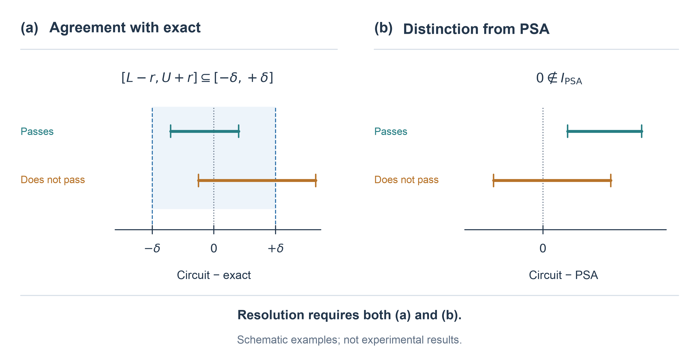

# Beyond mean field: can low-cost approximations capture neutrino correlations in supernovae?

## Abstract

This study proposes evaluating the phase-space approximation for connected two- and three-body cumulants in a two-flavor neutrino model. Exact, mean-field, and phase-space evolution will be compared, controlling numerical and sampling errors. Quantum circuits will be assessed for their ability to resolve the approximation’s deviations, with and without mitigation at equal measurement budgets. The paper presents the experimental design, parameters, evaluation metrics, and reproducibility materials. Conclusions about validity regimes and noise thresholds depend on the consolidation of results.

## Introduction

### Astrophysical context and motivation

Stars with initial masses above approximately eight solar masses can undergo gravitational core collapse. In a typical scenario, an iron-rich core surrounded by nuclear-burning shells loses support, contracts to near-nuclear densities, and undergoes a bounce, generating a shock (JANKA, 2012; ABI et al., 2020).

The shock can stall through energy losses from nuclear dissociation and neutrino emission. Neutrino absorption and fluid motion can revive it during accretion, meaning matter falling onto the remnant. Stellar structure and accretion influence explosion or black-hole formation if the remnant exceeds the mass it can support (JANKA, 2012; Figure 1).

*Figure 1 - Stellar core collapse, not to scale. (a) Core contraction and bounce. (b) Stalled shock and neutrino heating around the proto-neutron star (PNS). (c) Explosion or black-hole formation, including after an explosion. Source: original illustration based on Janka (2012).*

Neutrinos are electrically neutral elementary particles that interact weakly with matter and can become temporarily trapped in the dense core. A typical supernova emits about $10^{58}$ neutrinos, with characteristic energies of $10\,\mathrm{MeV}$, over approximately ten seconds, carrying more than 99% of the gravitational energy released by the collapsed core (ABI et al., 2020).

During supernova SN 1987A, in the Large Magellanic Cloud, Kamiokande-II, IMB, and Baksan recorded a few dozen events associated with the neutrino burst, allowing the interior of the collapsing star to be probed (VISSANI et al., 2010).

The electron, muon, and tau flavors correspond to their respective charged leptons in weak interactions. Flavor states are superpositions of mass states, whose propagation phases change detection probabilities, producing oscillations. The discovery, recognized by the 2015 Nobel Prize in Physics, established nonzero masses. Here, the electron and effective nonelectron flavors are represented by the states of a qubit, the basic unit of quantum information (DUAN; FULLER; QIAN, 2010; NOBEL PRIZE, 2015).

Absorption of electron neutrinos on neutrons or electron antineutrinos on protons heats matter behind the shock and interconverts neutrons and protons. Nagakura (2023) found an approximately 40% reduction in this heating with flavor conversion in the spherically symmetric configuration studied. In multidimensional models, Akaho et al. (2026) observed effects that favored or hindered explosion, depending on the progenitor and accretion.

The neutron-to-proton composition also affects nucleosynthesis, or the formation of atomic nuclei. The r-process, rapid neutron capture, produces some elements heavier than iron in neutron-rich matter, as in neutron-star mergers and rare explosions (COWAN et al., 2021).

DUNE is particularly sensitive to electron neutrinos; Hyper-Kamiokande and JUNO have important electron-antineutrino channels, providing complementary information about supernovae (BAUM; CAPOZZI; HORIUCHI, 2022; SARMAH et al., 2026). Interpreting these signals requires predicting their flavors. Near the core, coherent interactions between neutrinos couple flavor evolution, generating collective oscillations and the many-body problem discussed next (DUAN; FULLER; QIAN, 2010).

### State of the art and research gap

The collective dynamics described above constitutes a quantum many-body problem in which correlations and entanglement can develop between neutrinos, with entanglement associated with the nonseparability of the joint quantum state. In the general two-flavor representation, a pure state of $N$ neutrinos has $2^N$ complex amplitudes. This growth limits exact evolution of large systems on classical computers when no specific symmetries or compression schemes are exploited ([DUAN; FULLER; QIAN, 2010](https://doi.org/10.1146/annurev.nucl.012809.104524); [CERVIA et al., 2019](https://doi.org/10.1103/PhysRevD.100.083001)).

One strategy to reduce this cost is the mean-field approximation, which replaces the effects of other particles with an effective field determined by their averages. By factorizing expectation values of operators acting on distinct particles, this description neglects connected correlations and, for initially factorized states, does not track the generation of entanglement between neutrinos. [Cervia et al. (2019)](https://doi.org/10.1103/PhysRevD.100.083001) related differences between exact and mean-field evolution to the development of entanglement, with a dependence on initial conditions. In a three-flavor model, [Mangin-Brinet, Bauge, and Lacroix (2026)](https://doi.org/10.1103/yr2g-1g2g) also observed short-time deviations in the configurations examined. The validity of the approximation must therefore be assessed in terms of the model, initial conditions, and dynamical regime.

The phase-space approximation (PSA) seeks to incorporate effects beyond mean field through an ensemble of independent trajectories. Initial conditions are sampled to reproduce selected quantum moments, and each trajectory evolves according to mean-field equations; observables are estimated by statistical averages over the ensemble. [Lacroix et al. (2022)](https://doi.org/10.1103/PhysRevD.106.123006) obtained good agreement with mean values and entropies of one- and two-neutrino reduced states, calculated from their respective density matrices, in a two-beam model, although they did not reproduce long-time oscillations of fluctuations. The extension to multiple beams also compared collective two-body correlations through the covariance-based observable $C_{ZZ}$. This collective validation is not equivalent to assessing every pair individually and does not establish the accuracy of third-order cumulants ([LACROIX et al., 2024](https://doi.org/10.1103/PhysRevD.110.103027)). The extension to three flavors was subsequently compared with exact solutions for up to eight neutrinos ([MANGIN-BRINET; BAUGE; LACROIX, 2026](https://doi.org/10.1103/yr2g-1g2g)).

Another approach beyond mean field truncates the Bogoliubov–Born–Green–Kirkwood–Yvon (BBGKY) hierarchy, which relates the evolution of one-particle observables to higher-order correlations. In the preprint by [Riccio and Balantekin (2026)](https://arxiv.org/abs/2607.28619), the second-order closure retains pair contributions and sets connected three-body cumulants to zero to close the equations. This condition does not necessarily set the expectation value of a product of three operators to zero, because contributions constructed from individual means and pairs remain. PSA incorporates higher moments without imposing the same closure; its accuracy for third-order cumulants must be examined directly ([LACROIX et al., 2022](https://doi.org/10.1103/PhysRevD.106.123006)).

Quantum simulations offer a complementary route to investigate these correlations. [Hall et al. (2021)](https://doi.org/10.1103/PhysRevD.104.063009) demonstrated simulations of small neutrino systems on noisy devices, using error mitigation, namely techniques to reduce the effects of noise on observable estimates, to extract entanglement measures. [Illa and Savage (2023)](https://doi.org/10.1103/PhysRevLett.130.221003) investigated systems of up to twelve neutrinos on the Quantinuum H1-1 trapped-ion processor, including two- and three-body correlations and multipartite entanglement indicators. At a larger scale, [Kiss et al. (2026)](https://doi.org/10.1038/s42005-026-02697-2) studied thermalization with random circuits on IBM processors using more than one hundred qubits. Their performance was assessed through thermalization observables; the fidelity of specific cumulants during evolution requires separate validation.

The relevance of third-order cumulants also follows from the evolution hierarchy. For a Hamiltonian with pair interactions, the dynamics of one-particle observables depends on two-body correlations, whose equations couple to third-order moments ([LACROIX et al., 2024](https://doi.org/10.1103/PhysRevD.110.103027); [RICCIO; BALANTEKIN, 2026](https://arxiv.org/abs/2607.28619)). Deviations in the description of these contributions may therefore affect lower-order observables during evolution. This coupling motivates investigating triples, although the analysis of a single flavor component does not establish the origin of all deviations in probabilities.

Within the literature examined, no systematic comparison of PSA three-body cumulants with exact evolution was identified that controls system size, interaction strength, and computational and measurement uncertainties. Agreement in flavor averages, collective pair correlations, or reduced entropies does not guarantee accurate third-order cumulants. Addressing this gap requires establishing the approximation's validity regimes and separating its error from finite sampling, time discretization, and noise.

For the systems of four to eight neutrinos considered for the circuits, exact evolution is classically accessible and will provide a controlled reference. The quantum stage seeks to determine the precision and resources required to resolve discrepancies between PSA and this reference. Trotterization approximates the full evolution through a sequence of operations associated with the Hamiltonian terms over small time steps. The availability of exact calculations allows the effects of this discretization, noise, and measurement counts to be assessed separately; demonstrating a computational advantage at these sizes is not an objective. The astrophysical context motivates the model, but conclusions will remain restricted to the simplified configurations investigated.

### Research question, objective, and hypotheses

The central question is: in which regimes of interaction strength, system size, and evolution time, for the initial states considered, does PSA reproduce connected two- and three-body cumulants within predefined tolerances? Additionally, in regimes where its deviations from exact evolution are resolved, which noise conditions and measurement budgets allow quantum circuits to distinguish these predictions?

The general objective is to establish PSA's range of validity and quantify the conditions under which quantum circuits can resolve its deviations. Exact, mean-field, and PSA evolution will therefore be compared in a two-flavor model with distinct energies and interactions between all pairs. Python will be used for systems of four to approximately sixteen neutrinos and Qiskit for circuits of four to eight neutrinos, varying $\mu/\bar{\omega}$ from 0.1 to 10. Here, $\mu$ denotes the neutrino–neutrino interaction scale and $\bar{\omega}$ the mean vacuum oscillation frequency. The assessment will cover flavor probabilities, pair and triple cumulants, numerical convergence, and sampling uncertainties, followed by circuit comparisons with and without mitigation.

PSA sampling is constructed to reproduce selected initial moments, and evolution through mean-field trajectories does not guarantee the reproduction of connected third-order cumulants. These cumulants result from subtracting individual and pair contributions from the three-body moment; deviations in these contributions may produce large relative errors when the connected part is small, even if numerically resolved. The limitations in reproducing long-time fluctuation oscillations observed by Lacroix et al. (2022) also motivate examining their accuracy over different time windows. These arguments guide hypothesis **H1**: for the initial states and time windows specified in advance, PSA's normalized error for three-body cumulants is systematically larger than that for two-body cumulants when the references permit normalization. Individual flavor probabilities will remain an additional performance reference.

_Falsification criterion for H1: the comparison across scenarios, using the aggregation rule and difference margin specified in the protocol, establishes that the error for triples does not exceed that for pairs by the predicted margin. If uncertainties prevent these possibilities from being distinguished, the result will be considered inconclusive._

The dependence of error on interaction strength will be examined as a secondary analysis. Increasing $\mu$ increases the coefficients of the interaction terms coupling the hierarchy's orders, motivating an investigation of growing deviations. This argument does not, however, establish monotonic growth of normalized error, which also depends on the initial state, evolution time, and reference amplitude. The trend will be assessed within the defined regimes, without being assumed throughout the interval studied.

The quantum stage will examine hypothesis **H2**: for the scenarios selected in advance, the adopted mitigation technique increases the noise threshold at which three-body cumulants allow PSA to be distinguished from exact evolution, at a fixed total measurement budget. This hypothesis compares performance for a specified noise model and mitigation procedure, without assuming that mitigation is necessary under all conditions.

_Falsification criterion for H2: the comparison establishes that the mitigated threshold does not exceed the unmitigated threshold by the margin specified in the protocol, at the same total measurement budget. If the difference between thresholds cannot be determined with the required precision, the result will be considered inconclusive._

The experimental design and its amendments record initial states, time windows, tolerances, the noise model, and the mitigation technique. The following sections present these definitions and distinguish implemented analyses from criteria still needed for confirmatory conclusions about H1 and H2.

## Methodology

The study compares mean field, PSA, and quantum circuits against the exact evolution of finite systems. It focuses on connected three-body cumulants, complemented by flavor probabilities and pair cumulants. The [experimental protocol](PROTOCOLO_EXPERIMENTOS.md) records the configurations, controls, and amendments described below, without assuming that collection is complete.

### Physical model and conventions

Each neutrino corresponds to a qubit, with $|\nu_e\rangle=|0\rangle$ and $|\nu_x\rangle=|1\rangle$. With $\hbar=1$ and time $\tau=\bar{\omega}t$, the Hamiltonian is

$$
\frac{H}{\bar{\omega}}=\frac{1}{2}\sum_{i=0}^{N-1}\widetilde{\omega}_i\,\mathbf{B}\cdot\boldsymbol{\sigma}_i
+\frac{\lambda}{4N}\sum_{i<j}g_{ij}\,\boldsymbol{\sigma}_i\cdot\boldsymbol{\sigma}_j,
\qquad
\lambda=\frac{\mu}{\bar{\omega}},\quad
\widetilde{\omega}_i=\frac{\omega_i}{\bar{\omega}},
$$

where $\mathbf{B}=(\sin 2\theta,0,-\cos 2\theta)$, $\boldsymbol{\sigma}_i$ denotes the Pauli operators, and $g_{ij}$ defines the coupling. Each pair appears once in the sum. In configuration files, `mu` represents $\lambda$.

The model uses uniform couplings, distinct frequencies, and a flavor product state, without spatial transport, collisions, or hydrodynamics. Conclusions are restricted to these conditions. The shared window in $\tau$ corresponds to different scales $\mu t=\lambda\tau$ as interaction strength varies.

### Evolution methods

Exact evolution applies the exponential of the sparse Hamiltonian to the initial state using SciPy's `expm_multiply`. Its precision is checked for a small system through an independent construction using Kronecker products and dense exponentiation.

In mean field, polarization vectors evolve under the vacuum field and the means of other particles, integrated with fourth-order Runge–Kutta (RK4). Factorized moments provide a reference without connected correlations for the product state considered.

In PSA, initial transverse components independently take values $\pm1$, while the longitudinal component corresponds to the initial flavor. Trajectories follow mean-field equations, as in Lacroix et al. (2024). Their moments are pooled before cumulants are calculated, preserving seed blocks for uncertainty estimation.

Circuits use a symmetric second-order Trotter decomposition. Comparison between the local emulator and Qiskit checks implementation; comparison against exact evolution measures Trotter error. The analysis separates this error from finite measurements and noise simulated in Qiskit Aer.

### Observables and connected correlations

The flavor operator is $Z_i=|\nu_e\rangle_i\langle\nu_e|-|\nu_x\rangle_i\langle\nu_x|$, with mean $m_i(t)=\langle Z_i\rangle_t$ and electron-flavor probability $P_{e,i}(t)=[1+m_i(t)]/2$. For distinct particles, the cumulants are

$$
C^{(2)}_{ij}(t)=\langle Z_i Z_j\rangle_t-m_i(t)m_j(t)
$$

and

$$
\begin{aligned}
C^{(3)}_{ijk}(t)={}&\langle Z_i Z_j Z_k\rangle_t-m_i(t)m_j(t)m_k(t)\\
&-C^{(2)}_{ij}(t)m_k(t)-C^{(2)}_{ik}(t)m_j(t)-C^{(2)}_{jk}(t)m_i(t).
\end{aligned}
$$

Figure 2 distinguishes the three-particle moment from its connected part, following the cumulant expansion of Riccio and Balantekin (2026). The analysis considers $Z$, $ZZ$, and $ZZZ$ components; its conclusions do not automatically extend to other Pauli components.

*Figure 2 - Decomposition of $\langle Z_iZ_jZ_k\rangle$ into (a) a product of means, (b) pair contributions, and (c) the connected triple cumulant, at the same time. Circles represent particles; links and the diamond represent statistical contributions, without indicating new interactions or certifying entanglement. Source: original illustration based on Riccio and Balantekin (2026).*

In the data, $C^{(3)}_{ijk}$ is also identified as `c3` or $K^{zzz}_{ijk}$.

### Validation sequence

Execution starts with published-reference reproduction and noninteracting, integration, sampling, and Trotter controls. Classical collection and measurement, noise, and mitigation stages follow (Figure 3). Extension to larger systems depends on available resources.

*Figure 3 - Method comparison: (a) shared model and initial state; (b) exact, mean-field, and PSA evolution for $N=4$–16 and circuits for $N=4$–8; (c) observables and error controls. The network illustrates physical coupling, not processor connectivity. Source: original illustration based on Lacroix et al. (2024), Hall et al. (2021), and Illa and Savage (2023).*

Failed controls stop collection and require any amendment to be recorded. Results unfavorable to the hypotheses do not justify changing criteria or excluding configurations.

## Experiments and experimental parameters

### Study grid and sampling resources

Table 1 summarizes the classical grid. Frequency and initial flavor are assigned consistently for each size; this version does not scan initial states.

*Table 1 - Parameters of the original classical grid.*

| Parameter | Definition |
| --- | --- |
| Main sizes | $N=4,6,8$. |
| Classical extension | $N=12,16$, subject to available resources. |
| Interaction strength | $\lambda=0.1,\ 0.3,\ 1,\ 3,\ 10$. |
| Frequencies | $\widetilde{\omega}_i=0.7+0.6i/(N-1)$, for $i=0,\ldots,N-1$; mean equal to 1. |
| Mixing angle | $\theta=0.2$ rad. |
| Couplings | $g_{ij}=1$ for $i\ne j$; $g_{ii}=0$. |
| Initial state | First half of indices in $\nu_e$; second half in $\nu_x$. |
| Time | $0\leq\tau\leq10$, with 201 times at spacing $0.05$. |
| Observables | All individuals, $\binom{N}{2}$ distinct pairs, and $\binom{N}{3}$ distinct triples. |
| PSA | 20 blocks of 4,096 trajectories per configuration, totaling 81,920 trajectories. |
| Classical collection seeds | 10,001 through 10,020. |
| Original integration | 12 RK4 substeps per output interval. |

The main set has 15 physical configurations and 300 PSA blocks; the extension adds ten configurations and 200 blocks. Deterministic references may be reused across seeds while retaining independent PSA blocks.

### Published-reference reproduction and convergence controls

Reproduction uses Figure 2(c) of Lacroix et al. (2024): eight neutrinos, one per beam, $\theta=0.195$, unit frequencies, $g_{ij}=1-\cos[|i-j|\arccos(0.9)/7]$, and `mu=16`. The conversion $\tau=t_{\mathrm{publication}}/4$ maps the published interval of 0–200 to 0–50. This control differs from the study grid.

Coordinates were extracted from the figure vectors and are not raw author data. The comparison uses $\langle Z_i\rangle$, 10,000 trajectories, seed 50,001, and 20 RK4 substeps, with $\Delta\tau=0.0125$. Maximum tolerances are 0.02 for exact evolution and 0.06 for PSA. The [reference documentation](data/benchmarks/lacroix2024/README.md) records provenance, conversions, and uncertainties. This control alone does not validate third-order cumulants.

Study controls use $\lambda=0$ for $N=4,6,8$. Convergence uses $N=4,8$, $\lambda=0.1,1,10$, and five seeds, comparing 2, 4, 8, and 12 RK4 substeps and 512, 1,024, 2,048, and 4,096 trajectories. Acceptance considers the difference between 8 and 12 substeps and the largest standard error across seeds. Trotter refinement uses 1, 2, 4, 8, and 16 steps per interval; Qiskit checks also cover $\tau=1,2,4$.

### Measurements, noise, and mitigation

Without noise, the study uses $N=4,6,8$, the grid in Table 1, and twenty repetitions of 1,024, 4,096, or 16,384 measurements per time. Noise and mitigation analysis is restricted to $N=4$, triple $(0,1,2)$, and $\tau=1,2,4$, retaining the five interaction strengths and three budgets.

The original discretization for this stage contains eight points and 16 Trotter steps per interval, totaling 112 steps, subject to validation against exact evolution. Measurement, noise, and mitigation seeds are fixed in the protocols.

*Table 2 - Noise profiles defined for the Aer simulator.*

| Profile | Depolarization: one qubit | Depolarization: two qubits | Readout error |
| --- | ---: | ---: | ---: |
| Ideal | 0 | 0 | 0 |
| Mild | 0.0001 | 0.001 | 0.01 |
| Moderate | 0.001 | 0.01 | 0.03 |

Circuits are compiled into the `rz`, `sx`, `x`, and `cx` basis at optimization level 1 and simulated using density matrices in Aer. Depolarization acts on `sx`, `x`, and `cx`; readout undergoes symmetric, independent bit flips. The profiles in Table 2 do not reproduce a specific hardware calibration. Mitigation is assessed under mild and moderate noise.

Readout mitigation inverts the tensor product of per-qubit response matrices estimated with $|0000\rangle$ and $|1111\rangle$, retaining negative quasiprobabilities. Of budget $m$ per repetition, $3m/4$ goes to signal and $m/8$ to each calibration; the raw method uses $m$ for signal. With twenty repetitions, both receive $M=20m$ measurements. The correction does not eliminate gate errors.

The original primary point is $N=4$, $\lambda=3$, triple $(0,1,2)$, $\tau=2$, moderate noise, and $m=16,384$, totaling $M=327,680$ measurements per method. Other cases are sensitivity analyses.

### Amendments and hardware extension

Amendment v3 records the omission of the sampling control due to a routing failure and its subsequent failure in three of six cells. The supplement retains the precision limit and specifies twenty new blocks of 4,096 trajectories in each cell, using seeds 70,001–70,020. Classical data collected before detection depend on this validation and reanalysis; the original control remains recorded as failed.

Amendment v4 refines $N=4$, $\lambda=10$, $\tau=4$ to 29 points and 448 Trotter steps after a failed ideal control. At $\lambda=10$, $\tau=2$, PSA changes from 12 to 24 RK4 substeps while preserving noise counts. The primary point is unchanged. Applied amendments must be recorded with the collection; increased depth prevents attributing differences solely to physical interaction strength.

The IBM hardware extension depends on availability and compiled-circuit feasibility. Device, calibration, layout, depth, gates, measurements, and job identifiers will be recorded. Discretization changes must be disclosed and validated.

## Evaluation metrics

### Absolute and normalized errors

For $T$ times and $n_q$ particle sets, let $O^{\mathrm{ex}}_{q,\alpha}$ be the exact reference and $\widehat O_{q,\alpha}$ its estimate. The observables are $P_e$, $C^{(2)}$, and $C^{(3)}$ for individuals, pairs, and triples, respectively. RMS error and amplitude are

$$
E_q=\sqrt{\frac{1}{Tn_q}\sum_{\ell=1}^{T}\sum_{\alpha=1}^{n_q}
\left[\widehat{O}_{q,\alpha}(\tau_\ell)-O^{\mathrm{ex}}_{q,\alpha}(\tau_\ell)\right]^2},
\qquad
S_q=\sqrt{\frac{1}{Tn_q}\sum_{\ell=1}^{T}\sum_{\alpha=1}^{n_q}
\left[O^{\mathrm{ex}}_{q,\alpha}(\tau_\ell)\right]^2}.
$$

Define $R_q=E_q/S_q$ for $S_q\geq10^{-4}$; below this floor, only absolute errors are reported. Maximum deviation and per-triple metrics are also calculated. Squaring avoids cancellation between opposite signs. The main collection uses $0\leq\tau\leq10$; endpoint tests use the specified time and triple.

### Uncertainty and comparison between pairs and triples

H1 is examined through $D=R_3-R_2$ in each eligible configuration. The analysis generates 2,000 bootstrap replicates of independent seed blocks, preserving dependence between moments and times. Cumulants are recalculated from pooled moments; the 2.5th and 97.5th percentiles define the 95% interval.

An interval entirely above zero indicates a larger normalized error for triples in that configuration; including zero does not demonstrate equality. The trend of $D$ with $\log_{10}\lambda$ is exploratory, with seeds paired across interaction strengths for each $N$. A joint conclusion about H1 still requires an aggregation rule and relevance margin, formalized in an amendment declaring prior knowledge of the data.

### Circuit resolution and scope of H2

For circuits, aggregated counts are resampled through multinomial distributions, re-estimating calibration and independently resampling PSA blocks in each replicate. This preserves dependence between cumulant moments. The analysis uses 2,000 replicates and 95% percentile intervals without bias correction.

Let $I_{\mathrm{PSA}}$ be the interval for circuit minus PSA and $[L,U]$ that for circuit minus exact evolution, for $C^{(3)}$. The difference is resolved when

$$
0\notin I_{\mathrm{PSA}}
\quad\text{and}\quad
[L-r,U+r]\subseteq[-\delta,\delta],
\qquad \delta=0.01,
$$

where $r$ adds the absolute ideal–exact deviation at that point to the numerical tolerance $10^{-5}$. The margin remains fixed while the interval widens. Calibration condition numbers exceeding 10 or nonfinite values in any block or replicate make the case unresolved, without selective discarding.

Both conditions must hold for the same configuration and budget (Figure 4).

*Figure 4 - Resolution criterion: (a) circuit–exact interval, widened by the residual, contained in $[-\delta,+\delta]$; (b) circuit–PSA interval excluding zero. Both must hold. Each panel shows independent schematic examples, not experimental results. Source: original illustration.*

For H2, $p_{\max}(M)$ is the largest assessed level of a noise family satisfying this criterion under budget $M$. The comparison is

$$
\Delta p_{\max}(M)=p_{\max}^{\mathrm{mitigated}}(M)-p_{\max}^{\mathrm{raw}}(M).
$$

The current protocol compares discrete profiles and whether mitigation is needed at one point. This decision does not test $\Delta p_{\max}$: raw resolution at one point does not prevent mitigation from increasing the threshold. Its support or refutation labels will not be used as conclusions about the reformulated H2.

The confirmatory test requires an amendment fixing the noise family, scan, relevant margin, and uncertainty propagation. Until then, the comparison is descriptive. Bounds will be reported if the transition is not located, and regions in $(p,M)$ if behavior is nonmonotonic, retaining calibration within the budget.

### Numerical tolerances and resources

*Table 3 - Operational precision targets for the study.*

| Control | Criterion |
| --- | --- |
| Independent exact reference | Maximum absolute difference of $10^{-10}$. |
| Qiskit and emulator of the same circuit | Maximum probability difference of $10^{-10}$. |
| RK4 refinement of $P_e$ | Maximum absolute difference of $10^{-6}$. |
| RK4 refinement of $C^{(2)}$ and $C^{(3)}$ | Maximum absolute difference of $10^{-5}$. |
| PSA sampling | Largest standard error across seeds of $C^{(3)}$, over all times and triples, at most $0.01$. |
| Ideal Trotter | Maximum absolute error in $C^{(3)}$ at most $10^{-3}$. |
| Normalization | Exact RMS amplitude at least $10^{-4}$. |
| Circuit equivalence | Interval widened by the residual contained in $[-0.01,0.01]$. |
| Readout calibration | Response-matrix condition number at most 10. |

The targets in Table 3 are study resolution choices; the Trotter ceiling equals 10% of the equivalence margin. Cost assessment will include time, memory, storage, trajectories, measurements, and circuit resources.

## Organization of code and data

The [project repository](https://github.com/leonardovbf/correlacoes-tres-neutrinos) contains simulation and analysis code, protocols, workloads, and reproduction instructions. It includes the reference dataset extracted from Lacroix et al. (2024), with documented provenance and conversions. Complete collection data will be linked after consolidation and validation.

## Use of generative artificial intelligence

Generative artificial intelligence assistance was used to support writing and text revision, translation, organization of the methodological description from code and protocols, and production of code for the conceptual diagrams.

## References

Abi, B. et al. (2020). Deep Underground Neutrino Experiment (DUNE), Far Detector Technical Design Report, Volume II: DUNE Physics. Technical Report FERMILAB-PUB-20-025-ND, DUNE Collaboration. <https://arxiv.org/abs/2002.03005>.

Akaho, R., Nagakura, H., Iwakami, W., Furusawa, S., Harada, A., Okawa, H., Matsufuru, H., Sumiyoshi, K., and Yamada, S. (2026). Bifurcated Impact of Neutrino Fast Flavor Conversion on Core-Collapse Supernovae Informed by Multiangle Neutrino Radiation Hydrodynamics. *Physical Review Letters*, 136(19):191002. <https://doi.org/10.1103/fksy-1jtw>.

Baum, S., Capozzi, F., and Horiuchi, S. (2022). Rocks, water, and noble liquids: Unfolding the flavor contents of supernova neutrinos. *Physical Review D*, 106(12):123008. <https://doi.org/10.1103/PhysRevD.106.123008>.

Cervia, M. J., Patwardhan, A. V., Balantekin, A. B., Coppersmith, S. N., and Johnson, C. W. (2019). Entanglement and collective flavor oscillations in a dense neutrino gas. *Physical Review D*, 100(8):083001. <https://doi.org/10.1103/PhysRevD.100.083001>.

Cowan, J. J., Sneden, C., Lawler, J. E., Aprahamian, A., Wiescher, M., Langanke, K., Martínez-Pinedo, G., and Thielemann, F.-K. (2021). Origin of the heaviest elements: The rapid neutron-capture process. *Reviews of Modern Physics*, 93(1):015002. <https://doi.org/10.1103/RevModPhys.93.015002>.

Duan, H., Fuller, G. M., and Qian, Y.-Z. (2010). Collective Neutrino Oscillations. *Annual Review of Nuclear and Particle Science*, 60(1):569--594. <https://doi.org/10.1146/annurev.nucl.012809.104524>.

Hall, B., Roggero, A., Baroni, A., and Carlson, J. (2021). Simulation of collective neutrino oscillations on a quantum computer. *Physical Review D*, 104(6):063009. <https://doi.org/10.1103/PhysRevD.104.063009>.

Illa, M. and Savage, M. J. (2023). Multi-Neutrino Entanglement and Correlations in Dense Neutrino Systems. *Physical Review Letters*, 130:221003. <https://doi.org/10.1103/PhysRevLett.130.221003>.

Janka, H.-T. (2012). Explosion Mechanisms of Core-Collapse Supernovae. *Annual Review of Nuclear and Particle Science*, 62:407--451. <https://doi.org/10.1146/annurev-nucl-102711-094901>.

Kiss, O., Tavernelli, I., Tacchino, F., Lacroix, D., and Roggero, A. (2026). Neutrino thermalization via randomization on a quantum processor. *Communications Physics*, 9(1):282. <https://doi.org/10.1038/s42005-026-02697-2>.

Lacroix, D., Balantekin, A. B., Cervia, M. J., Patwardhan, A. V., and Siwach, P. (2022). Role of non-Gaussian quantum fluctuations in neutrino entanglement. *Physical Review D*, 106(12):123006. <https://doi.org/10.1103/PhysRevD.106.123006>.

Lacroix, D., Bauge, A., Yilmaz, B., Mangin-Brinet, M., Roggero, A., and Balantekin, A. B. (2024). Phase-space methods for neutrino oscillations: Extension to multibeams. *Physical Review D*, 110:103027. <https://doi.org/10.1103/PhysRevD.110.103027>.

Mangin-Brinet, M., Bauge, A., and Lacroix, D. (2026). Three-flavor neutrino oscillations using the phase space approach. *Physical Review D*, 113:036026. <https://doi.org/10.1103/yr2g-1g2g>.

Nagakura, H. (2023). Roles of Fast Neutrino-Flavor Conversion on the Neutrino-Heating Mechanism of Core-Collapse Supernova. *Physical Review Letters*, 130(21):211401. <https://doi.org/10.1103/PhysRevLett.130.211401>.

Nobel Prize (2015). The Nobel Prize in Physics 2015: Press release. <https://www.nobelprize.org/prizes/physics/2015/press-release/>.

Riccio, M. and Balantekin, A. B. (2026). Improved Approximations for Collective Neutrino Oscillations. Preprint, version 2. <https://doi.org/10.48550/arXiv.2607.28619>.

Sarmah, P., Chakraborty, S., Medhi, A., Bose, D., and Devi, M. M. (2026). Neutrino mass ordering from the next Galactic supernova at DUNE, HK, and JUNO. Preprint. <https://arxiv.org/abs/2606.06580>.

Vissani, F., Costantini, M. L., Fulgione, W., Ianni, A., and Pagliaroli, G. (2010). What is the issue with SN1987A neutrinos? Preprint. <https://arxiv.org/abs/1008.4726>.
