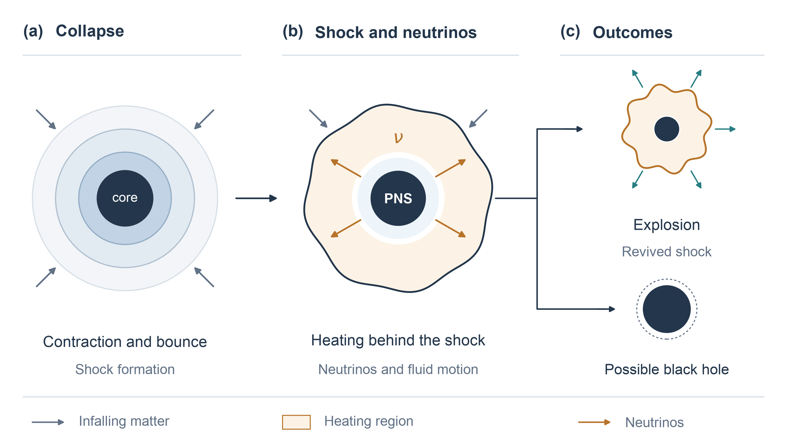
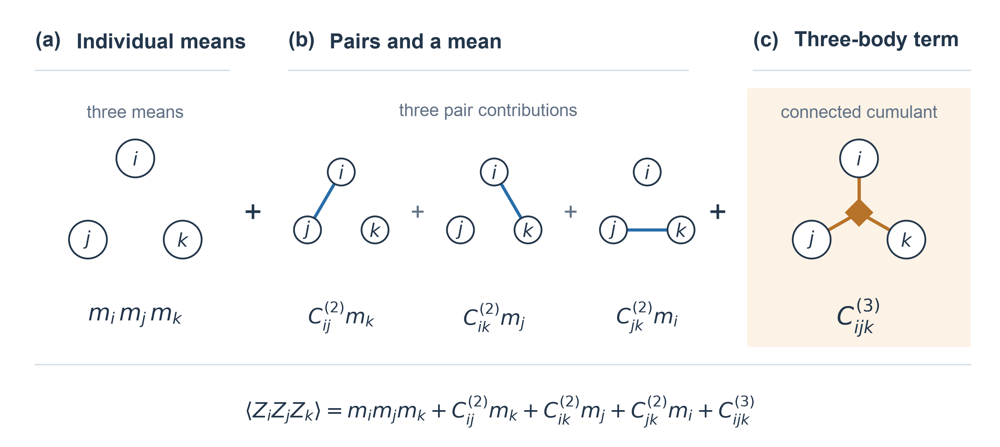
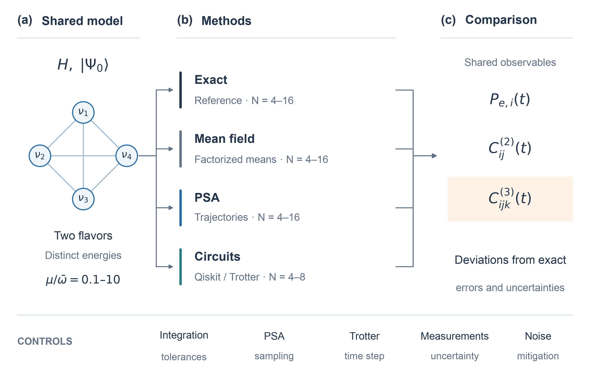

# Beyond mean field: can low-cost approximations capture neutrino correlations in supernovae?

_Além do campo médio: aproximações de baixo custo capturam as correlações entre neutrinos em supernovas?_

## Research problem

Neutrino flavor evolution influences matter heating in core-collapse supernovae, nucleosynthesis conditions, and the interpretation of signals in terrestrial detectors (JANKA, 2012; COWAN et al., 2021; BAUM; CAPOZZI; HORIUCHI, 2022). In simplified models of dense environments, neutrino interactions can generate correlations and entanglement, associated with the nonseparability of the joint quantum state, whereas the general representation of the full quantum state has an exponential cost in the number of particles (CERVIA et al., 2019). The mean-field approximation replaces interactions with an average influence and can exhibit deviations that depend on the initial conditions; the phase-space approximation (PSA) seeks to incorporate some effects beyond this description (LACROIX et al., 2022). Existing PSA validations include flavor probabilities, reduced entropies calculated from the density matrices of one- or two-neutrino subsystems, and collective two-body correlations. The remaining question therefore concerns connected third-order cumulants, namely the part of a three-particle correlation that remains after subtracting individual and pair contributions (LACROIX et al., 2022, 2024). In the Bogoliubov–Born–Green–Kirkwood–Yvon (BBGKY) hierarchy, a second-order closure considered in the literature neglects these cumulants to close the equations; the full hierarchy does not impose this condition (RICCIO; BALANTEKIN, 2026). It is therefore necessary to assess the regimes in which PSA reproduces connected two- and three-body correlations and the precision with which quantum circuits can distinguish its deviations from exact calculations.

## Research question

Does the phase-space approximation reproduce connected two- and three-body correlations in collective neutrino oscillations and, when deviations occur, can quantum circuits distinguish PSA predictions from exact results under the noise conditions assessed?

## Objectives

### General objective

Assess the accuracy of the phase-space approximation for connected two- and three-body correlations in collective neutrino oscillations, using exact calculations as benchmarks, and determine whether quantum circuits can distinguish its predictions from exact solutions under the noise conditions assessed.

### Specific objectives

1. Implement in Python a two-flavor model with distinct energies and interactions between all neutrino pairs, and calculate its exact, mean-field, and phase-space evolution using the same Hamiltonian and physical initial states.
2. Quantify absolute and normalized errors in individual flavor probabilities and connected two- and three-body cumulants, varying $\mu/\bar{\omega}$ from 0.1 to 10. Here, $\mu$ is the neutrino–neutrino coupling scale, expressed in the same units as $\bar{\omega}$, the mean vacuum oscillation frequency adopted as the reference.
3. Determine how these errors depend on system size, from four to approximately sixteen neutrinos, and assess convergence of numerical integration and PSA sampling.
4. Construct Trotterized Qiskit circuits for four to eight neutrinos, validate their ideal simulated evolution against the exact solution, and estimate the error caused by time discretization. Trotterization approximates the full evolution through a sequence of operations associated with the Hamiltonian terms over small time steps.
5. Investigate how noise and the number of measurements affect the resolution of differences between PSA and exact evolution, compare estimates with and without error mitigation, and execute the circuits on IBM hardware if access is available. Mitigation uses techniques to reduce the effects of noise on observable estimates.

## Hypotheses

### H1

PSA reproduces individual flavor probabilities and two-body cumulants more accurately than three-body cumulants. When the reference permits normalization, the normalized error for triples tends to increase with interaction strength.

_Falsification criterion: the normalized error for triples does not systematically exceed that for pairs within the assessed uncertainties, or the proposed increase with interaction strength is not observed._

### H2

For the configurations investigated, distinguishing PSA from exact evolution in three-body cumulants requires error mitigation at the noise levels and measurement budgets considered.

_Falsification criterion: unmitigated circuits distinguish PSA predictions from exact results under the established criterion, at the same noise levels and number of measurements._

Noise levels, measurement budgets, and the statistical criterion will be fixed before comparing methods. Cumulant amplitudes will be determined by the calculations.

## Resumo

As oscilações coletivas de neutrinos em supernovas de colapso de núcleo motivam o desenvolvimento de métodos computacionais capazes de descrever efeitos quânticos de muitos corpos. A evolução exata apresenta custo exponencial na representação geral, enquanto a aproximação de campo médio despreza correlações conectadas entre partículas. A aproximação de espaço de fase oferece uma alternativa de menor custo computacional, mas sua precisão para correlações de três corpos requer avaliação específica. Este projeto tem como objetivo avaliar se essa aproximação reproduz com precisão as correlações de dois e três corpos em oscilações coletivas de neutrinos, usando cálculos exatos como referência, e verificar se simulações quânticas conseguem medir as diferenças entre os métodos. Será estudado um modelo de dois sabores, com interações entre todos os pares e energias distintas para os neutrinos. Serão comparadas a evolução exata, a de campo médio e a aproximação de espaço de fase para sistemas de até dezesseis neutrinos, variando a razão entre intensidade de interação e frequência média de oscilação no vácuo de 0,1 a 10. Circuitos trotterizados implementados em Qiskit serão avaliados para quatro a oito neutrinos, em condições ideais e com ruído simulado, com execução em hardware IBM condicionada à disponibilidade. Serão quantificados erros absolutos e normalizados nas probabilidades de sabor e nos cumulantes conectados de dois e três corpos, controlando incertezas de amostragem, integração numérica e trotterização. Espera-se delimitar, no modelo estudado, o domínio de validade da aproximação e a precisão necessária para que circuitos quânticos distingam suas previsões dos resultados exatos.

**Palavras-chave:** Neutrinos. Oscilações coletivas. Correlações de três corpos. Computação quântica. Aproximação de espaço de fase.

## Abstract

Collective neutrino oscillations in core-collapse supernovae motivate the development of computational methods capable of describing quantum many-body effects. Exact evolution has an exponential cost in the general representation, whereas the mean-field approximation neglects connected correlations between particles. The phase-space approximation offers a computationally cheaper alternative, but its accuracy for three-body correlations requires specific assessment. This project aims to evaluate whether this approximation accurately reproduces two- and three-body correlations in collective neutrino oscillations, using exact calculations as benchmarks, and to determine whether quantum simulations can measure discrepancies between the methods. A two-flavor model with all-to-all interactions and distinct neutrino energies will be studied. Exact evolution, mean-field evolution, and the phase-space approximation will be compared for systems of up to sixteen neutrinos, varying the ratio of interaction strength to mean vacuum oscillation frequency from 0.1 to 10. Trotterized circuits implemented in Qiskit will be assessed for four to eight neutrinos under ideal conditions and simulated noise, with execution on IBM hardware subject to availability. Absolute and normalized errors in flavor probabilities and connected two- and three-body cumulants will be quantified, controlling for sampling uncertainty, numerical integration, and Trotterization. The expected contribution is to establish the approximation's range of validity for the model studied and the precision required for quantum circuits to distinguish its predictions from exact results.

**Keywords:** Neutrinos. Collective oscillations. Three-body correlations. Quantum computing. Phase-space approximation.

## Introduction

### Astrophysical context and motivation

Stars with initial masses above approximately eight solar masses can undergo gravitational core collapse. In a typical scenario, an iron-rich core surrounded by nuclear-burning shells loses support, contracts to near-nuclear densities, and undergoes a bounce, generating a shock (JANKA, 2012; ABI et al., 2020).

The shock can stall through energy losses from nuclear dissociation and neutrino emission. Neutrino absorption and fluid motion can revive it during accretion, meaning matter falling onto the remnant. Stellar structure and accretion influence explosion or black-hole formation if the remnant exceeds the mass it can support (JANKA, 2012; Figure 1).

*Figure 1 - Stellar core collapse, not to scale. (a) Core contraction and bounce. (b) Stalled shock and neutrino heating around the proto-neutron star (PNS). (c) Explosion or black-hole formation, including after an explosion. Source: original illustration based on Janka (2012).*

Neutrinos are electrically neutral elementary particles that interact weakly with matter and can become temporarily trapped in the dense core. A typical supernova emits about $10^{58}$ neutrinos, with characteristic energies of $10\,\mathrm{MeV}$, over approximately ten seconds, carrying more than 99% of the gravitational energy released by the collapsed core (ABI et al., 2020).

During supernova SN 1987A, in the Large Magellanic Cloud, Kamiokande-II, IMB, and Baksan recorded a few dozen events associated with the neutrino burst, allowing the interior of the collapsing star to be probed (VISSANI et al., 2010).

The electron, muon, and tau flavors correspond to their respective charged leptons in weak interactions. Flavor states are superpositions of mass states, whose propagation phases change detection probabilities, producing oscillations. The discovery, recognized by the 2015 Nobel Prize in Physics, established nonzero masses. Here, the electron and effective nonelectron flavors are represented by the states of a qubit, the basic unit of quantum information (DUAN; FULLER; QIAN, 2010; NOBEL PRIZE, 2015).

Absorption of electron neutrinos on neutrons or electron antineutrinos on protons heats matter behind the shock and interconverts neutrons and protons. Nagakura (2023) found an approximately 40% reduction in this heating with flavor conversion in the spherically symmetric configuration studied. In multidimensional models, Akaho et al. (2026) observed effects that favored or hindered explosion, depending on the progenitor and accretion.

The neutron-to-proton composition also affects nucleosynthesis, or the formation of atomic nuclei. The r-process, rapid neutron capture, produces some elements heavier than iron in neutron-rich matter, as in neutron-star mergers and rare explosions (COWAN et al., 2021).

DUNE is particularly sensitive to electron neutrinos; Hyper-Kamiokande and JUNO have important electron-antineutrino channels, providing complementary information about supernovae (BAUM; CAPOZZI; HORIUCHI, 2022; SARMAH et al., 2026). Interpreting these signals requires predicting their flavors. Near the core, coherent interactions between neutrinos couple flavor evolution, generating collective oscillations and the many-body problem discussed next (DUAN; FULLER; QIAN, 2010).

### State of the art and research gap

The collective dynamics described above constitutes a quantum many-body problem in which correlations and entanglement can develop between neutrinos, with entanglement associated with the nonseparability of the joint quantum state. In the general two-flavor representation, a pure state of $N$ neutrinos has $2^N$ complex amplitudes. This growth limits exact evolution of large systems on classical computers when no specific symmetries or compression schemes are exploited ([DUAN; FULLER; QIAN, 2010](https://doi.org/10.1146/annurev.nucl.012809.104524); [CERVIA et al., 2019](https://doi.org/10.1103/PhysRevD.100.083001)).

One strategy to reduce this cost is the mean-field approximation, which replaces the effects of other particles with an effective field determined by their averages. By factorizing expectation values of operators acting on distinct particles, this description neglects connected correlations and, for initially factorized states, does not track the generation of entanglement between neutrinos. [Cervia et al. (2019)](https://doi.org/10.1103/PhysRevD.100.083001) related differences between exact and mean-field evolution to the development of entanglement, with a dependence on initial conditions. In a three-flavor model, [Mangin-Brinet, Bauge, and Lacroix (2026)](https://doi.org/10.1103/yr2g-1g2g) also observed short-time deviations in the configurations examined. The validity of the approximation must therefore be assessed in terms of the model, initial conditions, and dynamical regime.

The phase-space approximation (PSA) seeks to incorporate effects beyond mean field through an ensemble of independent trajectories. Initial conditions are sampled to reproduce selected quantum moments, and each trajectory evolves according to mean-field equations; observables are estimated by statistical averages over the ensemble. [Lacroix et al. (2022)](https://doi.org/10.1103/PhysRevD.106.123006) obtained good agreement with mean values and entropies of one- and two-neutrino reduced states, calculated from their respective density matrices, in a two-beam model, although they did not reproduce long-time oscillations of fluctuations. The extension to multiple beams also compared collective two-body correlations through the covariance-based observable $C_{ZZ}$. This collective validation is not equivalent to assessing every pair individually and does not establish the accuracy of third-order cumulants ([LACROIX et al., 2024](https://doi.org/10.1103/PhysRevD.110.103027)). The extension to three flavors was subsequently compared with exact solutions for up to eight neutrinos ([MANGIN-BRINET; BAUGE; LACROIX, 2026](https://doi.org/10.1103/yr2g-1g2g)).

Another approach beyond mean field truncates the Bogoliubov–Born–Green–Kirkwood–Yvon (BBGKY) hierarchy, which relates the evolution of one-particle observables to higher-order correlations. In the preprint by [Riccio and Balantekin (2026)](https://arxiv.org/abs/2607.28619), the second-order closure retains pair contributions and sets connected three-body cumulants to zero to close the equations. This condition does not necessarily set the expectation value of a product of three operators to zero, because contributions constructed from individual means and pairs remain. PSA incorporates higher moments without imposing the same closure; its accuracy for third-order cumulants must be examined directly ([LACROIX et al., 2022](https://doi.org/10.1103/PhysRevD.106.123006)).

Quantum simulations offer a complementary route to investigate these correlations. [Hall et al. (2021)](https://doi.org/10.1103/PhysRevD.104.063009) demonstrated simulations of small neutrino systems on noisy devices, using error mitigation, namely techniques to reduce the effects of noise on observable estimates, to extract entanglement measures. [Illa and Savage (2023)](https://doi.org/10.1103/PhysRevLett.130.221003) investigated systems of up to twelve neutrinos on the Quantinuum H1-1 trapped-ion processor, including two- and three-body correlations and multipartite entanglement indicators. At a larger scale, [Kiss et al. (2026)](https://doi.org/10.1038/s42005-026-02697-2) studied thermalization with random circuits on IBM processors using more than one hundred qubits. Their performance was assessed through thermalization observables; the fidelity of specific cumulants during evolution requires separate validation.

Within the literature examined, no systematic comparison of PSA three-body cumulants with exact evolution was identified that controls system size, interaction strength, and computational and measurement uncertainties. It is also necessary to establish whether quantum circuits can distinguish these predictions. Agreement in flavor averages, collective pair correlations, or reduced entropies does not guarantee accurate third-order cumulants. Addressing this gap requires consistent observables and a separation of approximation error, finite sampling, time discretization, and circuit noise.

This work proposes to assess PSA connected two- and three-body cumulants against exact calculations, with mean field as an additional reference. Python will be used for classical systems of up to sixteen neutrinos and Qiskit for circuits of four to eight neutrinos, controlling numerical, sampling, and noise uncertainties. The intended contribution is to establish PSA validity and the conditions under which circuits can test its predictions. The study will present the model, methods, results, limitations, and conclusions.

## Proposed evaluation strategy

### Observables and connected correlations

To make the meaning of correlations explicit, consider the flavor operator $Z_i = |\nu_e\rangle_i\langle\nu_e| - |\nu_x\rangle_i\langle\nu_x|$, equivalent to the Pauli matrix $\sigma_z$ on qubit $i$, where $\nu_x$ is the effective nonelectron flavor. Its mean is $m_i(t)=\langle Z_i\rangle_t$, and the electron-flavor probability is $P_{e,i}(t)=[1+m_i(t)]/2$. For distinct particles, these operators commute, and second- and third-order cumulants are defined as

$$
C^{(2)}_{ij}(t)=\langle Z_i Z_j\rangle_t-m_i(t)m_j(t)
$$

and

$$
\begin{aligned}
C^{(3)}_{ijk}(t)={}&\langle Z_i Z_j Z_k\rangle_t-m_i(t)m_j(t)m_k(t)\\
&-C^{(2)}_{ij}(t)m_k(t)-C^{(2)}_{ik}(t)m_j(t)-C^{(2)}_{jk}(t)m_i(t).
\end{aligned}
$$

Figure 2 represents this decomposition: a three-particle moment combines products of means, pair contributions, and a connected three-body term. Neglecting $C^{(3)}_{ijk}$ in a closure is therefore not equivalent to neglecting $\langle Z_i Z_j Z_k\rangle$. This identity is a particular case of the cumulant expansion discussed by Riccio and Balantekin (2026). The particles and Pauli components to be assessed will be specified in the protocol; the $Z$ component illustrates the flavor convention here.

*Figure 2 - Decomposition of the moment $\langle Z_iZ_jZ_k\rangle$. (a) Product of individual means $m_i m_j m_k$. (b) Three contributions consisting of a pair cumulant times the mean of the remaining particle. (c) Connected cumulant $C^{(3)}_{ijk}$, highlighted as the part remaining after subtracting the preceding terms. Circles identify distinct particles $i$, $j$, and $k$; one link denotes a pair contribution, and the three-linked diamond denotes the triple cumulant without representing another particle. This statistical notation represents neither additional Hamiltonian interactions nor an entanglement certificate. All terms are evaluated at the same time. Source: original illustration based on the cumulant expansion of Riccio and Balantekin (2026).*

### Comparison criteria

The same observables, flavor basis, and normalization will be used in every method. Connected correlations will be described by cumulants of operators acting on distinct particles; a nonzero cumulant alone does not certify genuine entanglement. Absolute error will be reported over time and summarized by the root mean square of deviations. Normalized error will be the ratio of this measure to the root mean square of the exact reference, calculated over the same time grid and set of observables. When the reference is compatible with zero within numerical precision, absolute error will be reported, avoiding percentages with an unresolved denominator. In circuit assessments, a difference will be considered resolved when the estimate is compatible with exact evolution and incompatible with PSA within the uncertainties established by the protocol. Finite sampling, numerical integration, Trotterization, and noise will be assessed separately.

### Method comparison and error control

Figure 3 organizes the proposed protocol. For each system size, interaction strength, and initial state, the same Hamiltonian and observable definitions will be used for exact, mean-field, PSA, and circuit evolution. Initial conditions sampled by PSA must reproduce the moments prescribed by the method for the chosen physical state. Systems of four to eight neutrinos will be shared by all four methods; classical comparisons will extend to approximately sixteen neutrinos. This organization combines the systematic exact-reference comparisons of Lacroix et al. (2024) with the distinction between exact evolution, Trotterization, and measurements used by Hall et al. (2021) and Illa and Savage (2023).

*Figure 3 - Proposed comparison protocol. (a) A Hamiltonian $H$ and initial state $|\Psi_0\rangle$ shared by the methods, in the two-flavor model with distinct energies and $\mu/\bar{\omega}$ between 0.1 and 10. The four-node network illustrates interactions between all pairs; it represents neither processor connectivity nor a limit on system size. (b) Exact, mean-field, and PSA evolution for four to approximately sixteen neutrinos; circuits for the subset of four to eight, under ideal and noisy conditions. (c) Comparison of probabilities and cumulants against exact evolution, highlighting $C^{(3)}_{ijk}$. The bottom row groups integration, sampling, Trotter, measurement, and noise controls. Comparisons with and without mitigation will use the same total measurement budget; hardware execution will depend on availability. Source: original illustration informed by the comparisons of Lacroix et al. (2024), Hall et al. (2021), and Illa and Savage (2023).*

Before interpreting physical differences, convergence will be checked by refining time integration, increasing the number of PSA trajectories, and reducing the Trotter step in ideal simulation. Noisy assessments will follow this validation. Cumulant uncertainties must account for the fact that means and products may be estimated from the same measurements or trajectories, preserving their covariances during error propagation or resampling. Each configuration will record model parameters, initial state, time grid and interval, numerical tolerances, random seeds and trajectory counts, Trotter steps, noise model, measurement counts, and mitigation procedure.

### Presentation of results

Results will be presented in separate panels for probabilities, pair cumulants, and triple cumulants. Line and symbol meanings will remain consistent: exact evolution as a solid black line, mean field as a dotted gray line, PSA as a dashed blue line, and circuit estimates as symbols with uncertainty bars. Circles and squares will distinguish unmitigated and mitigated estimates without relying on color alone. Captions will specify the initial state, $N$, $\mu/\bar{\omega}$, dimensionless time $\bar{\omega}t$, sampling resources, and the statistical meaning of the bars. Deviation and normalized-error panels will complement the curves according to the established criteria; error tables or maps will summarize dependence on system size and interaction strength when sufficient data are available. Gate diagrams will show the implemented circuit and its Trotter order.

## Use of generative artificial intelligence

Generative artificial intelligence assistance was used to support writing revision, translation, and the production of code for the conceptual diagrams.

## References

ABI, B. et al. **Deep Underground Neutrino Experiment (DUNE), Far Detector Technical Design Report, Volume II: DUNE Physics**. Technical report, 2020. arXiv:2002.03005. Available at: https://arxiv.org/abs/2002.03005. Accessed: 23 Oct. 2026.

AKAHO, R. et al. Bifurcated impact of neutrino fast flavor conversion on core-collapse supernovae informed by multiangle neutrino radiation hydrodynamics. **Physical Review Letters**, v. 136, art. 191002, 2026. DOI: [10.1103/fksy-1jtw](https://doi.org/10.1103/fksy-1jtw).

BAUM, S.; CAPOZZI, F.; HORIUCHI, S. Rocks, water, and noble liquids: unfolding the flavor contents of supernova neutrinos. **Physical Review D**, v. 106, art. 123008, 2022. DOI: [10.1103/PhysRevD.106.123008](https://doi.org/10.1103/PhysRevD.106.123008).

CERVIA, M. J.; PATWARDHAN, A. V.; BALANTEKIN, A. B.; COPPERSMITH, S. N.; JOHNSON, C. W. Entanglement and collective flavor oscillations in a dense neutrino gas. **Physical Review D**, v. 100, art. 083001, 2019. DOI: [10.1103/PhysRevD.100.083001](https://doi.org/10.1103/PhysRevD.100.083001).

COWAN, J. J. et al. Origin of the heaviest elements: the rapid neutron-capture process. **Reviews of Modern Physics**, v. 93, art. 015002, 2021. DOI: [10.1103/RevModPhys.93.015002](https://doi.org/10.1103/RevModPhys.93.015002).

DUAN, H.; FULLER, G. M.; QIAN, Y.-Z. Collective neutrino oscillations. **Annual Review of Nuclear and Particle Science**, v. 60, p. 569-594, 2010. DOI: [10.1146/annurev.nucl.012809.104524](https://doi.org/10.1146/annurev.nucl.012809.104524).

HALL, B.; ROGGERO, A.; BARONI, A.; CARLSON, J. Simulation of collective neutrino oscillations on a quantum computer. **Physical Review D**, v. 104, art. 063009, 2021. DOI: [10.1103/PhysRevD.104.063009](https://doi.org/10.1103/PhysRevD.104.063009).

ILLA, M.; SAVAGE, M. J. Multi-neutrino entanglement and correlations in dense neutrino systems. **Physical Review Letters**, v. 130, art. 221003, 2023. DOI: [10.1103/PhysRevLett.130.221003](https://doi.org/10.1103/PhysRevLett.130.221003).

JANKA, H.-T. Explosion mechanisms of core-collapse supernovae. **Annual Review of Nuclear and Particle Science**, v. 62, p. 407-451, 2012. DOI: [10.1146/annurev-nucl-102711-094901](https://doi.org/10.1146/annurev-nucl-102711-094901).

KISS, O.; TAVERNELLI, I.; TACCHINO, F.; LACROIX, D.; ROGGERO, A. Neutrino thermalization via randomization on a quantum processor. **Communications Physics**, v. 9, art. 282, 2026. DOI: [10.1038/s42005-026-02697-2](https://doi.org/10.1038/s42005-026-02697-2).

LACROIX, D.; BALANTEKIN, A. B.; CERVIA, M. J.; PATWARDHAN, A. V.; SIWACH, P. Role of non-gaussian quantum fluctuations in neutrino entanglement. **Physical Review D**, v. 106, art. 123006, 2022. DOI: [10.1103/PhysRevD.106.123006](https://doi.org/10.1103/PhysRevD.106.123006).

LACROIX, D.; BAUGE, A.; YILMAZ, B.; MANGIN-BRINET, M.; ROGGERO, A.; BALANTEKIN, A. B. Phase-space methods for neutrino oscillations: extension to multibeams. **Physical Review D**, v. 110, art. 103027, 2024. DOI: [10.1103/PhysRevD.110.103027](https://doi.org/10.1103/PhysRevD.110.103027).

MANGIN-BRINET, M.; BAUGE, A.; LACROIX, D. Three-flavor neutrino oscillations using the phase space approach. **Physical Review D**, v. 113, art. 036026, 2026. DOI: [10.1103/yr2g-1g2g](https://doi.org/10.1103/yr2g-1g2g).

NAGAKURA, H. Roles of fast neutrino-flavor conversion on the neutrino-heating mechanism of core-collapse supernova. **Physical Review Letters**, v. 130, art. 211401, 2023. DOI: [10.1103/PhysRevLett.130.211401](https://doi.org/10.1103/PhysRevLett.130.211401).

NOBEL PRIZE. **The Nobel Prize in Physics 2015: press release**. 6 Oct. 2015. Available at: https://www.nobelprize.org/prizes/physics/2015/press-release/. Accessed: 23 Oct. 2026.

RICCIO, M.; BALANTEKIN, A. B. Improved approximations for collective neutrino oscillations. **arXiv**, 2026. Preprint, arXiv:2607.28619, version 2. DOI: [10.48550/arXiv.2607.28619](https://doi.org/10.48550/arXiv.2607.28619). Available at: [arXiv](https://arxiv.org/abs/2607.28619). Accessed: 23 Oct. 2026.

SARMAH, P. et al. **Neutrino mass ordering from the next Galactic supernova at DUNE, HK, and JUNO**. Preprint, 2026. arXiv:2606.06580. Available at: https://arxiv.org/abs/2606.06580. Accessed: 23 Oct. 2026.

VISSANI, F.; COSTANTINI, M. L.; FULGIONE, W.; IANNI, A.; PAGLIAROLI, G. **What is the issue with SN1987A neutrinos?** Preprint, 2010. arXiv:1008.4726. Available at: https://arxiv.org/abs/1008.4726. Accessed: 23 Oct. 2026.
