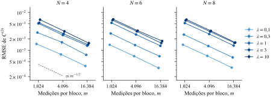
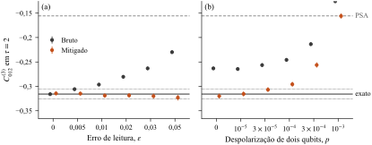

# Além do campo médio: a aproximação de espaço de fase captura as correlações de três corpos entre neutrinos?

_Beyond mean field: does the phase-space approximation capture three-body neutrino correlations?_

**Giovanna Fátima de Britto Vieira¹, Marco Ruas Sales Peixoto¹, Leonardo Villas Boas Fischel¹**

¹Instituto de Tecnologia e Liderança – Inteli, São Paulo – SP – Brasil

Orientadores: Jose Erinaldo da Fonseca e Bryan Kano Ferreira

## Resumo

O sabor dos neutrinos em supernovas pode influenciar a explosão e a produção de elementos pesados, mas a evolução quântica de muitos neutrinos só é tratável com aproximações. Este trabalho comparou a aproximação de espaço de fase (PSA) com a evolução exata nos cumulantes conectados de dois e três corpos de um modelo de dois sabores, com quatro a dezesseis neutrinos e razões de interação de 0,1 a 10. Após descontar o ruído amostral da própria PSA, o erro normalizado dos trios superou o das probabilidades de sabor em todas as 25 configurações e o dos pares em 22 delas, e cresceu com a interação até oito neutrinos. No caso principal, a PSA recuperou apenas 48% do cumulante de trio exato. Circuitos trotterizados ideais atingiram a precisão estatística esperada, com erro proporcional a $m^{-1/2}$. Uma varredura de ruído mostrou que a mitigação de leitura amplia o erro de leitura tolerável de menos de 0,5% para 3%, mas que nenhum dos métodos tolera despolarização acima de $3\times10^{-5}$ por porta de dois qubits, o que explica os valores próximos de zero obtidos no processador IBM com o circuito original. Com um circuito redesenhado de 108 CNOTs, o processador recuperou 61% do cumulante exato, mais do que a PSA, embora fora da margem de 0,01.

**Palavras-chave:** Neutrinos. Oscilações coletivas. Correlações de três corpos. Computação quântica. Aproximação de espaço de fase.

## Abstract

Neutrino flavor in supernovae can influence the explosion and heavy-element production, but the quantum evolution of many neutrinos is tractable only through approximations. This work compared the phase-space approximation (PSA) with exact evolution for two- and three-body connected cumulants of a two-flavor model, with four to sixteen neutrinos and interaction ratios from 0.1 to 10. After removing the PSA's own sampling noise, the normalized triple error exceeded the flavor-probability error in all 25 configurations and the pair error in 22 of them, and grew with the interaction up to eight neutrinos. In the primary case, the PSA recovered only 48% of the exact triple cumulant. Ideal Trotterized circuits reached the expected statistical precision, with error proportional to $m^{-1/2}$. A noise sweep showed that readout mitigation raises the tolerable readout error from below 0.5% to 3%, but neither method tolerates depolarization above $3\times10^{-5}$ per two-qubit gate, which explains the near-zero values obtained on the IBM processor with the original circuit. With a redesigned 108-CNOT circuit, the processor recovered 61% of the exact cumulant, more than the PSA, although outside the 0.01 margin.

**Keywords:** Neutrinos. Collective oscillations. Three-body correlations. Quantum computing. Phase-space approximation.

## Introdução

### Contexto astrofísico e motivação

Estrelas com massa inicial acima de cerca de oito massas solares podem sofrer colapso gravitacional do núcleo. O núcleo de ferro perde sustentação, contrai-se e sofre um rebote que origina um choque. Esse choque tende a estagnar por perdas com dissociação nuclear e emissão de neutrinos, e a absorção de neutrinos e os movimentos da matéria podem reativá-lo durante a acreção, isto é, a queda de matéria sobre o remanescente [Janka 2012, Abi et al. 2020]. Neutrinos são partículas elementares eletricamente neutras que interagem fracamente com a matéria. Uma supernova típica emite cerca de $10^{58}$ neutrinos, com energias características de $10\,\mathrm{MeV}$, que transportam mais de 99% da energia gravitacional liberada [Abi et al. 2020].

Os estados de sabor dos neutrinos são superposições dos estados de massa, e as fases de propagação desses estados produzem oscilações de sabor [Duan et al. 2010]. A evolução de sabor altera o aquecimento atrás do choque e a razão entre nêutrons e prótons, relevante para a nucleossíntese, com efeitos que dependem da configuração estelar [Nagakura 2023, Akaho et al. 2026, Cowan et al. 2021]. A detecção da SN 1987A e as perspectivas de DUNE, Hyper-Kamiokande e JUNO reforçam a importância de prever os sabores emitidos [Vissani et al. 2010, Baum et al. 2022, Sarmah et al. 2026]. Perto do núcleo, a interação coerente entre neutrinos acopla suas evoluções e gera oscilações coletivas, um problema quântico de muitos corpos [Duan et al. 2010].

### Problema, lacuna e objetivo

O custo da evolução exata cresce exponencialmente com o número de neutrinos. A aproximação de campo médio reduz esse custo ao desprezar as correlações conectadas entre partículas, e seus desvios em relação à evolução exata acompanham o desenvolvimento de emaranhamento e dependem das condições iniciais [Cervia et al. 2019]. A aproximação de espaço de fase, denominada _phase-space approximation_ (PSA), incorpora efeitos além do campo médio por meio de um conjunto de trajetórias com condições iniciais aleatórias [Lacroix et al. 2022]. Em neutrinos, a PSA foi validada em sistemas de quatro a doze partículas, com metade em cada sabor, por meio de médias de sabor, correlações coletivas de pares e entropias reduzidas [Lacroix et al. 2024, Mangin-Brinet et al. 2026]. Em registradores de qubits, ela perdeu precisão em observáveis de vários qubits e em acoplamento forte [de Correc et al. 2026]. Cumulantes de três corpos de neutrinos já foram medidos em hardware, sem comparação com a PSA [Illa e Savage 2023]. Na literatura examinada, não se encontrou uma comparação dos cumulantes conectados de três corpos da PSA com a evolução exata, feita par a par e trio a trio, que controle ao mesmo tempo o tamanho do sistema, a intensidade da interação e as incertezas de amostragem, discretização e medição.

A precisão dos cumulantes de terceira ordem importa porque, em um Hamiltoniano com interações entre pares, a hierarquia de evolução acopla observáveis de uma partícula a correlações de dois corpos, cujas equações dependem de momentos de terceira ordem. Desvios na descrição dos trios podem, portanto, afetar observáveis de ordem inferior ao longo da evolução [Lacroix et al. 2024, Riccio e Balantekin 2026]. As limitações de longo tempo relatadas para a PSA motivam examinar essa relação, sem atribuir de antemão todos os desvios de sabor a uma única ordem de cumulantes [Lacroix et al. 2022].

Para quatro a dezesseis neutrinos, o cálculo exato é acessível em computadores clássicos. A etapa quântica avalia com que precisão circuitos distinguem os desvios da PSA, porque em sistemas maiores, sem solução exata acessível, esses circuitos poderiam servir de referência para validar aproximações. Os sistemas pequenos permitem separar discretização, amostragem e ruído, sem pressupor vantagem computacional nem extrapolar os resultados para sistemas maiores.

Este trabalho busca responder em quais regimes de intensidade de interação, tamanho do sistema e tempo de evolução a PSA reproduz as correlações conectadas de dois e três corpos e, quando há desvios, sob quais condições de ruído e número de medições circuitos quânticos conseguem distingui-los dos resultados exatos. Foram avaliados os cumulantes de dois e três corpos da PSA frente ao cálculo exato, com o campo médio como referência adicional, em um modelo de dois sabores com estados iniciais de sabor puro fatorizados. As simulações clássicas cobrem de quatro a dezesseis neutrinos, e os circuitos, de quatro a oito. A razão $\lambda=\mu/\bar{\omega}$ variou de 0,1 a 10, em que $\mu$ é a escala efetiva da interação neutrino-neutrino e $\bar{\omega}$ é a frequência média de oscilação no vácuo. O contexto de supernovas motiva o modelo, e as conclusões restringem-se às configurações simplificadas examinadas.

O aumento da interação amplia os coeficientes dos termos que acoplam as ordens da hierarquia, o que motiva esperar maior sensibilidade dos trios aos efeitos além das trajetórias de campo médio. Essa expectativa depende do estado inicial e da janela temporal e não decorre de a PSA anular cumulantes superiores. A hipótese **H1** é que a PSA reproduz com maior precisão as probabilidades individuais de sabor e os cumulantes de dois corpos do que os de três corpos. Nos casos em que a referência permite normalização, o erro normalizado nos trios tende a crescer com a intensidade da interação. A hipótese **H2** é que a mitigação de leitura amplia o nível de ruído sob o qual um circuito ainda distingue a PSA da solução exata, com o mesmo orçamento total de medições. A Seção 6 define as métricas usadas para avaliá-las.

A Seção 2 apresenta os fundamentos físicos e computacionais, e a Seção 3 revisa os trabalhos relacionados. As Seções 4 a 6 descrevem a metodologia, os experimentos e as métricas, a Seção 7 apresenta os resultados e a Seção 8 resume as conclusões.

## Fundamentação teórica

### Oscilações de sabor e o Hamiltoniano coletivo

Em dois sabores, os estados $|\nu_e\rangle$ e $|\nu_x\rangle$, em que $\nu_x$ representa uma combinação efetiva de $\nu_\mu$ e $\nu_\tau$, relacionam-se aos estados de massa por um ângulo de mistura $\theta$ [Duan et al. 2010]. Um neutrino isolado é um sistema de dois níveis e pode ser descrito como um spin-1/2 em um campo efetivo. Com $\hbar=c=1$, na base de sabor,

$$
H_i=\frac{\omega_i}{2}\,\mathbf{B}\cdot\boldsymbol{\sigma}_i,\qquad
\omega_i=\frac{\Delta m^2}{2E_i},\qquad
\mathbf{B}=(\sin2\theta,0,-\cos2\theta),
\tag{1}
$$

em que $\boldsymbol{\sigma}_i=(X_i,Y_i,Z_i)$ reúne as matrizes de Pauli do neutrino $i$, $\Delta m^2$ é a diferença entre os quadrados das massas e $E_i$ é a energia. O estado reduzido escreve-se como $\rho_i=\tfrac12(\mathbb{1}+\mathbf{P}_i\cdot\boldsymbol{\sigma})$, com vetor de polarização $\mathbf{P}_i=\langle\boldsymbol{\sigma}_i\rangle$. No vácuo, $\mathbf{P}_i$ precessa em torno de $\mathbf{B}$ com frequência $\omega_i$, e a probabilidade de sabor eletrônico é $P_{e,i}=(1+m_i)/2$, com $m_i=\langle Z_i\rangle$ [Duan et al. 2010, Cervia et al. 2019]. A identificação $|\nu_e\rangle=|0\rangle$ e $|\nu_x\rangle=|1\rangle$ associa cada neutrino a um qubit, e a medição de $Z_i$ na base computacional distingue os dois sabores.

Em ambientes densos, o espalhamento frontal coerente entre neutrinos, mediado pela corrente neutra, gera um potencial com termos fora da diagonal de sabor, que trocam o sabor de dois neutrinos [Duan et al. 2010]. Em segunda quantização, essa interação assume a forma de um produto escalar entre os _spins_ de sabor de partículas distintas [Balantekin e Pehlivan 2007]. Para $N$ neutrinos com momentos discretizados,

$$
H=\frac{1}{2}\sum_{i=0}^{N-1}\omega_i\,\mathbf{B}\cdot\boldsymbol{\sigma}_i
+\frac{\mu}{4N}\sum_{i<j}g_{ij}\,\boldsymbol{\sigma}_i\cdot\boldsymbol{\sigma}_j,
\tag{2}
$$

em que $\mu$ é uma escala efetiva da interação, proporcional a $\sqrt{2}G_Fn_\nu$, com $G_F$ a constante de Fermi e $n_\nu$ a densidade de neutrinos, e $g_{ij}$ incorpora a dependência angular $1-\cos\vartheta_{ij}$ entre as direções de propagação. O fator $1/N$ mantém finita a energia de interação por neutrino. O termo $\boldsymbol{\sigma}_i\cdot\boldsymbol{\sigma}_j=Z_iZ_j+2(\sigma_i^+\sigma_j^-+\sigma_i^-\sigma_j^+)$ combina uma contribuição diagonal e a troca de sabor $|01\rangle\leftrightarrow|10\rangle$. Com $g_{ij}$ uniforme, a Equação (2) corresponde à aproximação de ângulo único, um modelo integrável do tipo Gaudin [Pehlivan et al. 2011, Cervia et al. 2019].

O espaço de estados de $N$ neutrinos tem dimensão $2^N$, o que limita a evolução exata de sistemas grandes quando não se exploram simetrias [Cervia et al. 2019]. A dinâmica conserva a energia e a projeção total $\sum_i\mathbf{B}\cdot\boldsymbol{\sigma}_i$, mas não o sabor total $\sum_i Z_i$ quando $\theta\neq0$. A Equação (2) omite matéria, antineutrinos, colisões, transporte e contribuições além do espalhamento frontal, e descreve, portanto, um sistema fechado simplificado, motivado pelo ambiente de supernovas.

### Correlações conectadas e emaranhamento

Um estado puro de $N$ neutrinos é separável quando se escreve como produto de estados individuais, e emaranhado no caso contrário. Se o estado global é puro, o emaranhamento de um neutrino com o restante do sistema pode ser quantificado pela entropia de von Neumann de $\rho_i$, que se anula apenas quando $|\mathbf{P}_i|=1$ [Cervia et al. 2019]. Partindo de um estado produto, o termo de interação da Equação (2) gera emaranhamento, enquanto o termo de vácuo, isoladamente, preserva a fatorização.

As correlações entre resultados de medição na base de sabor são descritas por cumulantes conectados, que isolam a parcela de um momento conjunto não explicada por momentos de ordem inferior [Riccio e Balantekin 2026]. Para partículas distintas,

$$
\begin{aligned}
C^{(2)}_{ij}(t)&=\langle Z_i Z_j\rangle_t-m_i(t)m_j(t),\\
C^{(3)}_{ijk}(t)&=\langle Z_i Z_j Z_k\rangle_t-m_i(t)m_j(t)m_k(t)\\
&\quad-C^{(2)}_{ij}(t)m_k(t)-C^{(2)}_{ik}(t)m_j(t)-C^{(2)}_{jk}(t)m_i(t).
\end{aligned}
\tag{3}
$$

A Equação (3) decompõe o momento de três operadores em produto de médias, três termos de par vezes média e a parcela conectada $C^{(3)}_{ijk}$. Anular $C^{(3)}_{ijk}$ não equivale, portanto, a anular $\langle Z_iZ_jZ_k\rangle$. Para um estado produto, todos os cumulantes de partículas distintas são nulos. Illa e Savage (2023) usaram a mesma definição para medir correlações de dois e três corpos em hardware.

Como $Z_i$, $Z_iZ_j$ e $Z_iZ_jZ_k$ são diagonais na base computacional, esses cumulantes dependem apenas da distribuição dos resultados de medição e não certificam, isoladamente, emaranhamento. A mistura de $|000\rangle$ e $|111\rangle$ com pesos iguais, que é separável, tem os mesmos $C^{(2)}$ e $C^{(3)}$ do estado GHZ $(|000\rangle+|111\rangle)/\sqrt2$. Na evolução exata a partir de um estado produto, em que o estado global permanece puro, $C^{(2)}_{ij}\neq0$ implica que os neutrinos $i$ e $j$ estão emaranhados com o restante do sistema, sem identificar com quais partículas. O interesse nos cumulantes de terceira ordem está, sobretudo, em seu papel na dinâmica.

### Campo médio e hierarquia BBGKY

A aproximação de campo médio substitui, no termo de interação, o operador de cada parceiro por sua média, $\boldsymbol{\sigma}_i\cdot\boldsymbol{\sigma}_j\approx\boldsymbol{\sigma}_i\cdot\mathbf{P}_j+\mathbf{P}_i\cdot\boldsymbol{\sigma}_j-\mathbf{P}_i\cdot\mathbf{P}_j$ [Balantekin e Pehlivan 2007, Cervia et al. 2019]. Cada vetor de polarização passa a precessar em um campo que reúne o termo de vácuo e a média dos demais,

$$
\frac{d\mathbf{P}_i}{dt}=\Big[\omega_i\,\mathbf{B}+\frac{\mu}{2N}\sum_{j\neq i}g_{ij}\,\mathbf{P}_j\Big]\times\mathbf{P}_i .
\tag{4}
$$

O problema reduz-se a $3N$ equações acopladas. Um estado produto permanece produto, com $|\mathbf{P}_i|=1$, de modo que a aproximação não gera emaranhamento nem correlações conectadas. A interação é mantida pelo campo das médias, e descartam-se apenas as correlações. Para um estado inicial fatorizado, a derivada de $\mathbf{P}_i$ coincide com a exata no instante inicial, e os desvios surgem à medida que as correlações crescem [Lacroix et al. 2022].

Na evolução exata, as equações de Ehrenfest não se fecham. Para a componente $b$ do vetor de polarização,

$$
\frac{dP_i^{b}}{dt}=\Big(\Big[\omega_i\mathbf{B}+\frac{\mu}{2N}\sum_{j\neq i}g_{ij}\mathbf{P}_j\Big]\times\mathbf{P}_i\Big)^{b}
+\frac{\mu}{2N}\sum_{j\neq i}g_{ij}\,\epsilon_{bac}\,C^{ac}_{ji},
\qquad C^{ac}_{ji}=\langle\sigma_j^a\sigma_i^c\rangle-P_j^aP_i^c,
\tag{5}
$$

em que $\epsilon_{bac}$ é o símbolo de Levi-Civita e há soma sobre os índices repetidos $a$ e $c$. O campo médio corresponde a anular os cumulantes de dois corpos $C^{ac}_{ji}$. As equações desses cumulantes dependem, por sua vez, de cumulantes de três corpos, e assim sucessivamente, formando uma hierarquia do tipo Bogoliubov–Born–Green–Kirkwood–Yvon (BBGKY) [Volpe et al. 2013, Lacroix e Ayik 2014]. Um fechamento de ordem $m$ anula os cumulantes de ordem $m+1$. O campo médio corresponde a $m=1$, e o fechamento de segunda ordem de Riccio e Balantekin (2026) anula todas as componentes dos cumulantes de três corpos, preservando nos produtos de três operadores as contribuições de médias e pares. Este trabalho mede apenas a componente $zzz$ desses cumulantes, acessível por medições de sabor. Na Equação (5), cada par contribui com coeficiente $\mu/(2N)$, somado sobre os $N-1$ parceiros, de modo que o peso dos termos de correlação cresce com a interação. Essa estrutura motiva a hipótese H1, sem demonstrá-la.

### Aproximação de espaço de fase

A PSA transforma a evolução quântica em um problema estatístico [Lacroix et al. 2022, Lacroix et al. 2024]. Sorteiam-se condições iniciais clássicas $\mathbf{s}_i^{(\ell)}(0)$ cujas médias e flutuações reproduzem as do estado quântico inicial. Cada trajetória $\ell$ evolui independentemente segundo a Equação (4), com $\mathbf{P}_i$ substituído por $\mathbf{s}_i^{(\ell)}$, e os observáveis são estimados por médias sobre o conjunto,

$$
\langle Z_iZ_j\cdots\rangle_t\approx\frac{1}{N_{\mathrm{traj}}}\sum_{\ell=1}^{N_{\mathrm{traj}}}s^{z,(\ell)}_i(t)\,s^{z,(\ell)}_j(t)\cdots .
\tag{6}
$$

A aleatoriedade restringe-se ao instante inicial. A ideia provém do campo médio estocástico da física nuclear [Lacroix e Ayik 2014] e compartilha a estrutura da aproximação de Wigner truncada (TWA) [Polkovnikov 2010]. O custo por trajetória é polinomial em $N$, em contraste com as $2^N$ amplitudes da evolução exata, e o erro estatístico das médias decresce com $1/\sqrt{N_{\mathrm{traj}}}$.

Para estados produto com um neutrino por feixe, Lacroix et al. (2024) propuseram uma amostragem bivaluada, em que a componente de $\mathbf{s}_i$ ao longo do sabor inicial é fixada e as duas componentes transversais assumem, independentemente, os valores $\pm1$ com igual probabilidade,

$$
\mathbf{s}_i^{(\ell)}(0)=\mathbf{n}_i+x_i^{(\ell)}\mathbf{u}_i+y_i^{(\ell)}\mathbf{v}_i,\qquad x_i^{(\ell)},\,y_i^{(\ell)}\in\{-1,+1\},
\tag{7}
$$

em que $\mathbf{n}_i=\pm\hat{z}$ indica o sabor inicial e $\mathbf{u}_i$, $\mathbf{v}_i$ completam uma base ortonormal. Essa escolha reproduz $\overline{\mathbf{s}_i}=\mathbf{n}_i$ e $\overline{s_i^a s_i^b}=\delta_{ab}$, como os momentos quânticos de $\boldsymbol{\sigma}_i$, e inicia o conjunto sem cumulantes entre partículas distintas. A mesma prescrição aparece na versão discreta da TWA para spins-1/2 [Schachenmayer et al. 2015]. A coincidência para estados produto é uma observação deste trabalho, e não uma equivalência estabelecida pelos autores da PSA.

Embora cada trajetória permaneça um produto de vetores clássicos, o conjunto desenvolve correlações entre partículas, porque trajetórias com condições iniciais distintas se separam ao longo da evolução. Segundo Lacroix et al. (2024), a PSA equivale a uma hierarquia BBGKY não truncada, que difere da exata apenas no nível de dois corpos. Diferentemente do fechamento de segunda ordem, a PSA não impõe $C^{(3)}=0$, e os trios constituem o primeiro nível em que as duas abordagens diferem por construção. Os cumulantes da PSA são correlações clássicas do conjunto de trajetórias, e sua concordância com os cumulantes exatos é o que este trabalho examina.

### Simulação quântica digital e trotterização

Na simulação quântica digital, o operador de evolução $U(t)=e^{-iHt}$ é aproximado por uma sequência de portas de um e dois qubits [Lloyd 1996, Nielsen e Chuang 2010]. A Equação (2) separa-se em termos de um corpo, $H_{\mathrm{v}}=\sum_i\tfrac{\omega_i}{2}\mathbf{B}\cdot\boldsymbol{\sigma}_i$, e termos de pares, $H_{ij}=\tfrac{\mu g_{ij}}{4N}\boldsymbol{\sigma}_i\cdot\boldsymbol{\sigma}_j$. Cada fator de $e^{-iH_{\mathrm{v}}\delta}$ é uma rotação de um qubit em torno de $\mathbf{B}$. Como $X_iX_j$, $Y_iY_j$ e $Z_iZ_j$ comutam entre si, $e^{-iH_{ij}\delta}$ é uma única porta de dois qubits, equivalente a uma troca parcial de sabor, pois $\boldsymbol{\sigma}_i\cdot\boldsymbol{\sigma}_j=2\,\mathrm{SWAP}_{ij}-\mathbb{1}$, e exige no máximo três CNOTs [Vatan e Williams 2004]. Como todos os pares interagem, o número de portas de dois qubits por passo cresce com $N^2$, e processadores com conectividade limitada exigem ainda portas SWAP de roteamento [Hall et al. 2021, Amitrano et al. 2023].

Como os termos não comutam entre si, a exponencial da soma é aproximada por produtos de exponenciais em $r$ passos de duração $\delta=t/r$. Para $H=\sum_{\gamma=1}^{\Gamma}H_\gamma$, a fórmula simétrica de Suzuki de segunda ordem é

$$
S_2(\delta)=e^{-iH_1\delta/2}\cdots e^{-iH_\Gamma\delta/2}\,e^{-iH_\Gamma\delta/2}\cdots e^{-iH_1\delta/2},
\qquad U(t)\approx S_2(t/r)^r,
\tag{8}
$$

com erro $O(\delta^3)$ por passo e $O(t^3/r^2)$ no intervalo total [Childs et al. 2021]. Termos de pares que compartilham uma partícula têm comutadores que envolvem operadores de três corpos, o que torna o erro de discretização relevante para os trios. Aumentar $r$ reduz esse erro, mas aprofunda o circuito e amplia a exposição ao ruído.

### Medição, ruído e mitigação de leitura

A medição na base computacional produz cadeias de bits $\mathbf{b}$ com probabilidade $p(\mathbf{b})=|\langle\mathbf{b}|\psi\rangle|^2$ [Nielsen e Chuang 2010]. Para um conjunto de qubits $S$, o valor esperado de $Z_S=\prod_{i\in S}Z_i$ é estimado pela paridade dos bits medidos em $m$ repetições,

$$
\widehat{\langle Z_S\rangle}=\frac{1}{m}\sum_{s=1}^{m}(-1)^{\sum_{i\in S}b_i^{(s)}},\qquad
\mathrm{Var}\big[\widehat{\langle Z_S\rangle}\big]=\frac{1-\langle Z_S\rangle^2}{m},
\tag{9}
$$

de modo que as mesmas contagens fornecem $m_i$, $\langle Z_iZ_j\rangle$ e $\langle Z_iZ_jZ_k\rangle$, e o erro estatístico decresce com $1/\sqrt{m}$. Como os cumulantes da Equação (3) combinam momentos estimados a partir das mesmas amostras, suas incertezas dependem das covariâncias entre esses momentos [Hall et al. 2021, Cai et al. 2023].

Os processadores atuais operam sem correção de erros, na chamada era NISQ, em que o ruído limita a profundidade útil dos circuitos [Preskill 2018]. Um modelo usual de erro de porta é o canal despolarizante, $\mathcal{E}(\rho)=(1-p)\rho+p\,\mathbb{1}/2^n$ para $n$ qubits, que multiplica por $1-p$ o valor esperado de qualquer operador de Pauli não trivial [Nielsen e Chuang 2010]. Na leitura, cada bit pode ser invertido com probabilidade $\varepsilon$, independente entre qubits, o que resulta em $\langle Z_S\rangle_{\mathrm{med}}=(1-2\varepsilon)^{|S|}\langle Z_S\rangle$, e o mesmo fator $(1-2\varepsilon)^3$ atenua $C^{(3)}$. Correlações de ordem maior sofrem, assim, atenuação mais forte, e os cumulantes de três corpos estão entre os observáveis mais sensíveis ao ruído.

A mitigação de erros procura reduzir o viés das estimativas por pós-processamento, sem correção de erros [Cai et al. 2023]. Na mitigação de leitura, a relação entre as distribuições ideal e medida é descrita por uma matriz de resposta, $\vec{p}_{\mathrm{med}}=A\,\vec{p}$. Supondo erros independentes entre qubits, $A$ fatoriza-se em matrizes de um qubit estimadas por circuitos de calibração, e a correção aplica sua inversa às frequências medidas [Bravyi et al. 2021],

$$
A_j=\begin{pmatrix}1-\epsilon_j&\eta_j\\ \epsilon_j&1-\eta_j\end{pmatrix},\qquad
\hat{\vec{p}}=\big(A_{N-1}^{-1}\otimes\cdots\otimes A_0^{-1}\big)\,\vec{p}_{\mathrm{med}},
\tag{10}
$$

em que $\epsilon_j$ e $\eta_j$ são as probabilidades de ler 1 após preparar 0 e de ler 0 após preparar 1 no qubit $j$. O resultado pode conter quasiprobabilidades negativas, que ainda fornecem estimativas não enviesadas de valores esperados. Em contrapartida, a inversão amplia a variância, e a calibração consome parte do orçamento de medições [Bravyi et al. 2021, Cai et al. 2023]. A mitigação de leitura não corrige erros de porta, que exigem técnicas como a extrapolação a ruído zero, com custo de amostragem que cresce exponencialmente com o ruído acumulado [Cai et al. 2023].

## Revisão bibliográfica

### O problema de muitos corpos e os limites do campo médio

A descrição de muitos corpos das oscilações coletivas parte do Hamiltoniano de espalhamento frontal escrito com operadores de spin de sabor, cuja versão de ângulo único é integrável [Balantekin e Pehlivan 2007, Pehlivan et al. 2011]. Com soluções exatas de até nove neutrinos, Cervia et al. (2019) relacionaram as diferenças entre campo médio e evolução exata ao desenvolvimento de emaranhamento, com forte dependência das condições iniciais. Patwardhan et al. (2021) associaram o emaranhamento máximo aos neutrinos próximos das divisões espectrais. Rrapaj (2020) comparou soluções exatas multiangulares ao campo médio, incluindo correlações conectadas de pares, e indicou que o desacordo esperado é máximo quando a polarização de sabor líquida é nula, como no estado com metade dos neutrinos em cada sabor adotado nesta pesquisa.

Há, porém, limites para extrapolar esses resultados. Martin et al. (2022) mostraram, em um modelo de dois feixes, que o campo médio recupera observáveis de um corpo no limite de muitos neutrinos com razões fixas, embora ainda divirja da solução exata com 128 neutrinos. Shalgar e Tamborra (2023) argumentaram que sistemas fechados com poucos neutrinos não bastam para validar ou invalidar o campo médio em fontes astrofísicas abertas. Esses trabalhos justificam o foco em correlações, que o campo médio despreza por construção, e a restrição das conclusões a sistemas fechados pequenos.

### Métodos além do campo médio

Redes tensoriais estenderam a evolução de muitos corpos a sistemas maiores [Roggero 2021, Cervia et al. 2022], mas são pouco adequadas à interação entre todos os pares e perderam precisão em sistemas grandes nas comparações relatadas [Mangin-Brinet et al. 2026, Kiss et al. 2026]. A PSA oferece uma alternativa de custo polinomial. Lacroix et al. (2022) aplicaram-na a um modelo de dois feixes, em que o método reproduziu médias, flutuações e entropias de um e dois neutrinos, mas não as oscilações de longo tempo das flutuações. A extensão para múltiplos feixes usou um arranjo semelhante ao deste trabalho, com quatro, oito e doze neutrinos, metade em cada sabor e interação entre todos os pares [Lacroix et al. 2024]. Nesse estudo, as médias individuais de sabor foram sobreamortecidas em tempos longos, enquanto a correlação coletiva $C_{ZZ}$, que soma as covariâncias de todos os pares, e a entropia média de um neutrino foram bem reproduzidas. Não se avaliaram covariâncias par a par, cumulantes de três corpos nem a dependência com a intensidade da interação. A versão de três sabores foi comparada com soluções exatas de até oito neutrinos e reproduziu populações de sabor e entropias [Mangin-Brinet et al. 2026].

Fora de neutrinos, de Correc et al. (2026) aplicaram a PSA a registradores de qubits em modelos de Ising, inclusive com interação entre todos os pares, e observaram perda de precisão em correlações de dois qubits e em entropias de subsistemas maiores, sobretudo em acoplamento forte. Esse resultado antecipa qualitativamente a hipótese H1, mas não envolve cumulantes conectados de três corpos nem o Hamiltoniano de neutrinos.

Na linha da hierarquia BBGKY, Volpe et al. (2013) derivaram equações estendidas para neutrinos desprezando termos de três corpos. Riccio e Balantekin (2026) desenvolveram um fechamento sistemático de segunda ordem, que anula os cumulantes de três corpos e trata cerca de cem neutrinos com custo polinomial. Nesse preprint, a comparação com a evolução exata restringiu-se a quatro neutrinos em três sabores. Como a PSA equivale, segundo seus autores, a uma hierarquia não truncada, os cumulantes de três corpos são o ponto em que as duas abordagens diferem por construção. Roggero et al. (2022) empregaram uma aproximação semiclássica gaussiana para oscilações rápidas e sugeriram a TWA como extensão, sem aplicá-la.

### Simulação quântica de oscilações coletivas

Hall et al. (2021) simularam quatro neutrinos em um processador IBM com redes de SWAP e usaram mitigação de leitura e extrapolação a ruído zero para extrair medidas de emaranhamento, com rendimento da mitigação menor no processador real do que no simulador ruidoso. Amitrano et al. (2023) analisaram o custo de fórmulas de Trotter de segunda ordem para a interação entre todos os pares e mostraram que a conectividade total de íons aprisionados reduz a profundidade dos circuitos, com execuções de até oito neutrinos.

Illa e Savage (2023) mediram correlações conectadas de dois e três corpos em sistemas de até doze neutrinos, com a mesma definição de cumulantes da Equação (3) e o mesmo estado inicial com metade em cada sabor. Com 240 medições no processador de íons aprisionados e 1.200 no emulador, a maioria dos cumulantes de três corpos ficou compatível com zero, o que indica que o orçamento de medições limita a resolução desses observáveis. Kiss et al. (2026) usaram processadores IBM com até 112 qubits para estudar a termalização e compararam os resultados com a PSA, mas apenas em observáveis de um qubit. Balantekin et al. (2023) reúnem esses desenvolvimentos em uma revisão.

### Síntese e posicionamento

_Tabela 1 - Trabalhos relacionados e observáveis comparados. CM: campo médio; "coletivo": soma das covariâncias de todos os pares; "anulado": cumulante igualado a zero pelo fechamento. Fonte: elaboração própria._

| Trabalho                    | Métodos                  |    Sabores     | $N$ máximo |  $P_e$   | $C^{(2)}$ | $C^{(3)}$ | Plataforma        |
| --------------------------- | ------------------------ | :------------: | ---------: | :------: | :-------: | :-------: | ----------------- |
| Cervia et al. (2019)        | Exato, CM                |       2        |          9 |   Sim    |     —     |     —     | Clássica          |
| Rrapaj (2020)               | Exato, CM                |       2        |         20 |   Sim    |   Pares   |     —     | Clássica          |
| Lacroix et al. (2022)       | Exato, CM, PSA           |       2        |        100 |   Sim    | Coletivo  |     —     | Clássica          |
| Lacroix et al. (2024)       | Exato, PSA               |       2        |         12 |   Sim    | Coletivo  |     —     | Clássica          |
| Mangin-Brinet et al. (2026) | Exato, CM, PSA           |       3        |          8 |   Sim    |     —     |     —     | Clássica          |
| de Correc et al. (2026)     | Exato, CM, PSA           | Qubits (Ising) |         10 |   Sim    |   Média   |     —     | Clássica          |
| Riccio e Balantekin (2026)  | BBGKY, CM, exato         |     2 e 3      |  4 (exato) |   Sim    |    Sim    |  Anulado  | Clássica          |
| Hall et al. (2021)          | Circuito                 |       2        |          4 |   Sim    |     —     |     —     | IBM               |
| Amitrano et al. (2023)      | Circuito                 |       2        |          8 |   Sim    |     —     |     —     | Íons aprisionados |
| Illa e Savage (2023)        | Exato, circuito          |       2        |         12 |   Sim    |    Sim    |    Sim    | Íons aprisionados |
| Kiss et al. (2026)          | Circuito, PSA            |       2        |        112 | Um qubit |     —     |     —     | IBM               |
| Este trabalho               | Exato, CM, PSA, circuito |       2        |         16 |   Sim    |   Pares   |   Trios   | Aer, IBM          |

A Tabela 1 mostra que os cumulantes de três corpos aparecem apenas em medições em hardware sem comparação com aproximações [Illa e Savage 2023] ou anulados por construção em um fechamento da hierarquia [Riccio e Balantekin 2026]. As validações da PSA em neutrinos usaram médias, correlações coletivas e entropias. Comparações entre PSA e evolução exata em função de $N$ e medições de cumulantes de três corpos em hardware já existem separadamente. Na literatura localizada, porém, não foi identificado trabalho que compare os cumulantes conectados de três corpos da PSA com a evolução exata. A contribuição deste trabalho é comparar os cumulantes conectados de três corpos da PSA com a evolução exata, por par e por trio, controlando o tamanho do sistema, a razão $\lambda$ e as incertezas de amostragem, discretização e medição, e avaliar se circuitos quânticos com ruído e mitigação de leitura distinguem os desvios da PSA.

## Metodologia

O estudo compara quatro descrições da mesma dinâmica. A evolução exata serve de referência. O campo médio e a PSA são as aproximações avaliadas, e os circuitos trotterizados representam a alternativa quântica. Todas usam a forma adimensional da Equação (2), com $\tau=\bar{\omega}t$, $\lambda=\mu/\bar{\omega}$ e $\widetilde{\omega}_i=\omega_i/\bar{\omega}$,

$$
\frac{H}{\bar{\omega}}=\frac{1}{2}\sum_{i=0}^{N-1}\widetilde{\omega}_i\,\mathbf{B}\cdot\boldsymbol{\sigma}_i
+\frac{\lambda}{4N}\sum_{i<j}g_{ij}\,\boldsymbol{\sigma}_i\cdot\boldsymbol{\sigma}_j .
\tag{11}
$$

**Evolução exata.** O estado de $2^N$ amplitudes é propagado pela ação da exponencial da matriz esparsa do Hamiltoniano sobre o vetor de estado (`expm_multiply`, SciPy). Para verificar a construção dessa matriz, um Hamiltoniano denso montado de forma independente, por produtos de Kronecker, foi comparado a ela em um sistema de quatro neutrinos com acoplamentos e estados genéricos.

**Campo médio e PSA.** As Equações (4) e (7) são integradas por Runge–Kutta de quarta ordem (RK4) com subpassos fixos entre instantes consecutivos. A PSA é organizada em blocos de 4.096 trajetórias, cada um com semente própria. Os momentos $m_i$, $\langle Z_iZ_j\rangle$ e $\langle Z_iZ_jZ_k\rangle$ são somados entre os blocos antes do cálculo dos cumulantes, porque cumulantes calculados em cada bloco e depois promediados teriam viés de ordem $1/N_{\mathrm{traj}}$.

**Circuitos.** Os circuitos aplicam a fórmula de Suzuki de segunda ordem da Equação (8), com uma porta de dois qubits por par e por meio passo. A implementação em Qiskit foi comparada a um emulador independente de vetor de estado. As medições ideais são amostradas da distribuição exata do circuito. As execuções ruidosas usam o simulador Qiskit Aer com matriz densidade e, no caso principal, o processador `ibm_kingston`. A mitigação de leitura segue a Equação (10), com matrizes calibradas pelos estados $|0000\rangle$ e $|1111\rangle$, e preserva quasiprobabilidades negativas.

**Observáveis.** Avaliam-se as probabilidades $P_{e,i}$ e os cumulantes $C^{(2)}_{ij}$ e $C^{(3)}_{ijk}$ da Equação (3) para todos os indivíduos, pares e trios distintos.

**Controles.** Antes da comparação, cada etapa passou por verificações com limites fixados previamente (Tabela 5). Os controles incluem a reprodução de um resultado publicado da PSA, a ausência de cumulantes sem interação, a coincidência entre exato e campo médio sem interação, a convergência do RK4, o erro-padrão da PSA entre sementes e o erro de Trotter dos circuitos ideais. Dois controles falharam na primeira execução. No primeiro, o erro-padrão de $C^{(3)}$ entre cinco blocos de PSA superou $10^{-2}$ em três de seis configurações testadas, e o número de blocos foi elevado para vinte em todas as configurações, o que reduziu o maior erro-padrão para $5{,}11\times10^{-3}$. No segundo, o circuito ideal com 112 passos errou $C^{(3)}$ em $4{,}0\times10^{-3}$ em $\lambda=10$, $\tau=4$, acima do limite de $10^{-3}$, e essa configuração passou a usar 448 passos. Na mesma interação, a referência PSA em $\tau=2$ passou de 12 para 24 subpassos RK4. Nenhum resultado foi descartado, e todas as configurações passaram nos controles após essas mudanças.

## Experimentos e parâmetros

### Grade clássica

A Tabela 2 resume a grade usada para H1. A associação entre frequência e sabor inicial é fixa, com as frequências mais baixas no sabor eletrônico.

_Tabela 2 - Parâmetros da grade clássica._

| Parâmetro             | Valores                                                                                     |
| --------------------- | ------------------------------------------------------------------------------------------- |
| Tamanho               | $N=4,6,8$ (principal) e $N=12,16$ (extensão)                                                |
| Interação             | $\lambda=0{,}1;\ 0{,}3;\ 1;\ 3;\ 10$                                                        |
| Frequências e mistura | $\widetilde{\omega}_i=0{,}7+0{,}6\,i/(N-1)$; $\theta=0{,}2$ rad                             |
| Acoplamentos          | $g_{ij}=1$ para $i\neq j$                                                                   |
| Estado inicial        | Primeira metade dos neutrinos em $\nu_e$ e a segunda em $\nu_x$                             |
| Tempo                 | $0\leq\tau\leq10$, 201 instantes, 12 subpassos RK4 por intervalo                            |
| PSA                   | 20 blocos de 4.096 trajetórias (81.920 no total), sementes 10.001 a 10.020                  |

A reprodução de Lacroix et al. (2024) usa a Figura 2(c) daquele estudo, com oito neutrinos e 10.000 trajetórias, em configuração distinta da Tabela 2. As coordenadas foram extraídas da figura publicada, o que acrescenta uma incerteza de leitura aos desvios.

### Circuitos e ruído

Os circuitos ideais usam $N=4,6,8$, as cinco interações e vinte blocos de $m=1.024$, $4.096$ ou $16.384$ medições por instante. As execuções ruidosas restringem-se a $N=4$, ao trio $(0,1,2)$ e a $\tau=1,2,4$, com sete intervalos de tempo e 16 passos de Trotter por intervalo. O caso principal é $N=4$, $\lambda=3$, $\tau=2$, em que o cumulante exato é grande e a PSA se afasta dele.

A Tabela 3 apresenta a profundidade dos circuitos usados no simulador e o menor número de passos que mantém o erro de Trotter de $C^{(3)}$ abaixo de $10^{-3}$. Os 112 passos das execuções no Aer resultam em 4.032 CNOTs no simulador, sem restrição de conectividade, e em 6.048 após a compilação para uma cadeia linear de qubits, próxima da conectividade do hardware. No caso principal, 12 passos bastam e reduzem o circuito a 648 CNOTs. A primeira execução em hardware já usou uma discretização mais curta, com 2 passos por intervalo, 14 no total, que somam 756 CNOTs em cadeia linear e erro de Trotter de $7{,}2\times10^{-4}$.

_Tabela 3 - Circuitos do trio $(0,1,2)$ com $N=4$, compilados para portas `rz`, `sx`, `x` e `cx` em cadeia linear (Qiskit, otimização de nível 1). As três primeiras colunas numéricas referem-se à discretização usada no Aer e as duas últimas, ao menor número de passos com erro de Trotter em $C^{(3)}$ abaixo de $10^{-3}$._

| $\lambda$ | $\tau$ | Passos | Profundidade | CNOTs  | Passos mín. | CNOTs (mín.) |
| --------: | -----: | -----: | -----------: | -----: | ----------: | -----------: |
|   0,1–0,3 |  1–4   |    112 | 11.989–15.909 |  6.048 |         1–2 |       54–108 |
|         1 |      1 |    112 |       11.989 |  6.048 |           1 |           54 |
|         1 |      2 |    112 |       11.989 |  6.048 |           3 |          162 |
|         1 |      4 |    112 |       11.989 |  6.048 |           6 |          324 |
|         3 |      1 |    112 |       11.989 |  6.048 |           5 |          270 |
|     **3** |  **2** |**112** |   **11.989** |**6.048**|      **12** |      **648** |
|         3 |      4 |    112 |       11.989 |  6.048 |          22 |        1.188 |
|        10 |      1 |    112 |       11.989 |  6.048 |          20 |        1.080 |
|        10 |      2 |    112 |       11.989 |  6.048 |          37 |        1.998 |
|        10 |      4 |    448 |       47.941 | 24.192 |         224 |       12.096 |

A Tabela 4 lista os modelos de ruído. Os perfis leve e moderado reproduzem as execuções originais com 112 passos. A varredura usa o circuito de 12 passos do caso principal e varia separadamente a despolarização das portas de dois qubits, $p$, e o erro de leitura, $\varepsilon$, para testar H2.

_Tabela 4 - Modelos de ruído no Qiskit Aer. A despolarização de um qubit vale $p/10$ e atua em `sx` e `x`; a de dois qubits atua em `cx`._

| Modelo     | Passos | Despolarização $p$                                  | Erro de leitura $\varepsilon$                  |
| ---------- | -----: | --------------------------------------------------- | ---------------------------------------------- |
| Leve       |    112 | $10^{-3}$                                           | 0,01                                           |
| Moderado   |    112 | $10^{-2}$                                           | 0,03                                           |
| Varredura  |     12 | $0;\ 10^{-5};\ 3\times10^{-5};\ 10^{-4};\ 3\times10^{-4};\ 10^{-3}$ | $0;\ 0{,}005;\ 0{,}01;\ 0{,}02;\ 0{,}03;\ 0{,}05$ |

O orçamento por método é $M=20m$, com $m=16.384$. O método bruto usa todas as medições no circuito do sinal. O mitigado usa $3m/4$ medições no sinal e $m/8$ em cada calibração, de modo que a calibração consome parte do mesmo orçamento. Na varredura, o Aer calcula a distribuição de probabilidades com ruído de portas, o erro de leitura é aplicado como produto tensorial de matrizes de inversão de bit, e as contagens são sorteadas dessa distribuição. A primeira execução no `ibm_kingston` usou o caso principal com 14 passos, vinte blocos e o mesmo orçamento. Em seguida, o experimento em hardware foi refeito com um circuito mais curto. O instante $\tau=1{,}5$ foi escolhido depois da primeira execução, porque nele o cumulante exato do trio $(0,1,2)$ ainda vale $-0{,}159$, a PSA recupera apenas 34% dele, e o menor número de passos com erro de Trotter abaixo de $10^{-3}$ é 2, com erro de $8{,}2\times10^{-4}$. Esse circuito tem 108 CNOTs em cadeia linear, sete vezes menos que o da primeira execução. Como a escolha do instante foi posterior aos primeiros resultados, uma triagem exploratória no processador precedeu a confirmação, feita com vinte trabalhos de 16.384 medições e sementes novas, com _twirling_ de portas e sem mitigação de leitura. Nesse caso, a PSA de referência é calculada com as 256 condições iniciais da amostragem bivaluada, o que elimina seu erro de Monte Carlo.

_Tabela 5 - Controles numéricos. Valores máximos observados sobre todas as configurações de cada controle._

| Controle                                  | Limite              | Máximo observado          |
| :---------------------------------------- | ------------------: | ------------------------: |
| Reprodução publicada: exato               | $2\times10^{-2}$    | $1{,}41\times10^{-3}$     |
| Reprodução publicada: PSA                 | $6\times10^{-2}$    | $2{,}99\times10^{-2}$     |
| Exato: Hamiltoniano denso independente    | $10^{-10}$          | $2{,}22\times10^{-16}$    |
| Sem interação: $C^{(3)}$ exato            | $10^{-10}$          | $1{,}33\times10^{-15}$    |
| Qiskit versus emulador                    | $10^{-10}$          | $2{,}80\times10^{-12}$    |
| Refinamento RK4: $P_e$                    | $10^{-6}$           | $5{,}16\times10^{-8}$     |
| Refinamento RK4: cumulantes               | $10^{-5}$           | $1{,}26\times10^{-7}$     |
| Erro-padrão da PSA: $C^{(3)}$             | $10^{-2}$           | $5{,}11\times10^{-3}$     |
| Trotter ideal: $C^{(3)}$                  | $10^{-3}$           | $8{,}91\times10^{-5}$     |

## Métricas de avaliação

### Erro normalizado e hipótese H1

Para $T$ instantes e $n_q$ conjuntos de partículas de ordem $q$, sejam $O^{\mathrm{ex}}_{q,\alpha}(\tau_\ell)$ a referência exata e $\widehat O_{q,\alpha}(\tau_\ell)$ a estimativa da PSA. O erro e a escala do sinal são

$$
E_q^2=\frac{1}{Tn_q}\sum_{\ell,\alpha}\left[\widehat{O}_{q,\alpha}(\tau_\ell)-O^{\mathrm{ex}}_{q,\alpha}(\tau_\ell)\right]^2-\overline{\sigma^2_q},\qquad
S_q^2=\frac{1}{Tn_q}\sum_{\ell,\alpha}\left[O^{\mathrm{ex}}_{q,\alpha}(\tau_\ell)\right]^2,
\tag{12}
$$

em que $\overline{\sigma^2_q}$ é a variância média do estimador da PSA, estimada pela dispersão entre os vinte blocos dividida por vinte. Sem esse termo, o erro quadrático incluiria o ruído de Monte Carlo da própria PSA, que é comparável ao sinal quando a interação é fraca e inflaria $E_q$ justamente onde os cumulantes são pequenos. O erro normalizado é $R_q=E_q/S_q$, com $q=1,2,3$. Para as probabilidades de sabor, usa-se $m_i=2P_{e,i}-1$, de modo que $S_1$ mede o afastamento de $P_e$ em relação a $1/2$. A primeira parte de H1 é avaliada por $D=R_3-R_2$ e por $D_1=R_3-R_1$, com valores positivos indicando que a PSA erra mais nos trios.

Os intervalos de 95% vêm de 2.000 réplicas bootstrap dos vinte blocos. Como a estatística corrigida estima o erro sistemático da PSA, e no mundo bootstrap a média dos blocos não tem ruído próprio, usa-se o intervalo básico $[\widehat D-q_{97{,}5},\ \widehat D-q_{2{,}5}]$, em que $q_{2{,}5}$ e $q_{97{,}5}$ são percentis da diferença entre cada réplica corrigida e o valor sem correção calculado na média dos blocos, que é a referência do mundo bootstrap. O mesmo procedimento vale para $D_1$ e para as inclinações. Quando o ruído da PSA supera 1,5 vez o erro sistemático estimado, a configuração é sinalizada como dominada por ruído.

A segunda parte de H1, o crescimento do erro dos trios com a interação, é medida pela inclinação $b_N$ da regressão linear de $R_3$ em $\log_{10}\lambda$, para cada $N$. O intervalo de $b_N$ usa as mesmas réplicas bootstrap, com sementes pareadas entre as interações, e essa parte de H1 recebe apoio quando o intervalo de 95% de $b_N$ fica acima de zero.

### Critério para os circuitos e hipótese H2

Para um circuito ruidoso, sejam $I_{\mathrm{PSA}}$ o intervalo de 95% de circuito menos PSA e $[L,U]$ o de circuito menos exato, ambos obtidos de 2.000 réplicas multinomiais das contagens agregadas, com a calibração reestimada a cada réplica e os blocos da PSA reamostrados. O circuito distingue a PSA do exato quando

$$
0\notin I_{\mathrm{PSA}}
\quad\text{e}\quad
[L-r,U+r]\subseteq[-0{,}01;\ 0{,}01],
\tag{13}
$$

em que $r$ soma o erro de Trotter do circuito ideal a uma tolerância numérica de $10^{-5}$. Calibrações com número de condição superior a 10 tornam o caso não resolvido. Como critério complementar, que não exige recuperar o valor exato, compara-se o erro absoluto do circuito com o da PSA por $\Delta=|\widehat C^{(3)}_{\mathrm{circ}}-C^{(3)}_{\mathrm{ex}}|-|C^{(3)}_{\mathrm{PSA}}-C^{(3)}_{\mathrm{ex}}|$, com intervalo obtido pela reamostragem dos trabalhos. O valor $\Delta<0$ indica que o circuito ficou mais perto do exato do que a aproximação. Para cada método, o limiar de ruído é o maior valor da varredura que satisfaz a Equação (13). H2 recebe apoio quando o limiar do método mitigado supera o do bruto.

## Resultados experimentais

### A PSA recupera metade do cumulante de trio no caso principal

No caso principal ($N=4$, $\lambda=3$, $\tau=2$), o cumulante exato do trio $(0,1,2)$ é $C^{(3)}=-0{,}316$. A PSA, com três amostras independentes de 81.920 trajetórias, forneceu $-0{,}156$, $-0{,}152$ e $-0{,}147$, e sua média é $-0{,}151\pm0{,}002$. A aproximação recupera, portanto, 48% do cumulante exato, um desvio de 0,165, mais de oitenta vezes o erro-padrão. Nos mesmos dados, o erro normalizado dos pares é $R_2=0{,}419$, contra $R_3=0{,}948$ dos trios. O desvio não decorre da amostragem da PSA nem da discretização, porque o erro-padrão e o erro de integração ficaram três ordens de grandeza abaixo dele (Tabela 5).

### Precisão da PSA em pares e trios

A Tabela 6 apresenta $D$ para as 25 configurações, com o ruído amostral da PSA descontado.

_Tabela 6 - Diferença $D=R_3-R_2$ entre os erros normalizados de trios e pares da PSA, com intervalo de 95%. Valores positivos indicam erro maior nos trios. O asterisco marca as configurações em que o ruído amostral da PSA supera 1,5 vez o erro sistemático estimado._

| $N$ | $\lambda=0{,}1$ | $\lambda=0{,}3$ | $\lambda=1$ | $\lambda=3$ | $\lambda=10$ |
| ---: | :---: | :---: | :---: | :---: | :---: |
| 4 | −0,180 [−0,326; −0,048] | 0,267 [0,237; 0,293] | 0,430 [0,417; 0,443] | 0,529 [0,524; 0,535] | 0,602 [0,599; 0,605] |
| 6 | 0,109 [−0,052; 0,257] | 0,306 [0,270; 0,346] | 0,359 [0,347; 0,370] | 0,625 [0,617; 0,632] | 0,752 [0,747; 0,756] |
| 8 | 0,264 [0,062; 0,430] | 0,358 [0,294; 0,405] | 0,362 [0,351; 0,373] | 0,505 [0,495; 0,513] | 0,936 [0,933; 0,939] |
| 12 | 0,347 [−0,007; 0,664]$^{*}$ | 0,445 [0,376; 0,501] | 0,311 [0,297; 0,323] | 0,371 [0,361; 0,379] | 0,720 [0,710; 0,729] |
| 16 | 0,695 [0,041; 1,282]$^{*}$ | 0,583 [0,476; 0,669] | 0,239 [0,228; 0,250] | 0,174 [0,163; 0,184] | 0,517 [0,508; 0,526] |

O intervalo de 95% de $D$ ficou acima de zero em 22 das 25 configurações. As exceções ocorreram todas com a interação mais fraca, $\lambda=0{,}1$. Em $N=4$, o intervalo ficou abaixo de zero, com $D=-0{,}180$ $[-0{,}326;\ -0{,}048]$, de modo que nessa configuração a PSA errou mais nos pares do que nos trios. Em $N=6$ e $N=12$, o sinal ficou indefinido. Nessa interação, os cumulantes exatos são pequenos, com escala de $10^{-3}$ nos trios, e em $N=12$ e $N=16$ o ruído amostral da PSA superou o erro sistemático, o que torna esses dois valores pouco informativos com 81.920 trajetórias.

A correção do ruído amostral alterou de forma relevante apenas as configurações com $\lambda\leq0{,}3$. Sem ela, o erro quadrático incluía a variância de Monte Carlo da PSA, e cinco estimativas de $D$ ficavam fora dos próprios intervalos bootstrap, porque cada réplica, ao repetir blocos, acrescentava ruído e deslocava a distribuição para cima. Em $N=16$, $\lambda=0{,}1$, por exemplo, o valor sem correção era $2{,}062$, fora do intervalo $[2{,}425;\ 3{,}280]$, e o valor corrigido é $0{,}695$. Para $\lambda\geq1$, o ruído amostral é pequeno diante do erro sistemático, e os valores corrigidos diferem dos originais em no máximo 0,002.

Os trios também foram reproduzidos com menos precisão do que as probabilidades de sabor. O intervalo de $D_1=R_3-R_1$ ficou acima de zero nas 25 configurações. Com $\lambda\leq0{,}3$, o erro normalizado das probabilidades não passou de 0,011, enquanto o dos trios ficou entre 0,50 e 1,15. Com $\lambda=10$, porém, $R_1$ chegou a valores entre 0,53 e 1,01, porque a PSA amortece as oscilações das probabilidades individuais em acoplamento forte, como relataram Lacroix et al. (2024), e a vantagem das probabilidades sobre os trios caiu para 0,09 a 0,24.

O erro normalizado dos trios cresceu com a interação nos sistemas menores. A inclinação de $R_3$ por década de $\lambda$ foi $b_{4}=0{,}264$ $[0{,}215;\ 0{,}319]$, $b_{6}=0{,}162$ $[0{,}101;\ 0{,}229]$ e $b_{8}=0{,}150$ $[0{,}061;\ 0{,}260]$. Em $N=12$, a inclinação foi $b_{12}=0{,}042$ $[-0{,}144;\ 0{,}264]$, e em $N=16$, $b_{16}=-0{,}260$ $[-0{,}587;\ 0{,}101]$, ambas sem tendência definida. Nesses dois tamanhos, $R_3$ caiu de 0,70 a 1,15 com $\lambda\leq0{,}3$ para 0,24 a 0,44 com $\lambda$ entre 1 e 3 e voltou a subir em $\lambda=10$. A primeira parte de H1 vale, portanto, para as probabilidades de sabor em todas as configurações e para os pares em todos os tamanhos com $\lambda\geq0{,}3$. A segunda parte vale para $N\leq8$.

### Orçamento de medições

Nos circuitos ideais, o RMSE de $C^{(3)}$ em relação ao exato diminuiu a cada aumento de orçamento nas quinze configurações (Figura 1). De 1.024 para 16.384 medições por bloco, a redução foi de 3,75 a 4,19 vezes, próxima do fator quatro esperado da dependência $m^{-1/2}$. O erro dos circuitos ideais é, portanto, dominado pela estatística das medições. Com o maior orçamento, o RMSE ficou entre $3{,}4\times10^{-4}$ e $1{,}8\times10^{-3}$, bem abaixo do desvio da PSA no caso principal.

_Figura 1 - RMSE de $C^{(3)}$ dos circuitos ideais em relação ao exato, sobre todos os instantes e trios, com vinte blocos de $m$ medições. As barras indicam a faixa de 95% em 500 repetições independentes do experimento._

### Ruído, mitigação e hardware

A Figura 2 mostra a estimativa de $C^{(3)}$ no caso principal sob a varredura de ruído. Sem ruído de porta, o método bruto distinguiu a PSA do exato apenas com leitura perfeita, porque a atenuação $(1-2\varepsilon)^3$ já desloca a estimativa para fora da margem de 0,01 com $\varepsilon=0{,}005$. A mitigação de leitura manteve a estimativa dentro da margem até $\varepsilon=0{,}03$, e em $\varepsilon=0{,}05$ o resultado oscilou entre os níveis de ruído de porta, sinal de que o aumento da variância da inversão aproxima o intervalo do limite da margem. Para o ruído de leitura, portanto, a mitigação ampliou o limiar, como prevê H2.

O ruído de porta produziu outro quadro. Sem erro de leitura, o maior nível de despolarização que satisfez o critério foi $p=10^{-5}$ para o método bruto e $p=3\times10^{-5}$ para o mitigado, e com $p=10^{-4}$ os dois métodos já ficaram fora da margem. A diferença em $3\times10^{-5}$ está no limite da resolução da varredura, porque nesse nível o método mitigado passou em apenas três dos seis erros de leitura. Com $\varepsilon=0{,}03$, o método bruto não atingiu a margem em nenhum nível, e o mitigado, até $p=10^{-5}$. A mitigação de leitura não trata o ruído de porta, e o apoio a H2 restringe-se ao erro de leitura. Com $p=10^{-3}$, da ordem dos processadores atuais, e $\varepsilon=0{,}03$, o circuito mitigado estimou $C^{(3)}=-0{,}156$. Esse valor é próximo da previsão da PSA, mas resulta da atenuação do sinal pelo ruído, o que mostra que um circuito ruidoso pode parecer concordar com a aproximação sem resolver a diferença.

_Figura 2 - Estimativas de $C^{(3)}_{012}$ no caso principal ($N=4$, $\lambda=3$, $\tau=2$) com o circuito de 12 passos e $M=327.680$ medições por método. (a) Sem ruído de porta, em função do erro de leitura. (b) Com erro de leitura de 0,03, em função da despolarização de dois qubits. As barras são intervalos de 95% ampliados pelo erro de Trotter, a linha contínua é o valor exato com a margem de $\pm0{,}01$ pontilhada, e a tracejada é a PSA._

A profundidade dos circuitos explica os resultados da Tabela 7, em que as quatro estimativas ficaram entre $-0{,}0003$ e $0{,}0064$, com ou sem mitigação. No Aer, os 112 passos somam 4.032 CNOTs, e uma auditoria das contagens mostrou que a matriz densidade antes da leitura ficou a menos de $8\times10^{-11}$ do estado maximamente misto, de modo que o ruído de portas apagou o sinal. No hardware, o circuito de 14 passos tem 756 CNOTs, mais do que os 648 do circuito de 12 passos da Figura 2, que já exigiria despolarização abaixo de $3\times10^{-5}$ para resolver o cumulante em $\tau=2$, cerca de cem vezes menos que a dos processadores atuais. A execução no `ibm_kingston` completou vinte blocos e oitenta trabalhos, com 655.360 medições incluindo calibrações, em 72,87 minutos. Por isso, o experimento em hardware foi refeito com o circuito curto de $\tau=1{,}5$.

_Tabela 7 - Estimativas de $C^{(3)}$ no caso principal ($\tau=2$) e intervalo de 95% da diferença circuito menos exato, ampliado pelo erro de Trotter. Cada método recebe $M=327.680$ medições, e a calibração integra o orçamento mitigado. O valor exato é $-0{,}316$, e o da PSA, $-0{,}151$._

| Ambiente | Passos | CNOTs | Método   | Estimativa  | IC95 da diferença        |
| -------- | -----: | ----: | -------- | ----------: | ------------------------ |
| Aer      |    112 | 4.032 | Bruto    | $-0{,}0003$ | $[0{,}312;\ 0{,}319]$    |
| Aer      |    112 | 4.032 | Mitigado |  $0{,}0013$ | $[0{,}312;\ 0{,}322]$    |
| IBM      |     14 |   756 | Bruto    |  $0{,}0058$ | $[0{,}318;\ 0{,}326]$    |
| IBM      |     14 |   756 | Mitigado |  $0{,}0064$ | $[0{,}317;\ 0{,}327]$    |

Com o circuito curto, o processador preservou um sinal mensurável. A estimativa da IBM foi $C^{(3)}=-0{,}097$, contra $-0{,}159$ do exato e $-0{,}054$ da PSA, de modo que o circuito recuperou 61% do cumulante e a aproximação, 34%. O erro absoluto do circuito foi 0,062, e o da PSA, 0,104, com $\Delta=-0{,}043$ $[-0{,}046;\ -0{,}039]$. O intervalo da diferença circuito menos PSA também excluiu zero. Uma simulação do mesmo circuito no Aer, com o modelo de ruído calibrado do processador e o mesmo número de medições, previu $C^{(3)}=-0{,}081$, próximo do valor medido. Já o intervalo da diferença circuito menos exato, $[0{,}058;\ 0{,}065]$, ficou fora da margem de $\pm0{,}01$, e o critério da Equação (13) não foi satisfeito. O hardware distinguiu, portanto, a previsão da PSA e ficou mais perto do exato do que ela, mas a atenuação de cerca de 40% acumulada nas 108 portas de dois qubits ainda impede recuperar o valor exato sem mitigação de erros de porta, como a extrapolação a ruído zero.

### Comparação com trabalhos relacionados

A Tabela 8 compara os métodos, as grandezas e as condições de teste deste trabalho com os dois estudos mais próximos, Lacroix et al. (2024) para a PSA e Illa e Savage (2023) para a medição de cumulantes em hardware.

_Tabela 8 - Condições de teste deste trabalho e dos estudos mais próximos. Fonte: elaboração própria, com base nos trabalhos citados._

| Aspecto           | Lacroix et al. (2024)          | Illa e Savage (2023)                     | Este trabalho                                       |
| ----------------- | ------------------------------ | ---------------------------------------- | --------------------------------------------------- |
| Métodos           | Exato, PSA                     | Exato, circuito                          | Exato, campo médio, PSA, circuito                   |
| $N$               | 4, 8 e 12                      | Até 12                                   | 4 a 16 (clássico); 4 (hardware)                     |
| Estado inicial    | Metade em cada sabor           | Metade em cada sabor                     | Metade em cada sabor                                |
| Correlações       | $C_{ZZ}$ coletivo              | $C^{(2)}$ e $C^{(3)}$                    | $C^{(2)}$ por par e $C^{(3)}$ por trio              |
| Aproximação       | PSA comparada ao exato         | Nenhuma                                  | PSA comparada ao exato e aos circuitos              |
| Medições          | Não se aplica                  | 240 (processador) e 1.200 (emulador)     | 327.680 por instante e método                       |
| Plataforma        | Clássica                       | Íons aprisionados                        | Clássica, Aer e `ibm_kingston`                      |

No arranjo de Lacroix et al. (2024), a PSA reproduziu bem a correlação coletiva $C_{ZZ}$, enquanto os resultados deste trabalho indicam erros altos em pares e trios. As duas observações são compatíveis. Calculada sobre os mesmos dados da Tabela 6, a soma das covariâncias de todos os pares teve erro normalizado entre 0,06 e 0,37 e ficou abaixo do erro par a par $R_2$ em 21 das 25 configurações. No caso principal, esse erro foi 0,17, contra $R_2=0{,}42$ e $R_3=0{,}95$. Os desvios dos pares individuais compensam-se em parte na soma, de modo que uma grandeza coletiva pode ser bem reproduzida mesmo quando as correlações de cada par e de cada trio não são. O sobreamortecimento das médias de sabor relatado por esses autores também aparece aqui, como o aumento do erro de $P_e$ com a interação, que chega a $R_1$ entre 0,53 e 1,01 em $\lambda=10$. A principal diferença está na grandeza comparada. A validação anterior não examinou cumulantes de três corpos nem a dependência com $\lambda$, e é nesses dois aspectos que a PSA se afasta da evolução exata.

Illa e Savage (2023) usaram a mesma definição de cumulante conectado e o mesmo estado inicial, mas a maioria dos cumulantes de três corpos medidos ficou compatível com zero. Os resultados deste trabalho atribuem essa limitação ao orçamento de medições. No circuito curto, o intervalo de 95% da diferença entre a IBM e o exato teve meia largura de 0,0035 com 327.680 medições, o que corresponde a um erro-padrão de cerca de 0,0018. Pela dependência $M^{-1/2}$ observada na Figura 1, o mesmo circuito com 240 medições teria erro-padrão próximo de 0,07, comparável ao próprio cumulante exato, de $-0{,}159$. Com o orçamento ampliado, o hardware resolveu um cumulante não nulo e ainda o distinguiu da previsão da PSA. Também se acrescenta a comparação com uma aproximação, ausente naquele estudo. A atenuação de cerca de 40% observada mostra, porém, que aumentar o orçamento não basta e que, além da estatística, o ruído de porta limita a recuperação do valor exato.

## Conclusões

A PSA reproduziu as probabilidades de sabor com mais precisão do que os cumulantes de três corpos em todas as 25 configurações examinadas, e os cumulantes de dois corpos em 22 delas. O erro dos trios cresceu com a interação em sistemas de quatro a oito neutrinos. No caso principal, com $N=4$, $\lambda=3$ e $\tau=2$, a aproximação recuperou 48% do cumulante de trio exato, um desvio muito acima das incertezas de amostragem e de integração. Em sistemas de doze e dezesseis neutrinos, o erro dos trios continuou maior, mas não cresceu de forma monotônica com a interação. Em acoplamento forte, a PSA também perdeu precisão nas probabilidades de sabor, o que reduz a vantagem dos observáveis de uma partícula sobre os trios. Com acoplamento fraco, os cumulantes são pequenos e o ruído de Monte Carlo da própria PSA precisa ser descontado, sob pena de produzir diferenças espúrias entre trios e pares.

Circuitos quânticos ideais distinguiram esse desvio com folga, com erro que decresce como $m^{-1/2}$ e fica abaixo de $2\times10^{-3}$ com 16.384 medições por bloco. Com ruído, a mitigação de leitura ampliou de menos de 0,5% para 3% o erro de leitura tolerável, o que apoia H2 nesse tipo de ruído. Para o ruído de porta, nenhum dos métodos tolerou despolarização acima de $3\times10^{-5}$ por porta de dois qubits no circuito de 648 CNOTs, cerca de cem vezes abaixo dos processadores atuais. Isso explica as estimativas próximas de zero obtidas no `ibm_kingston` com o circuito original e mostra que, com ruído de porta realista, a atenuação pode levar o circuito a valores próximos aos da PSA sem resolver a diferença. Com um circuito redesenhado de 108 CNOTs, o processador recuperou 61% do cumulante exato e ficou mais perto dele do que a PSA, que recupera 34%, mas ainda fora da margem exigida.

As conclusões restringem-se a um modelo de dois sabores com ângulo único, estado inicial com metade dos neutrinos em cada sabor e à componente $zzz$ dos cumulantes. Trabalhos futuros podem estender a comparação a acoplamentos angulares não uniformes e a três sabores, aumentar o número de trajetórias com acoplamento fraco e combinar a mitigação de leitura com a extrapolação a ruído zero, para que a execução em hardware alcance a margem de resolução exigida.

### Código e dados

O código, os protocolos e os dados derivados estão em <https://github.com/leonardovbf/correlacoes-tres-neutrinos>. O motor numérico (exato, campo médio, PSA e circuitos) fica em `src/neutrinos/`, os protocolos de cada fase em `configs/protocols/artigo_v1/`, e a análise estatística em `src/neutrinos/study_analysis.py`. Os resultados deste artigo são reproduzidos, nesta ordem, por `scripts/grade_psa.py gerar`, `scripts/grade_psa.py analisar` e `scripts/grade_psa.py coletivo` (grade de H1 e comparação com a correlação coletiva), `scripts/varredura_ruido.py` (H2), `figuras/dados_orcamento.py` (orçamento de medições), e por `figuras/gerar_tabelas.py`, `figuras/figura_orcamento.py` e `figuras/figura_ruido.py` (tabelas e figuras). O ambiente usa Python 3.15, NumPy 2.4.3, SciPy 1.17.1, Qiskit 2.5.2, Qiskit Aer 0.18.2, Qiskit IBM Runtime 0.51.0 e Matplotlib 3.10.8, com as versões fixadas em `requirements-research.lock`. Todas as sementes são fixas, e a reprodução das medições ideais coincide com os valores originais em todas as 45 configurações. As contagens brutas, os circuitos e as calibrações da segunda campanha em hardware estão em `analysis/campaigns/`, e as contagens do circuito curto também em `dados/ibm/circuito_curto_n4.json`. Os identificadores e tempos dos 80 trabalhos da primeira execução estão em `analysis/article_packages/`, e `scripts/exportar_contagens_ibm.py` exporta suas contagens brutas para `dados/ibm/`. Os blocos de trajetórias da PSA são regenerados de forma determinística pelos scripts acima.

## Referências

Abi, B. et al. (2020). Deep Underground Neutrino Experiment (DUNE), Far Detector Technical Design Report, Volume II: DUNE Physics. Technical Report FERMILAB-PUB-20-025-ND, DUNE Collaboration. <https://arxiv.org/abs/2002.03005>.

Akaho, R., Nagakura, H., Iwakami, W., Furusawa, S., Harada, A., Okawa, H., Matsufuru, H., Sumiyoshi, K., and Yamada, S. (2026). Bifurcated Impact of Neutrino Fast Flavor Conversion on Core-Collapse Supernovae Informed by Multiangle Neutrino Radiation Hydrodynamics. _Physical Review Letters_, 136(19):191002. <https://doi.org/10.1103/fksy-1jtw>.

Amitrano, V., Roggero, A., Luchi, P., Turro, F., Vespucci, L., and Pederiva, F. (2023). Trapped-ion quantum simulation of collective neutrino oscillations. _Physical Review D_, 107(2):023007. <https://doi.org/10.1103/PhysRevD.107.023007>.

Balantekin, A. B. and Pehlivan, Y. (2007). Neutrino–neutrino interactions and flavour mixing in dense matter. _Journal of Physics G: Nuclear and Particle Physics_, 34(1):47--65. <https://doi.org/10.1088/0954-3899/34/1/004>.

Balantekin, A. B., Cervia, M. J., Patwardhan, A. V., Rrapaj, E., and Siwach, P. (2023). Quantum information and quantum simulation of neutrino physics. _The European Physical Journal A_, 59(8):186. <https://doi.org/10.1140/epja/s10050-023-01092-7>.

Baum, S., Capozzi, F., and Horiuchi, S. (2022). Rocks, water, and noble liquids: Unfolding the flavor contents of supernova neutrinos. _Physical Review D_, 106(12):123008. <https://doi.org/10.1103/PhysRevD.106.123008>.

Bravyi, S., Sheldon, S., Kandala, A., Mckay, D. C., and Gambetta, J. M. (2021). Mitigating measurement errors in multiqubit experiments. _Physical Review A_, 103(4):042605. <https://doi.org/10.1103/PhysRevA.103.042605>.

Cai, Z., Babbush, R., Benjamin, S. C., Endo, S., Huggins, W. J., Li, Y., McClean, J. R., and O'Brien, T. E. (2023). Quantum error mitigation. _Reviews of Modern Physics_, 95(4):045005. <https://doi.org/10.1103/RevModPhys.95.045005>.

Cervia, M. J., Siwach, P., Patwardhan, A. V., Balantekin, A. B., Coppersmith, S. N., and Johnson, C. W. (2022). Collective neutrino oscillations with tensor networks using a time-dependent variational principle. _Physical Review D_, 105(12):123025. <https://doi.org/10.1103/PhysRevD.105.123025>.

Cervia, M. J., Patwardhan, A. V., Balantekin, A. B., Coppersmith, S. N., and Johnson, C. W. (2019). Entanglement and collective flavor oscillations in a dense neutrino gas. _Physical Review D_, 100(8):083001. <https://doi.org/10.1103/PhysRevD.100.083001>.

Childs, A. M., Su, Y., Tran, M. C., Wiebe, N., and Zhu, S. (2021). Theory of Trotter Error with Commutator Scaling. _Physical Review X_, 11(1):011020. <https://doi.org/10.1103/PhysRevX.11.011020>.

Cowan, J. J., Sneden, C., Lawler, J. E., Aprahamian, A., Wiescher, M., Langanke, K., Martínez-Pinedo, G., and Thielemann, F.-K. (2021). Origin of the heaviest elements: The rapid neutron-capture process. _Reviews of Modern Physics_, 93(1):015002. <https://doi.org/10.1103/RevModPhys.93.015002>.

de Correc, C., Lacroix, D., and Bertrand, C. (2026). Emulation of large-scale qubit registers with a phase-space approach. _APS Open Science_, 1:000017. <https://doi.org/10.1103/swn6-s387>.

Duan, H., Fuller, G. M., and Qian, Y.-Z. (2010). Collective Neutrino Oscillations. _Annual Review of Nuclear and Particle Science_, 60(1):569--594. <https://doi.org/10.1146/annurev.nucl.012809.104524>.

Hall, B., Roggero, A., Baroni, A., and Carlson, J. (2021). Simulation of collective neutrino oscillations on a quantum computer. _Physical Review D_, 104(6):063009. <https://doi.org/10.1103/PhysRevD.104.063009>.

Illa, M. and Savage, M. J. (2023). Multi-Neutrino Entanglement and Correlations in Dense Neutrino Systems. _Physical Review Letters_, 130:221003. <https://doi.org/10.1103/PhysRevLett.130.221003>.

Janka, H.-T. (2012). Explosion Mechanisms of Core-Collapse Supernovae. _Annual Review of Nuclear and Particle Science_, 62:407--451. <https://doi.org/10.1146/annurev-nucl-102711-094901>.

Kiss, O., Tavernelli, I., Tacchino, F., Lacroix, D., and Roggero, A. (2026). Neutrino thermalization via randomization on a quantum processor. _Communications Physics_, 9(1):282. <https://doi.org/10.1038/s42005-026-02697-2>.

Lacroix, D. and Ayik, S. (2014). Stochastic quantum dynamics beyond mean field. _The European Physical Journal A_, 50(6):95. <https://doi.org/10.1140/epja/i2014-14095-8>.

Lacroix, D., Balantekin, A. B., Cervia, M. J., Patwardhan, A. V., and Siwach, P. (2022). Role of non-Gaussian quantum fluctuations in neutrino entanglement. _Physical Review D_, 106(12):123006. <https://doi.org/10.1103/PhysRevD.106.123006>.

Lacroix, D., Bauge, A., Yilmaz, B., Mangin-Brinet, M., Roggero, A., and Balantekin, A. B. (2024). Phase-space methods for neutrino oscillations: Extension to multibeams. _Physical Review D_, 110:103027. <https://doi.org/10.1103/PhysRevD.110.103027>.

Lloyd, S. (1996). Universal Quantum Simulators. _Science_, 273(5278):1073--1078. <https://doi.org/10.1126/science.273.5278.1073>.

Mangin-Brinet, M., Bauge, A., and Lacroix, D. (2026). Three-flavor neutrino oscillations using the phase space approach. _Physical Review D_, 113:036026. <https://doi.org/10.1103/yr2g-1g2g>.

Martin, J. D., Roggero, A., Duan, H., Carlson, J., and Cirigliano, V. (2022). Classical and quantum evolution in a simple coherent neutrino problem. _Physical Review D_, 105(8):083020. <https://doi.org/10.1103/PhysRevD.105.083020>.

Nagakura, H. (2023). Roles of Fast Neutrino-Flavor Conversion on the Neutrino-Heating Mechanism of Core-Collapse Supernova. _Physical Review Letters_, 130(21):211401. <https://doi.org/10.1103/PhysRevLett.130.211401>.

Nielsen, M. A. and Chuang, I. L. (2010). _Quantum Computation and Quantum Information: 10th Anniversary Edition_. Cambridge University Press, Cambridge. <https://doi.org/10.1017/CBO9780511976667>.

Patwardhan, A. V., Cervia, M. J., and Balantekin, A. B. (2021). Spectral splits and entanglement entropy in collective neutrino oscillations. _Physical Review D_, 104(12):123035. <https://doi.org/10.1103/PhysRevD.104.123035>.

Pehlivan, Y., Balantekin, A. B., Kajino, T., and Yoshida, T. (2011). Invariants of collective neutrino oscillations. _Physical Review D_, 84(6):065008. <https://doi.org/10.1103/PhysRevD.84.065008>.

Polkovnikov, A. (2010). Phase space representation of quantum dynamics. _Annals of Physics_, 325(8):1790--1852. <https://doi.org/10.1016/j.aop.2010.02.006>.

Preskill, J. (2018). Quantum Computing in the NISQ era and beyond. _Quantum_, 2:79. <https://doi.org/10.22331/q-2018-08-06-79>.

Riccio, M. and Balantekin, A. B. (2026). Improved Approximations for Collective Neutrino Oscillations. Preprint arXiv:2607.28619, versão 2. <https://doi.org/10.48550/arXiv.2607.28619>.

Roggero, A. (2021). Entanglement and many-body effects in collective neutrino oscillations. _Physical Review D_, 104(10):103016. <https://doi.org/10.1103/PhysRevD.104.103016>.

Roggero, A., Rrapaj, E., and Xiong, Z. (2022). Entanglement and correlations in fast collective neutrino flavor oscillations. _Physical Review D_, 106(4):043022. <https://doi.org/10.1103/PhysRevD.106.043022>.

Rrapaj, E. (2020). Exact solution of multiangle quantum many-body collective neutrino-flavor oscillations. _Physical Review C_, 101(6):065805. <https://doi.org/10.1103/PhysRevC.101.065805>.

Sarmah, P., Chakraborty, S., Medhi, A., Bose, D., and Devi, M. M. (2026). Neutrino mass ordering from the next Galactic supernova at DUNE, HK, and JUNO. Preprint arXiv:2606.06580. <https://arxiv.org/abs/2606.06580>.

Schachenmayer, J., Pikovski, A., and Rey, A. M. (2015). Many-Body Quantum Spin Dynamics with Monte Carlo Trajectories on a Discrete Phase Space. _Physical Review X_, 5(1):011022. <https://doi.org/10.1103/PhysRevX.5.011022>.

Shalgar, S. and Tamborra, I. (2023). Do we have enough evidence to invalidate the mean-field approximation adopted to model collective neutrino oscillations? _Physical Review D_, 107(12):123004. <https://doi.org/10.1103/PhysRevD.107.123004>.

Vatan, F. and Williams, C. (2004). Optimal quantum circuits for general two-qubit gates. _Physical Review A_, 69(3):032315. <https://doi.org/10.1103/PhysRevA.69.032315>.

Vissani, F., Costantini, M. L., Fulgione, W., Ianni, A., and Pagliaroli, G. (2010). What is the issue with SN1987A neutrinos? Preprint arXiv:1008.4726. <https://arxiv.org/abs/1008.4726>.

Volpe, C., Väänänen, D., and Espinoza, C. (2013). Extended evolution equations for neutrino propagation in astrophysical and cosmological environments. _Physical Review D_, 87(11):113010. <https://doi.org/10.1103/PhysRevD.87.113010>.
