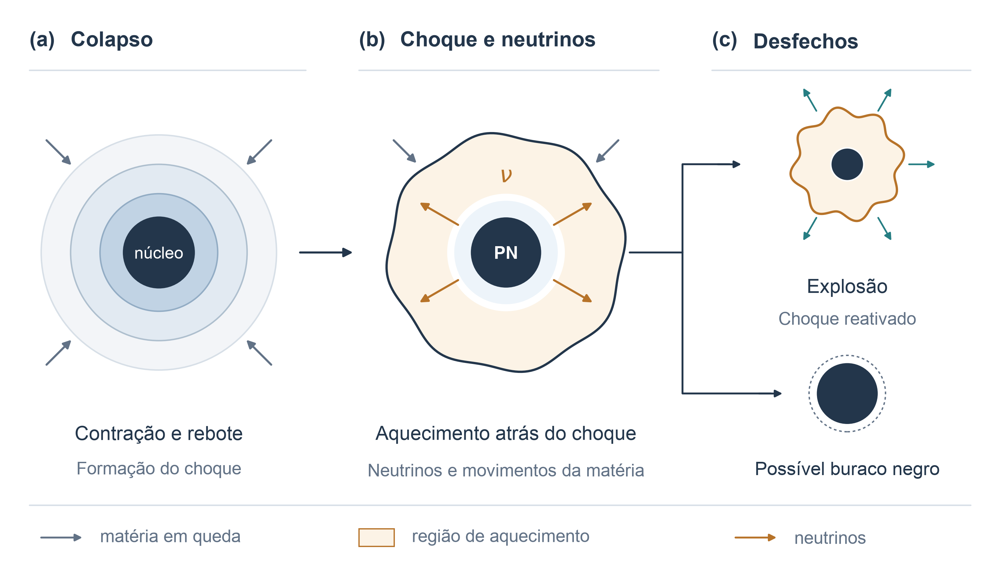
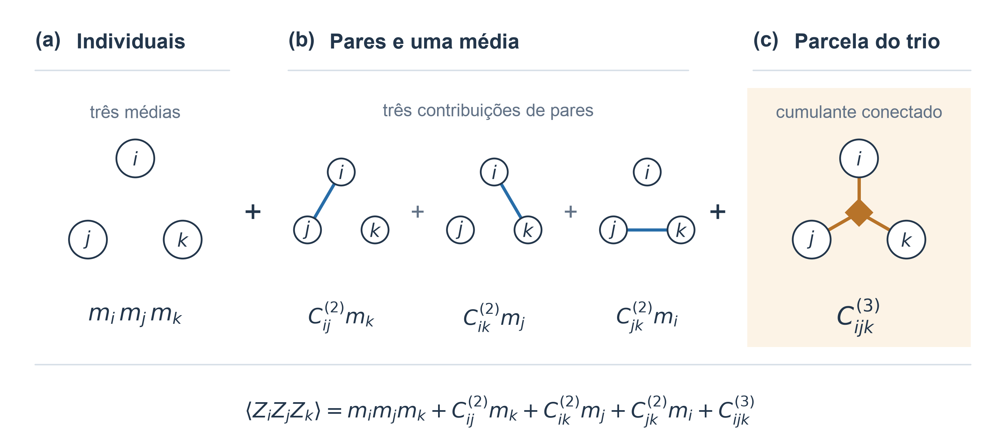
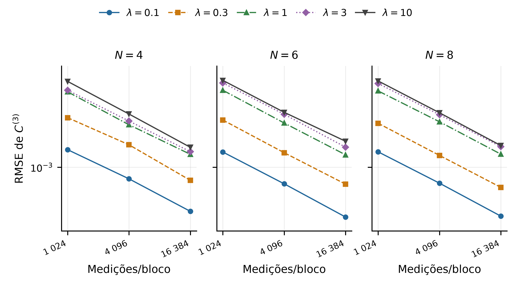
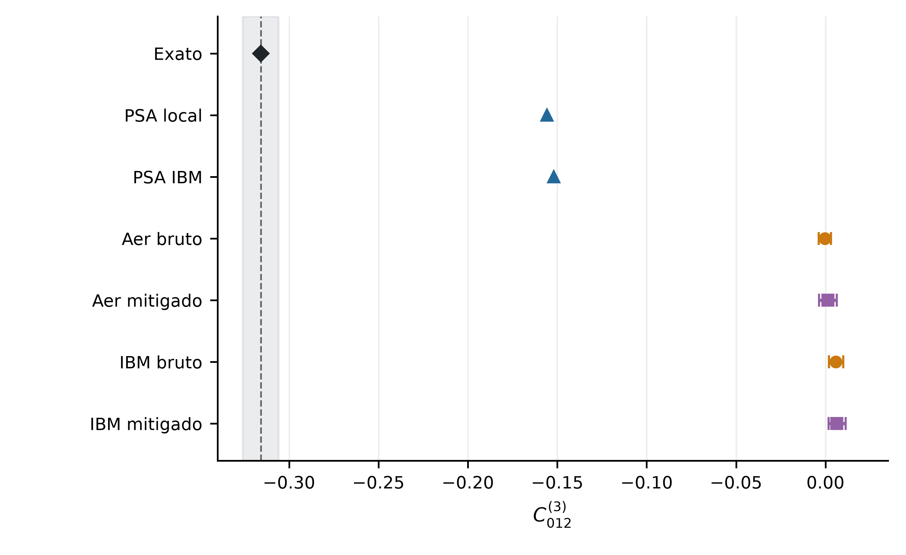

# Além do campo médio: a aproximação de espaço de fase captura as correlações de três corpos entre neutrinos?

_Beyond mean field: does the phase-space approximation capture three-body neutrino correlations?_

**Giovanna Fátima de Britto Vieira¹, Marco Ruas Sales Peixoto¹, Leonardo Villas Boas Fischel¹**

¹Instituto de Tecnologia e Liderança – Inteli, São Paulo – SP – Brasil

Orientadores: Jose Erinaldo da Fonseca e Bryan Kano Ferreira

## Resumo

O sabor dos neutrinos em supernovas pode influenciar a explosão e a produção de elementos pesados. Contudo, simular esta evolução quântica em sistemas grandes exige aproximações frente ao número
alto de neutrinos no sistema. Este trabalho avaliou a aproximação de espaço de fase nos cumulantes de dois e três corpos de um modelo de dois sabores, com referências exata e de campo médio, e circuitos trotterizados ideais e ruidosos. Os intervalos indicaram maior erro normalizado dos trios em 14 de 15 configurações principais. Mais medições reduziram o erro dos circuitos ideais. No caso ruidoso principal, a mitigação de leitura não recuperou o cumulante exato no simulador nem na IBM. Conclusões confirmatórias exigem revisão estatística e avaliação de limiares de ruído.

**Palavras-chave:** Neutrinos. Oscilações coletivas. Correlações de três corpos. Computação quântica. Aproximação de espaço de fase.

## Abstract

The flavor of neutrinos in supernovae can influence the explosion and heavy-element production. Simulating this quantum evolution in large systems requires approximations, given the large numbers of neutrinos in the system. This work assessed the phase-space approximation for two- and three-body cumulants in a two-flavor model, with exact and mean-field references, and ideal and noisy Trotterized circuits. The intervals indicated larger normalized triple errors in 14 of 15 main configurations. More measurements reduced ideal-circuit error. In the primary noisy case, readout mitigation recovered the exact cumulant neither in simulation nor on IBM hardware. Confirmatory conclusions require statistical review and noise-threshold evaluation.

**Keywords:** Neutrinos. Collective oscillations. Three-body correlations. Quantum computing. Phase-space approximation.

## Introdução

### Contexto astrofísico e motivação

Estrelas com massa inicial acima de aproximadamente oito massas solares podem sofrer colapso gravitacional do núcleo. No cenário típico, um núcleo rico em ferro perde sustentação, contrai-se e sofre um rebote, originando um choque. Esse choque pode estagnar por perdas com dissociação nuclear e emissão de neutrinos. A absorção de neutrinos e os movimentos da matéria podem reativá-lo durante a acreção, isto é, a queda de matéria sobre o remanescente (Figura 1) [Janka 2012, Abi et al. 2020].

_Figura 1 - Colapso estelar, sem escala física. (a) Contração e rebote do núcleo. (b) Choque estagnado e aquecimento por neutrinos ao redor da protoestrela de nêutrons (PN). (c) Explosão ou formação de um buraco negro, inclusive após uma explosão. Fonte: elaboração própria com base em Janka (2012)._

Neutrinos são partículas elementares eletricamente neutras que interagem fracamente com a matéria. Uma supernova típica emite cerca de $10^{58}$ neutrinos, com energias características de $10\,\mathrm{MeV}$, em aproximadamente dez segundos, transportando mais de 99% da energia gravitacional liberada pelo núcleo colapsado [Abi et al. 2020]. Seus estados de sabor são superposições dos estados de massa, cujas fases de propagação alteram as probabilidades de detecção, produzindo oscilações [Duan et al. 2010].

A evolução de sabor pode alterar o aquecimento atrás do choque e a composição de nêutrons e prótons, relevante para a nucleossíntese. Seus efeitos dependem da configuração estelar, como mostram os estudos de Nagakura (2023) e Akaho et al. (2026); a relação entre matéria rica em nêutrons e formação de elementos pesados é discutida por Cowan et al. (2021). Os eventos da SN 1987A e as perspectivas de detecção em DUNE, Hyper-Kamiokande e JUNO reforçam a importância de prever os sabores emitidos [Vissani et al. 2010, Baum et al. 2022, Sarmah et al. 2026]. Perto do núcleo, a interação coerente entre neutrinos acopla sua evolução, gerando oscilações coletivas e o problema de muitos corpos discutido a seguir [Duan et al. 2010].

### Problema, lacuna e objetivo

A dinâmica coletiva constitui um problema quântico de muitos corpos, cujo custo exato cresce exponencialmente com o número de neutrinos. A aproximação de campo médio reduz esse custo ao desprezar as correlações conectadas entre partículas, mas seus desvios em relação à evolução exata acompanham o desenvolvimento de emaranhamento e dependem das condições iniciais [Cervia et al. 2019]. A aproximação de espaço de fase, denominada _phase-space approximation_ (PSA), incorpora efeitos além do campo médio por meio de um conjunto de trajetórias com condições iniciais aleatórias [Lacroix et al. 2022]. Suas validações em neutrinos, inclusive feita também em sistemas de quatro a doze neutrinos com metade em cada sabor, examinaram médias de sabor, correlações coletivas de pares e entropias reduzidas [Lacroix et al. 2024, Mangin-Brinet et al. 2026]. Em registradores de qubits, a PSA perdeu precisão em observáveis de vários qubits e em acoplamento forte [de Correc et al. 2026]. Em neutrinos, cumulantes de três corpos já foram medidos em hardware, sem comparação com a PSA [Illa e Savage 2023]. Na literatura examinada, não foi identificada uma comparação dos cumulantes conectados de três corpos da PSA com a evolução exata em neutrinos, feita par a par e trio a trio, que controle simultaneamente o tamanho do sistema, a intensidade da interação e as incertezas de amostragem, discretização e medição.

A precisão dos cumulantes de terceira ordem é relevante porque, em um Hamiltoniano com interações entre pares, a hierarquia de evolução acopla observáveis de uma partícula a correlações de dois corpos, cujas equações dependem de momentos de terceira ordem. Assim, desvios na descrição dos trios podem afetar observáveis de ordens inferiores ao longo da evolução [Lacroix et al. 2024, Riccio e Balantekin 2026]. As limitações de longo tempo relatadas para a PSA motivam examinar essa relação, sem atribuir previamente todos os desvios de sabor a uma única componente dos cumulantes [Lacroix et al. 2022].

Para quatro a oito neutrinos, o cálculo exato é acessível em computadores clássicos. A etapa quântica busca determinar com que precisão os circuitos distinguem desvios da PSA. Em sistemas maiores, sem solução exata acessível, esses circuitos poderiam servir de referência para validar aproximações. Os sistemas pequenos permitem avaliar essa possibilidade separando discretização, amostragem e ruído, sem pressupor vantagem computacional ou extrapolar os resultados para sistemas maiores.

Diante disso, este trabalho busca responder em quais regimes de intensidade de interação, tamanho do sistema e tempo de evolução a PSA reproduz as correlações conectadas de dois e três corpos e, quando há desvios, sob quais condições de ruído e número de medições circuitos quânticos conseguem distingui-los dos resultados exatos.

Para isso, foram-se avaliados cumulantes conectados de dois e três corpos da PSA frente ao cálculo exato, com o campo médio como referência adicional, buscando delimitar os regimes de validade da aproximação. A linguagem Python foi utilizada para sistemas de quatro a dezesseis neutrinos e Qiskit para circuitos de quatro a oito, em um modelo de dois sabores com estados iniciais de sabor puro fatorizados. A razão $\mu/\bar{\omega}$ variou de 0,1 a 10, em que $\mu$ é a escala efetiva da interação neutrino-neutrino e $\bar{\omega}$, a frequência média de oscilação no vácuo. O contexto de supernovas motiva o modelo. Finalmente, as conclusões restringem-se às configurações simplificadas examinadas.

O aumento da interação amplia os coeficientes dos termos que acoplam as ordens da hierarquia, motivando a expectativa de maior sensibilidade dos trios aos efeitos além das trajetórias de campo médio. Essa é uma conjectura dependente do estado inicial e da janela temporal, não uma consequência de a PSA anular cumulantes superiores. A hipótese **H1** é que a PSA reproduz com maior precisão as probabilidades individuais de sabor e os cumulantes de dois corpos do que os de três corpos. Nos casos em que a referência permite normalização, o erro normalizado nos trios tende a crescer com a intensidade da interação. A hipótese **H2** prevê que a mitigação amplia o limiar de ruído que permite distinguir a PSA da solução exata sob o mesmo orçamento total de medições. Os critérios usados para avaliá-las estão descritos na Seção 6.

A Seção 2 apresenta os fundamentos físicos e computacionais do estudo, incluindo, o Hamiltoniano coletivo, os cumulantes conectados, o campo médio, a PSA, a trotterização e o tratamento de medições e ruído. A Seção 3 revisa os trabalhos relacionados e posiciona a contribuição. As Seções 4 a 6 descrevem a metodologia, os experimentos e parâmetros e as métricas de avaliação, e a Seção 7 apresenta os resultados experimentais.

## Fundamentação teórica

### Oscilações de sabor e o Hamiltoniano coletivo

Em dois sabores, os estados $|\nu_e\rangle$ e $|\nu_x\rangle$, em que $\nu_x$ representa uma combinação efetiva de $\nu_\mu$ e $\nu_\tau$, relacionam-se aos estados de massa por um ângulo de mistura $\theta$ [Duan et al. 2010]. Um neutrino isolado constitui um sistema de dois níveis e pode ser descrito como um spin-1/2 em um campo efetivo. Com $\hbar=c=1$, na base de sabor,

$$
H_i=\frac{\omega_i}{2}\,\mathbf{B}\cdot\boldsymbol{\sigma}_i,\qquad
\omega_i=\frac{\Delta m^2}{2E_i},\qquad
\mathbf{B}=(\sin2\theta,0,-\cos2\theta),
\tag{1}
$$

em que $\boldsymbol{\sigma}_i=(X_i,Y_i,Z_i)$ reúne as matrizes de Pauli do neutrino $i$, $\Delta m^2$ é a diferença entre os quadrados das massas e $E_i$ é a energia. O estado reduzido escreve-se como $\rho_i=\tfrac12(\mathbb{1}+\mathbf{P}_i\cdot\boldsymbol{\sigma})$, com vetor de polarização $\mathbf{P}_i=\langle\boldsymbol{\sigma}_i\rangle$. No vácuo, $\mathbf{P}_i$ precessa em torno de $\mathbf{B}$ com frequência $\omega_i$, e a probabilidade de sabor eletrônico é $P_{e,i}=(1+m_i)/2$, com $m_i=\langle Z_i\rangle$ [Duan et al. 2010, Cervia et al. 2019]. A identificação $|\nu_e\rangle=|0\rangle$ e $|\nu_x\rangle=|1\rangle$ associa cada neutrino a um qubit, e a medição de $Z_i$ na base computacional distingue os dois sabores.

Em ambientes densos, o espalhamento frontal coerente entre neutrinos, mediado pela corrente neutra, gera um potencial com termos fora da diagonal de sabor, que trocam o sabor de dois neutrinos [Duan et al. 2010]. Em segunda quantização, essa interação assume a forma de um produto escalar entre os _spins_ de sabor de partículas distintas [Balantekin e Pehlivan 2007]. Para $N$ neutrinos com momentos discretizados,

$$
H=\frac{1}{2}\sum_{i=0}^{N-1}\omega_i\,\mathbf{B}\cdot\boldsymbol{\sigma}_i
+\frac{\mu}{4N}\sum_{i<j}g_{ij}\,\boldsymbol{\sigma}_i\cdot\boldsymbol{\sigma}_j,
\tag{2}
$$

em que $\mu$ é uma escala efetiva da interação, proporcional a $\sqrt{2}G_Fn_\nu$, com $G_F$ a constante de Fermi e $n_\nu$ a densidade de neutrinos, e $g_{ij}$ incorpora a dependência angular $1-\cos\vartheta_{ij}$ entre as direções de propagação. O fator $1/N$ mantém finita a energia de interação por neutrino. O termo $\boldsymbol{\sigma}_i\cdot\boldsymbol{\sigma}_j=Z_iZ_j+2(\sigma_i^+\sigma_j^-+\sigma_i^-\sigma_j^+)$ combina uma contribuição diagonal e a troca de sabor $|01\rangle\leftrightarrow|10\rangle$. Com $g_{ij}$ uniforme, a Equação (2) corresponde à aproximação de ângulo único, um modelo integrável do tipo Gaudin, cujos invariantes restringem a dinâmica [Pehlivan et al. 2011, Cervia et al. 2019].

O espaço de estados de $N$ neutrinos tem dimensão $2^N$, o que limita a evolução exata de sistemas grandes quando não se exploram simetrias [Cervia et al. 2019]. A dinâmica conserva a energia e a projeção total $\sum_i\mathbf{B}\cdot\boldsymbol{\sigma}_i$, mas não o sabor total $\sum_i Z_i$ quando $\theta\neq0$. A Equação (2) omite matéria, antineutrinos, colisões, transporte e contribuições além do espalhamento frontal. Portanto, este descreve um sistema fechado simplificado, seguindo a motivação do ambiente de _supernovae_.

### Correlações conectadas e emaranhamento

Um estado puro de $N$ neutrinos é separável quando se escreve como produto de estados individuais, e emaranhado no caso contrário. Se o estado global é puro, o emaranhamento de um neutrino com o restante do sistema pode ser quantificado pela entropia de von Neumann de $\rho_i$, que se anula apenas quando $|\mathbf{P}_i|=1$ [Cervia et al. 2019]. Partindo de um estado produto, o termo de interação da Equação (2) gera emaranhamento ao longo da evolução, enquanto o termo de vácuo, isoladamente, preserva a fatorização.

As correlações entre resultados de medição na base de sabor são descritas por cumulantes conectados, que isolam a parcela de um momento conjunto não explicada por momentos de ordem inferior [Riccio e Balantekin 2026]. Para partículas distintas,

$$
\begin{aligned}
C^{(2)}_{ij}(t)&=\langle Z_i Z_j\rangle_t-m_i(t)m_j(t),\\
C^{(3)}_{ijk}(t)&=\langle Z_i Z_j Z_k\rangle_t-m_i(t)m_j(t)m_k(t)\\
&\quad-C^{(2)}_{ij}(t)m_k(t)-C^{(2)}_{ik}(t)m_j(t)-C^{(2)}_{jk}(t)m_i(t).
\end{aligned}
\tag{3}
$$

A Figura 2 representa essa decomposição. Anular $C^{(3)}_{ijk}$ não equivale a anular $\langle Z_iZ_jZ_k\rangle$, pois permanecem as contribuições de médias e pares. Para um estado produto, todos os cumulantes de partículas distintas são nulos. Illa e Savage (2023) usaram a mesma definição para medir correlações de dois e três corpos em hardware.

_Figura 2 - Decomposição do momento $\langle Z_iZ_jZ_k\rangle$. (a) Produto das médias individuais $m_i m_j m_k$. (b) Três contribuições de cumulante de par vezes média da partícula restante. (c) Cumulante conectado $C^{(3)}_{ijk}$, destacado como a parcela que resta após subtrair os termos anteriores. Os círculos identificam as partículas distintas $i$, $j$ e $k$; uma ligação representa a contribuição de um par, e o losango com três conexões representa o cumulante do trio, sem indicar outra partícula. Essa notação estatística não representa interações adicionais no Hamiltoniano nem certifica emaranhamento. Todos os termos são avaliados no mesmo instante. Fonte: elaboração do corpo de pesquisa com base na expansão em cumulantes de Riccio e Balantekin (2026).\_

Como $Z_i$, $Z_iZ_j$ e $Z_iZ_jZ_k$ são diagonais na base computacional, esses cumulantes dependem apenas da distribuição dos resultados de medição e não certificam, isoladamente, emaranhamento. Um estado misto separável pode ter os mesmos cumulantes de um estado emaranhado. A mistura de $|000\rangle$ e $|111\rangle$ com pesos iguais tem os mesmos $C^{(2)}$ e $C^{(3)}$ do estado GHZ $(|000\rangle+|111\rangle)/\sqrt2$. Na evolução exata a partir de um estado produto, em que o estado global permanece puro, $C^{(2)}_{ij}\neq0$ implica-se que os neutrinos $i$ e $j$ estão emaranhados com o restante do sistema, sem identificar com quais partículas. Os cumulantes de terceira ordem interessam, sobretudo, por seu papel na dinâmica, discutido a seguir.

### Campo médio e hierarquia BBGKY

A aproximação de campo médio substitui, no termo de interação, o operador de cada parceiro por sua média, $\boldsymbol{\sigma}_i\cdot\boldsymbol{\sigma}_j\approx\boldsymbol{\sigma}_i\cdot\mathbf{P}_j+\mathbf{P}_i\cdot\boldsymbol{\sigma}_j-\mathbf{P}_i\cdot\mathbf{P}_j$ [Balantekin e Pehlivan 2007, Cervia et al. 2019]. Cada vetor de polarização passa a precessar em um campo que reúne o termo de vácuo e a média dos demais:

$$
\frac{d\mathbf{P}_i}{dt}=\Big[\omega_i\,\mathbf{B}+\frac{\mu}{2N}\sum_{j\neq i}g_{ij}\,\mathbf{P}_j\Big]\times\mathbf{P}_i .
\tag{4}
$$

O problema reduz-se a $3N$ equações acopladas. Um estado produto permanece produto, com $|\mathbf{P}_i|=1$, de modo que a aproximação não gera emaranhamento nem correlações conectadas. A interação é mantida pelo campo das médias; descartam-se apenas as correlações. Para um estado inicial fatorizado, a derivada de $\mathbf{P}_i$ coincide com a exata no instante inicial, e os desvios surgem à medida que as correlações crescem [Lacroix et al. 2022].

Na evolução exata, as equações de Ehrenfest não se fecham. Para a componente $b$ do vetor de polarização,

$$
\frac{dP_i^{b}}{dt}=\Big(\Big[\omega_i\mathbf{B}+\frac{\mu}{2N}\sum_{j\neq i}g_{ij}\mathbf{P}_j\Big]\times\mathbf{P}_i\Big)^{b}
+\frac{\mu}{2N}\sum_{j\neq i}g_{ij}\,\epsilon_{bac}\,C^{ac}_{ji},
\qquad C^{ac}_{ji}=\langle\sigma_j^a\sigma_i^c\rangle-P_j^aP_i^c,
\tag{5}
$$

em que $\epsilon_{bac}$ é o símbolo de Levi-Civita e há soma sobre os índices repetidos $a$ e $c$. O campo médio corresponde a anular os cumulantes de dois corpos $C^{ac}_{ji}$. Por sua vez, as equações desses cumulantes dependem de cumulantes de três corpos, e assim sucessivamente, formando uma hierarquia do tipo Bogoliubov–Born–Green–Kirkwood–Yvon (BBGKY) [Volpe et al. 2013, Lacroix e Ayik 2014]. Um fechamento de ordem $m$ anula os cumulantes de ordem $m+1$: o campo médio corresponde a $m=1$, e o fechamento de segunda ordem de Riccio e Balantekin (2026) anula todas as componentes dos cumulantes de três corpos, preservando nos produtos de três operadores as contribuições de médias e pares. A pesquisa mede apenas a componente $zzz$ desses cumulantes, acessível através das medições de sabor. Na Equação (5), cada par contribui com coeficiente $\mu/(2N)$, somado sobre os $N-1$ parceiros, de forma que, o peso dos termos de correlação cresce, e, portanto, com a interação, se motiva a hipótese H1 sem demonstrá-la.

### Aproximação de espaço de fase

A PSA transforma a evolução quântica em um problema estatístico [Lacroix et al. 2022, Lacroix et al. 2024]. Sorteiam-se condições iniciais clássicas $\mathbf{s}_i^{(\ell)}(0)$ cujas médias e flutuações reproduzem as do estado quântico inicial. Cada trajetória $\ell$ evolui independentemente segundo a Equação (4), com $\mathbf{P}_i$ substituído por $\mathbf{s}_i^{(\ell)}$, e os observáveis são estimados por médias sobre o conjunto:

$$
\langle Z_iZ_j\cdots\rangle_t\approx\frac{1}{N_{\mathrm{traj}}}\sum_{\ell=1}^{N_{\mathrm{traj}}}s^{z,(\ell)}_i(t)\,s^{z,(\ell)}_j(t)\cdots .
\tag{6}
$$

A aleatoriedade restringe-se ao instante inicial. A ideia provém do campo médio estocástico da física nuclear [Lacroix e Ayik 2014] e compartilha a estrutura da aproximação de Wigner truncada (TWA), que é exata na ordem dominante das flutuações quânticas [Polkovnikov 2010]. O custo por trajetória é polinomial em $N$, em contraste com as $2^N$ amplitudes da evolução exata, e o erro estatístico das médias decresce com $1/\sqrt{N_{\mathrm{traj}}}$.

Para estados produto com um neutrino por feixe, Lacroix et al. (2024) propuseram uma amostragem bivaluada. Nesta amostragem, a componente de $\mathbf{s}_i$ ao longo do sabor inicial é fixada, e as duas componentes transversais assumem, independentemente, os valores $\pm1$ com igual probabilidade,

$$
\mathbf{s}_i^{(\ell)}(0)=\mathbf{n}_i+x_i^{(\ell)}\mathbf{u}_i+y_i^{(\ell)}\mathbf{v}_i,\qquad x_i^{(\ell)},\,y_i^{(\ell)}\in\{-1,+1\},
\tag{7}
$$

em que $\mathbf{n}_i=\pm\hat{z}$ indica o sabor inicial e $\mathbf{u}_i$, $\mathbf{v}_i$ completam uma base ortonormal. Essa escolha reproduz $\overline{\mathbf{s}_i}=\mathbf{n}_i$ e $\overline{s_i^a s_i^b}=\delta_{ab}$, como os momentos quânticos de $\boldsymbol{\sigma}_i$, e inicia o conjunto sem cumulantes entre partículas distintas. A mesma prescrição aparece na versão discreta da TWA (DTWA) para spins-1/2 [Schachenmayer et al. 2015]. A coincidência para estados produto é uma observação deste trabalho, não uma equivalência estabelecida pelos autores da PSA.

Embora cada trajetória permaneça um produto de vetores clássicos, o conjunto desenvolve correlações entre partículas, porque trajetórias com condições iniciais distintas se separam ao longo da evolução. Segundo Lacroix et al. (2024), a PSA equivale a uma hierarquia BBGKY não truncada, que difere da exata apenas no nível de dois corpos. Diferentemente do fechamento de segunda ordem, a PSA não impõe $C^{(3)}=0$, e os trios constituem o primeiro nível em que as duas abordagens diferem por construção. Os cumulantes da PSA são correlações clássicas do conjunto de trajetórias; sua concordância com os cumulantes exatos é o que este trabalho examina.

### Simulação quântica digital e trotterização

Na simulação quântica digital, o operador de evolução $U(t)=e^{-iHt}$ é aproximado por uma sequência de portas de um e dois qubits [Lloyd 1996, Nielsen e Chuang 2010]. Com o mapeamento em qubits apresentado no início desta seção, a Equação (2) separa-se em termos de um corpo, $H_{\mathrm{v}}=\sum_i\tfrac{\omega_i}{2}\mathbf{B}\cdot\boldsymbol{\sigma}_i$, e termos de pares, $H_{ij}=\tfrac{\mu g_{ij}}{4N}\boldsymbol{\sigma}_i\cdot\boldsymbol{\sigma}_j$. Cada fator de $e^{-iH_{\mathrm{v}}\delta}$ é uma rotação de um qubit em torno de $\mathbf{B}$. Como $X_iX_j$, $Y_iY_j$ e $Z_iZ_j$ comutam entre si, $e^{-iH_{ij}\delta}$ é uma única porta de dois qubits, equivalente a uma troca parcial de sabor, pois $\boldsymbol{\sigma}_i\cdot\boldsymbol{\sigma}_j=2\,\mathrm{SWAP}_{ij}-\mathbb{1}$; portas genéricas de dois qubits exigem no máximo três CNOTs [Vatan e Williams 2004]. Como todos os pares interagem, o número de portas de dois qubits por passo cresce com $N^2$; em processadores com conectividade limitada, somam-se operações SWAP de roteamento ou redes de troca [Hall et al. 2021, Amitrano et al. 2023].

Como os termos não comutam entre si, a exponencial da soma é aproximada por produtos de exponenciais em $r$ passos de duração $\delta=t/r$. Para $H=\sum_{\gamma=1}^{\Gamma}H_\gamma$, a fórmula simétrica de Suzuki de segunda ordem é

$$
S_2(\delta)=e^{-iH_1\delta/2}\cdots e^{-iH_\Gamma\delta/2}\,e^{-iH_\Gamma\delta/2}\cdots e^{-iH_1\delta/2},
\qquad U(t)\approx S_2(t/r)^r,
\tag{8}
$$

com erro $O(\delta^3)$ por passo e $O(t^3/r^2)$ no intervalo total, limitado por comutadores aninhados dos termos [Childs et al. 2021]. Os termos de pares que compartilham uma partícula têm comutadores que envolvem operadores de três corpos, o que torna o controle do erro de discretização relevante para os cumulantes de trios. Aumentar $r$ reduz esse erro, mas aprofunda o circuito e amplia a exposição ao ruído.

### Medição, ruído e mitigação de leitura

A medição projetiva na base computacional produz cadeias de bits $\mathbf{b}$ com probabilidade $p(\mathbf{b})=|\langle\mathbf{b}|\psi\rangle|^2$ [Nielsen e Chuang 2010]. Para um conjunto de qubits $S$, o valor esperado de $Z_S=\prod_{i\in S}Z_i$ é estimado pela paridade dos bits medidos em $m$ repetições,

$$
\widehat{\langle Z_S\rangle}=\frac{1}{m}\sum_{s=1}^{m}(-1)^{\sum_{i\in S}b_i^{(s)}},\qquad
\mathrm{Var}\big[\widehat{\langle Z_S\rangle}\big]=\frac{1-\langle Z_S\rangle^2}{m},
\tag{9}
$$

de modo que as mesmas contagens fornecem $m_i$, $\langle Z_iZ_j\rangle$ e $\langle Z_iZ_jZ_k\rangle$, e o erro estatístico decresce com $1/\sqrt{m}$. Como os cumulantes da Equação (3) combinam momentos estimados a partir das mesmas amostras, suas incertezas dependem das covariâncias entre esses momentos [Hall et al. 2021, Cai et al. 2023].

Os processadores atuais operam sem correção de erros, na chamada era NISQ, em que o ruído limita a profundidade útil dos circuitos [Preskill 2018]. Um modelo usual de erro de porta é o canal despolarizante, $\mathcal{E}(\rho)=(1-p)\rho+p\,\mathbb{1}/2^n$ para $n$ qubits, que multiplica por $1-p$ o valor esperado de qualquer operador de Pauli não trivial [Nielsen e Chuang 2010]. Na leitura, cada bit pode ser invertido; com probabilidade simétrica $p_r$, independente entre qubits, resulta $\langle Z_S\rangle_{\mathrm{med}}=(1-2p_r)^{|S|}\langle Z_S\rangle$, e o mesmo fator $(1-2p_r)^3$ atenua $C^{(3)}$. Assim, correlações de ordem maior sofrem atenuação mais forte, e os cumulantes de três corpos estão entre os observáveis mais sensíveis ao ruído.

A mitigação de erros procura reduzir o viés das estimativas por pós-processamento, sem correção de erros [Cai et al. 2023]. Na mitigação de leitura, a relação entre as distribuições ideal e medida é descrita por uma matriz de resposta, $\vec{p}_{\mathrm{med}}=A\,\vec{p}$. Supondo erros independentes entre qubits, $A$ fatoriza-se em matrizes de um qubit estimadas por circuitos de calibração, e a correção aplica sua inversa às frequências medidas [Bravyi et al. 2021]:

$$
A_j=\begin{pmatrix}1-\epsilon_j&\eta_j\\ \epsilon_j&1-\eta_j\end{pmatrix},\qquad
\hat{\vec{p}}=\big(A_{N-1}^{-1}\otimes\cdots\otimes A_0^{-1}\big)\,\vec{p}_{\mathrm{med}},
\tag{10}
$$

em que $\epsilon_j$ e $\eta_j$ são as probabilidades de ler 1 após preparar 0 e de ler 0 após preparar 1 no qubit $j$. O resultado pode conter quasiprobabilidades negativas, que ainda fornecem estimativas não enviesadas de valores esperados. Em contrapartida, a inversão amplia a variância, tanto mais quanto pior o condicionamento de $A$, e a calibração consome parte do orçamento de medições [Bravyi et al. 2021, Cai et al. 2023]. A mitigação de leitura não corrige erros de porta; técnicas como a extrapolação a ruído zero e o cancelamento probabilístico de erros tratam esses erros a um custo de amostragem que cresce exponencialmente com o ruído acumulado [Cai et al. 2023].

## Revisão bibliográfica

### O problema de muitos corpos e os limites do campo médio

A descrição de muitos corpos das oscilações coletivas parte do Hamiltoniano de espalhamento frontal escrito com operadores de spin de sabor, cuja versão de ângulo único é integrável [Balantekin e Pehlivan 2007, Pehlivan et al. 2011]. Com soluções exatas de até nove neutrinos, Cervia et al. (2019) relacionaram as diferenças entre campo médio e evolução exata ao desenvolvimento de emaranhamento, com forte dependência das condições iniciais. Patwardhan et al. (2021) associaram o emaranhamento máximo aos neutrinos próximos das divisões espectrais. Rrapaj (2020) comparou soluções exatas multiangulares ao campo médio, incluindo correlações conectadas de pares, e indicou que o desacordo esperado é máximo quando a polarização de sabor líquida é nula, situação do estado com metade dos neutrinos em cada sabor adotado nesta pesquisa.

Há, porém, limites para extrapolar esses resultados. Martin et al. (2022) mostraram, em um modelo de dois feixes, que o campo médio recupera observáveis de um corpo no limite de muitos neutrinos com razões fixas, embora ainda divirja da solução exata com 128 neutrinos. Shalgar e Tamborra (2023) argumentaram que sistemas fechados com poucos neutrinos não bastam para validar ou invalidar o campo médio em fontes astrofísicas abertas. Esses trabalhos justificam o foco em correlações, que o campo médio despreza por construção, e a restrição das conclusões a sistemas fechados pequenos.

### Métodos além do campo médio

Redes tensoriais estenderam a evolução de muitos corpos a sistemas maiores [Roggero 2021, Cervia et al. 2022], mas são pouco adequadas à interação entre todos os pares e perderam precisão em sistemas grandes nas comparações relatadas [Mangin-Brinet et al. 2026, Kiss et al. 2026]. A PSA oferece uma alternativa de custo polinomial. Lacroix et al. (2022) aplicaram-na a um modelo de dois feixes: o método reproduziu médias, flutuações e entropias de um e dois neutrinos, mas não as oscilações de longo tempo das flutuações. A extensão para múltiplos feixes usou um arranjo semelhante ao deste trabalho, com quatro, oito e doze neutrinos, metade em cada sabor e interação entre todos os pares [Lacroix et al. 2024]. Nesse estudo, as médias individuais de sabor foram sobreamortecidas em tempos longos, enquanto a correlação coletiva $C_{ZZ}$, que soma as covariâncias de todos os pares, e a entropia média de um neutrino foram bem reproduzidas. Não se avaliaram covariâncias par a par, cumulantes de três corpos nem a dependência com a intensidade da interação. A versão de três sabores foi comparada com soluções exatas de até oito neutrinos, reproduzindo populações de sabor e entropias [Mangin-Brinet et al. 2026].

Fora de neutrinos, de Correc et al. (2026) aplicaram a PSA a registradores de qubits em modelos de Ising, inclusive com interação entre todos os pares, e observaram perda de precisão em correlações de dois qubits e em entropias de subsistemas maiores, sobretudo em acoplamento forte. Esse resultado antecipa qualitativamente a hipótese H1, mas não envolve cumulantes conectados de três corpos nem o Hamiltoniano de neutrinos.

Na linha da hierarquia BBGKY, Volpe et al. (2013) derivaram equações estendidas para neutrinos desprezando termos de três corpos, e Riccio e Balantekin (2026) desenvolveram um fechamento sistemático de segunda ordem, que anula os cumulantes de três corpos e trata cerca de cem neutrinos com custo polinomial; nesse preprint, a comparação com a evolução exata restringiu-se a quatro neutrinos em três sabores. Como a PSA equivale, segundo seus autores, a uma hierarquia não truncada, os cumulantes de três corpos são o ponto em que as duas abordagens diferem por construção. Roggero et al. (2022) empregaram uma aproximação semiclássica gaussiana para oscilações rápidas e sugeriram a TWA como extensão, sem aplicá-la.

### Simulação quântica de oscilações coletivas

Hall et al. (2021) simularam quatro neutrinos em um processador IBM com redes de SWAP e usaram mitigação de leitura e extrapolação a ruído zero para extrair medidas de emaranhamento. Esta mitigação rendeu menos no processador real do que no simulador ruidoso. Amitrano et al. (2023) analisaram o custo de fórmulas de Trotter de segunda ordem para a interação entre todos os pares e mostraram que a conectividade total de íons aprisionados reduz a profundidade dos circuitos, com execuções de até oito neutrinos.

Illa e Savage (2023) mediram correlações conectadas de dois e três corpos em sistemas de até doze neutrinos, com a mesma definição de cumulantes da Equação (3) e o mesmo estado inicial com metade em cada sabor. Com 240 medições no processador de íons aprisionados e 1.200 no emulador, a maioria dos cumulantes de três corpos ficou compatível com zero, o que indica que o orçamento de medições limita a resolução desses observáveis. Kiss et al. (2026) usaram processadores IBM com até 112 qubits para estudar a termalização e compararam os resultados com a PSA, mas apenas em observáveis de um qubit. Balantekin et al. (2023) reúnem esses desenvolvimentos em uma revisão sobre informação e simulação quânticas em física de neutrinos.

### Síntese e posicionamento

_Tabela 1 - Trabalhos relacionados e observáveis comparados. CM: campo médio; "coletivo": soma das covariâncias de todos os pares; "anulado": cumulante igualado a zero pelo fechamento. Fonte: elaboração própria._

| Trabalho                    | Métodos                  |    Sabores     | $N$ máximo |  $P_e$   | $C^{(2)}$ | $C^{(3)}$ | Plataforma        |
| --------------------------- | ------------------------ | :------------: | ---------: | :------: | :-------: | :-------: | ----------------- |
| Cervia et al. (2019)        | Exato, CM                |       2        |          9 |   Sim    |     —     |     —     | Clássica          |
| Rrapaj (2020)               | Exato, CM                |       2        |         20 |   Sim    |   Pares   |     —     | Clássica          |
| Lacroix et al. (2022)       | Exato, CM, PSA           |       2        |        100 |   Sim    | Coletivo  |     —     | Clássica          |
| Lacroix et al. (2024)       | Exato, PSA               |       2        |         12 |   Sim    | Coletivo  |     —     | Clássica          |
| Mangin-Brinet et al. (2026) | Exato, CM, PSA           |       3        |          8 |   Sim    |     —     |     —     | Clássica          |
| de Correc et al. (2026)     | Exato, CM, PSA           | Qubits (Ising) |         10 |   Sim    |   Média   |     —     | Clássica          |
| Riccio e Balantekin (2026)  | BBGKY, CM, exato         |     2 e 3      |  4 (exato) |   Sim    |    Sim    |  Anulado  | Clássica          |
| Hall et al. (2021)          | Circuito                 |       2        |          4 |   Sim    |     —     |     —     | IBM               |
| Amitrano et al. (2023)      | Circuito                 |       2        |          8 |   Sim    |     —     |     —     | Íons aprisionados |
| Illa e Savage (2023)        | Exato, circuito          |       2        |         12 |   Sim    |    Sim    |    Sim    | Íons aprisionados |
| Kiss et al. (2026)          | Circuito, PSA            |       2        |        112 | Um qubit |     —     |     —     | IBM               |
| Este trabalho               | Exato, CM, PSA, circuito |       2        |         16 |   Sim    |   Pares   |   Trios   | Aer, IBM          |

A Tabela 1 mostra que os cumulantes de três corpos aparecem apenas em medições em hardware sem comparação com aproximações [Illa e Savage 2023] ou anulados por construção em um fechamento da hierarquia [Riccio e Balantekin 2026]. As validações da PSA em neutrinos usaram médias, correlações coletivas e entropias. Comparações entre PSA e evolução exata em função de $N$ e medições de cumulantes de três corpos em hardware já existem separadamente. Na literatura localizada, porém, não foi identificado trabalho que compare os cumulantes conectados de três corpos da PSA com a evolução exata. A contribuição deste trabalho é essa comparação, por par e por trio, controlando simultaneamente o tamanho do sistema, a razão $\mu/\bar{\omega}$ e as incertezas de amostragem, discretização e medição, e avaliando se circuitos quânticos com ruído e mitigação de leitura distinguem os desvios da PSA.

## Metodologia

Comparam-se campo médio, PSA e circuitos com a evolução exata. O [protocolo](PROTOCOLO_EXPERIMENTOS.md) reúne configurações, sementes e controles.

Cada neutrino corresponde a um qubit, com $|\nu_e\rangle=|0\rangle$ e $|\nu_x\rangle=|1\rangle$. Na forma adimensional da Equação (2), com $\hbar=1$, $\tau=\bar{\omega}t$, $\lambda=\mu/\bar{\omega}$ e $\widetilde{\omega}_i=\omega_i/\bar{\omega}$,

$$
\frac{H}{\bar{\omega}}=\frac{1}{2}\sum_{i=0}^{N-1}\widetilde{\omega}_i\,\mathbf{B}\cdot\boldsymbol{\sigma}_i
+\frac{\lambda}{4N}\sum_{i<j}g_{ij}\,\boldsymbol{\sigma}_i\cdot\boldsymbol{\sigma}_j.
$$

em que $\mathbf{B}=(\sin2\theta,0,-\cos2\theta)$, $\boldsymbol{\sigma}_i$ reúne os operadores de Pauli e $g_{ij}$ define o acoplamento. Cada par aparece uma vez. O modelo exclui transporte, colisões e hidrodinâmica; a janela fixa em $\tau$ corresponde a $\mu t=\lambda\tau$.

A referência usa `expm_multiply` (SciPy), verificado por exponenciação densa em um sistema pequeno. Campo médio e PSA usam RK4. Na PSA, amostram-se componentes transversais independentes em $\pm1$, com a longitudinal fixada pelo sabor [Lacroix et al. 2024].

Os circuitos usam Trotter simétrico de segunda ordem. A comparação Qiskit–emulador verifica a implementação; a comparação com o exato isola a discretização da amostragem e do ruído.

Os observáveis são as probabilidades $P_{e,i}$ e os cumulantes $C^{(2)}_{ij}$ e $C^{(3)}_{ijk}$ da Equação (3), definidos na Fundamentação teórica; a análise restringe-se a $Z$, $ZZ$ e $ZZZ$.

Os controles cobrem reprodução publicada, ausência de interação, integração, amostragem e Trotter. Falhas exigem emendas documentadas, sem exclusão de resultados desfavoráveis.

## Experimentos e parâmetros

A grade reúne quinze configurações principais e dez na extensão (Tabela 2), com associação fixa entre frequência e sabor inicial.

_Tabela 2 - Parâmetros da grade clássica original._

| Parâmetro             | Definição                                                                               |
| --------------------- | --------------------------------------------------------------------------------------- |
| Tamanhos e interação  | $N=4,6,8$; extensão: $12,16$. $\lambda=0,1;0,3;1;3;10$.                                 |
| Frequências e mistura | $\widetilde{\omega}_i=0,7+0,6i/(N-1)$, $i=0,\ldots,N-1$; $\theta=0,2$ rad.              |
| Acoplamentos          | $g_{ij}=1$ para $i\ne j$; $g_{ii}=0$.                                                   |
| Estado inicial        | Primeira metade dos índices em $\nu_e$; segunda em $\nu_x$.                             |
| Tempo e integração    | $0\leq\tau\leq10$, 201 instantes; 12 subpassos RK4 por intervalo.                       |
| Observáveis           | Todos os indivíduos, pares e trios distintos.                                           |
| PSA e sementes        | 20 blocos independentes de 4.096 trajetórias (81.920 no total); sementes 10.001–10.020. |

A reprodução de Lacroix et al. (2024) usa a Figura 2(c) daquele estudo, em configuração distinta da Tabela 2, com oito neutrinos e 10.000 trajetórias. As coordenadas foram extraídas da figura; parâmetros e conversões estão na [documentação da referência](data/benchmarks/lacroix2024/README.md).

A convergência em $N=4,8$ e $\lambda=0,1;1;10$ varia trajetórias, subpassos RK4 e passos de Trotter. A Tabela 4 limita os desvios absolutos máximos, o refinamento de 8 para 12 subpassos e o maior erro-padrão entre sementes, sobre tempos e trios.

Os circuitos ideais usam $N=4,6,8$ e vinte blocos de 1.024, 4.096 ou 16.384 medições por instante. A etapa ruidosa restringe-se a $N=4$, ao trio $(0,1,2)$ e a $\tau=1,2,4$, mantendo as cinco interações e os três orçamentos. A discretização original totaliza 112 passos de Trotter.

_Tabela 3 - Perfis de ruído definidos para o simulador Aer._

| Perfil   | Despolarização: um qubit | Despolarização: dois qubits | Erro de leitura |
| -------- | -----------------------: | --------------------------: | --------------: |
| Ideal    |                        0 |                           0 |               0 |
| Leve     |                   0,0001 |                       0,001 |            0,01 |
| Moderado |                    0,001 |                        0,01 |            0,03 |

O Aer usa matriz densidade, base `rz`, `sx`, `x`, `cx` e otimização de nível 1. Os perfis sintéticos da Tabela 3 aplicam despolarização em `sx`, `x`, `cx` e inversões de leitura simétricas independentes.

A mitigação inverte o produto tensorial das matrizes de resposta calibradas com $|0000\rangle$ e $|1111\rangle$, preservando quasiprobabilidades negativas. Por bloco, usa $3m/4$ medições no sinal e $m/8$ em cada calibração; o método bruto usa $m$ no sinal. Ambos recebem $M=20m$. A correção não elimina erros de portas.

O caso principal usa $N=4$, $\lambda=3$, $\tau=2$, ruído moderado e $m=16.384$, com execução adicional no `ibm_kingston`.

A emenda v3 respondeu à identificação de um controle amostral omitido e à sua reprovação em três de seis configurações. Acrescentou vinte blocos de 4.096 trajetórias por configuração, aprovados sob o mesmo limite. A reanálise preservou a reprovação original.

Após a falha de Trotter, a v4 adotou 29 pontos e 448 passos em $N=4$, $\lambda=10$, $\tau=4$; em $\lambda=10$, $\tau=2$, elevou a PSA de 12 para 24 subpassos RK4. O caso principal não mudou. As profundidades distintas limitam comparações entre interações.

## Métricas de avaliação

Para $T$ instantes e $n_q$ conjuntos de partículas, sejam $O^{\mathrm{ex}}_{q,\alpha}$ a referência e $\widehat O_{q,\alpha}$ a estimativa de $P_e$, $C^{(2)}$ ou $C^{(3)}$. Definem-se

$$
\begin{aligned}
E_q&=\sqrt{\frac{1}{Tn_q}\sum_{\ell=1}^{T}\sum_{\alpha=1}^{n_q}
\left[\widehat{O}_{q,\alpha}(\tau_\ell)-O^{\mathrm{ex}}_{q,\alpha}(\tau_\ell)\right]^2},\\
S_q&=\sqrt{\frac{1}{Tn_q}\sum_{\ell=1}^{T}\sum_{\alpha=1}^{n_q}
\left[O^{\mathrm{ex}}_{q,\alpha}(\tau_\ell)\right]^2}.
\end{aligned}
$$

Usa-se $R_q=E_q/S_q$ para $S_q\geq10^{-4}$ e apenas erro absoluto abaixo desse piso. Para H1, $D=R_3-R_2$ recebe 2.000 réplicas bootstrap de blocos independentes. Agregam-se momentos antes dos cumulantes, preservando a dependência temporal; os percentis 2,5 e 97,5 definem o intervalo de 95%.

Os circuitos usam 2.000 réplicas multinomiais das contagens agregadas, reestimando a calibração e reamostrando independentemente os blocos PSA, sem correção de viés. Para $C^{(3)}$, sejam $I_{\mathrm{PSA}}$ o intervalo de circuito menos PSA e $[L,U]$ o de circuito menos exato. Exige-se

$$
0\notin I_{\mathrm{PSA}}
\quad\text{e}\quad
[L-r,U+r]\subseteq[-\delta,\delta],
\qquad \delta=0,01,
$$

em que $r$ soma o desvio ideal–exato a $10^{-5}$. Calibrações com número de condição não finito ou superior a 10 tornam o caso não resolvido.

Para H2, $p_{\max}(M)$ é o maior ruído avaliado que satisfaz o critério sob orçamento $M$. Comparar os limiares com e sem mitigação exige fixar família de ruído, varredura e margem relevante; a grade atual não estima essa diferença.

_Tabela 4 - Tolerâncias e verificações selecionadas. Máximos nas configurações de cada controle; traços indicam valores não reproduzidos nesta síntese._

| Controle                               |           Limite |            Observado |
| -------------------------------------- | ---------------: | -------------------: |
| Reprodução publicada: exato            | $2\times10^{-2}$ |  $1,41\times10^{-3}$ |
| Reprodução publicada: PSA              | $6\times10^{-2}$ |  $2,99\times10^{-2}$ |
| Exato independente                     |       $10^{-10}$ |                    — |
| Qiskit versus emulador                 |       $10^{-10}$ | $2,80\times10^{-12}$ |
| Refinamento RK4: $P_e$                 |        $10^{-6}$ |                    — |
| Refinamento RK4: cumulantes            |        $10^{-5}$ |                    — |
| Erro-padrão PSA suplementar: $C^{(3)}$ |        $10^{-2}$ |  $5,11\times10^{-3}$ |
| Trotter ideal: $C^{(3)}$               |        $10^{-3}$ |                    — |

## Resultados experimentais

### Validação e precisão da PSA

As onze fases locais, incluindo $N=12,16$, passaram nos controles após as emendas (Tabela 4). Os desvios da reprodução publicada incluem a incerteza de extração da figura.

O intervalo de 95% de $D$ foi positivo em 14 de 15 configurações principais (Figura 3). Em $N=4$, $\lambda=0,1$, o sinal ficou indefinido: $D=-0,132$, intervalo $[-0,209;0,048]$. Em $N=4$, $\lambda=3$, obtiveram-se $R_2=0,419$, $R_3=0,948$ e $D=0,529$, intervalo $[0,524;0,535]$.

_Figura 3 - $D=R_3-R_2$ para $0\leq\tau\leq10$: estimativas com vinte blocos PSA e intervalos percentis de 95% com 2.000 réplicas. O círculo aberto marca a estimativa fora do próprio intervalo. Fonte: elaboração própria a partir do pacote de resultados._

Os dez intervalos da extensão foram positivos. Contudo, cinco estimativas ficaram fora dos próprios intervalos: $N=8$, $\lambda=0,1$, e $N=12,16$, $\lambda=0,1$ e $0,3$. Elas e as inclinações agregadas de $N=8,12,16$ exigem revisão do viés bootstrap. Uma conclusão global de H1 requer critérios de agregação, relevância e multiplicidade.

O maior erro dos trios não cresce monotonicamente com a interação: em $N=8$, $D$ cai de $0,485$ para $0,363$ entre $\lambda=0,1$ e $1$, antes de aumentar.

### Orçamento de medições

Nos circuitos ideais, o RMSE de $C^{(3)}$ diminuiu com cada aumento de orçamento nas quinze configurações. De 1.024 para 16.384 medições por bloco, a redução de 3,75 a 4,19 vezes (Figura 4) aproxima-se do fator quatro esperado da dependência $1/\sqrt{m}$. Três orçamentos não estabelecem uma lei de escala nem avaliam erros de portas.

_Figura 4 - RMSE dos trios em relação ao exato, agregado sobre tempos e trios. Cada ponto usa vinte blocos de $m$ medições por instante; linhas conectam os orçamentos, sem intervalos de confiança. Fonte: elaboração própria a partir do pacote de resultados._

### Ruído, mitigação e hardware

No caso principal, o cumulante exato foi $-0,315784$; a PSA estimou $-0,155768$ nos blocos locais e $-0,151947$ nos associados à IBM, amostras distintas. Os circuitos ruidosos ficaram próximos de zero, com e sem mitigação (Tabela 5 e Figura 5).

_Tabela 5 - Caso principal: estimativas de $C^{(3)}$ e intervalos de 95% para circuito menos exato, ampliados pelo resíduo numérico. Cada método recebe $M=327.680$ medições; a calibração integra o orçamento mitigado._

| Ambiente | Método   |  Estimativa | IC95 da diferença     |
| -------- | -------- | ----------: | --------------------- |
| Aer      | Bruto    | $-0,000305$ | $[0,312040;0,318866]$ |
| Aer      | Mitigado |  $0,001301$ | $[0,312190;0,322029]$ |
| IBM      | Bruto    |  $0,005847$ | $[0,317702;0,325733]$ |
| IBM      | Mitigado |  $0,006376$ | $[0,317486;0,327007]$ |

_Figura 5 - Caso principal: faixa de $\pm0,01$ ao redor do exato; intervalos dos circuitos ampliados pelo resíduo e transladados para $C^{(3)}$. PSA sem intervalo individual; círculos e quadrados representam métodos brutos e mitigados. Fonte: elaboração própria a partir do pacote de resultados._

Os quatro intervalos de circuito menos PSA excluem zero, mas nenhum de circuito menos exato cabe em $[-0,01;0,01]$. A mitigação não recuperou o cumulante nessa margem. A decisão pontual é inconclusiva e não testa o limiar de ruído de H2.

A IBM completou vinte blocos, quatro qubits, oitenta trabalhos e 655.360 medições, incluindo calibrações, em 72,87 minutos. O relatório mantém o status científico provisório, embora todos os trabalhos tenham terminado; os tempos detalhados estão no pacote de resultados.

As conclusões restringem-se ao modelo, estado inicial e componentes estudados. O [repositório](https://github.com/leonardovbf/correlacoes-tres-neutrinos) reúne códigos, protocolos, workloads, referência e resultados auditáveis. O arquivo integral de trajetórias e contagens em `results/`, necessário à reanálise completa, não integra o pacote.

## Referências

Abi, B. et al. (2020). Deep Underground Neutrino Experiment (DUNE), Far Detector Technical Design Report, Volume II: DUNE Physics. Technical Report FERMILAB-PUB-20-025-ND, DUNE Collaboration. <https://arxiv.org/abs/2002.03005>.

Akaho, R., Nagakura, H., Iwakami, W., Furusawa, S., Harada, A., Okawa, H., Matsufuru, H., Sumiyoshi, K., and Yamada, S. (2026). Bifurcated Impact of Neutrino Fast Flavor Conversion on Core-Collapse Supernovae Informed by Multiangle Neutrino Radiation Hydrodynamics. _Physical Review Letters_, 136(19):191002. <https://doi.org/10.1103/fksy-1jtw>.

Amitrano, V., Roggero, A., Luchi, P., Turro, F., Vespucci, L., and Pederiva, F. (2023). Trapped-ion quantum simulation of collective neutrino oscillations. _Physical Review D_, 107(2):023007. <https://doi.org/10.1103/PhysRevD.107.023007>.

Balantekin, A. B. and Pehlivan, Y. (2007). Neutrino–neutrino interactions and flavour mixing in dense matter. _Journal of Physics G: Nuclear and Particle Physics_, 34(1):47--65. <https://doi.org/10.1088/0954-3899/34/1/004>.

Balantekin, A. B., Cervia, M. J., Patwardhan, A. V., Rrapaj, E., and Siwach, P. (2023). Quantum information and quantum simulation of neutrino physics. _The European Physical Journal A_, 59(8):186. <https://doi.org/10.1140/epja/s10050-023-01092-7>.

Baum, S., Capozzi, F., and Horiuchi, S. (2022). Rocks, water, and noble liquids: Unfolding the flavor contents of supernova neutrinos. _Physical Review D_, 106(12):123008. <https://doi.org/10.1103/PhysRevD.106.123008>.

Bravyi, S., Sheldon, S., Kandala, A., Mckay, D. C., and Gambetta, J. M. (2021). Mitigating measurement errors in multiqubit experiments. _Physical Review A_, 103(4):042605. <https://doi.org/10.1103/PhysRevA.103.042605>.

Cai, Z., Babbush, R., Benjamin, S. C., Endo, S., Huggins, W. J., Li, Y., McClean, J. R., and O'Brien, T. E. (2023). Quantum error mitigation. _Reviews of Modern Physics_, 95(4):045005. <https://doi.org/10.1103/RevModPhys.95.045005>.

Cervia, M. J., Siwach, P., Patwardhan, A. V., Balantekin, A. B., Coppersmith, S. N., and Johnson, C. W. (2022). Collective neutrino oscillations with tensor networks using a time-dependent variational principle. _Physical Review D_, 105(12):123025. <https://doi.org/10.1103/PhysRevD.105.123025>.

Cervia, M. J., Patwardhan, A. V., Balantekin, A. B., Coppersmith, S. N., and Johnson, C. W. (2019). Entanglement and collective flavor oscillations in a dense neutrino gas. _Physical Review D_, 100(8):083001. <https://doi.org/10.1103/PhysRevD.100.083001>.

Childs, A. M., Su, Y., Tran, M. C., Wiebe, N., and Zhu, S. (2021). Theory of Trotter Error with Commutator Scaling. _Physical Review X_, 11(1):011020. <https://doi.org/10.1103/PhysRevX.11.011020>.

Cowan, J. J., Sneden, C., Lawler, J. E., Aprahamian, A., Wiescher, M., Langanke, K., Martínez-Pinedo, G., and Thielemann, F.-K. (2021). Origin of the heaviest elements: The rapid neutron-capture process. _Reviews of Modern Physics_, 93(1):015002. <https://doi.org/10.1103/RevModPhys.93.015002>.

de Correc, C., Lacroix, D., and Bertrand, C. (2026). Emulation of large-scale qubit registers with a phase-space approach. _APS Open Science_, 1:000017. <https://doi.org/10.1103/swn6-s387>.

Duan, H., Fuller, G. M., and Qian, Y.-Z. (2010). Collective Neutrino Oscillations. _Annual Review of Nuclear and Particle Science_, 60(1):569--594. <https://doi.org/10.1146/annurev.nucl.012809.104524>.

Hall, B., Roggero, A., Baroni, A., and Carlson, J. (2021). Simulation of collective neutrino oscillations on a quantum computer. _Physical Review D_, 104(6):063009. <https://doi.org/10.1103/PhysRevD.104.063009>.

Illa, M. and Savage, M. J. (2023). Multi-Neutrino Entanglement and Correlations in Dense Neutrino Systems. _Physical Review Letters_, 130:221003. <https://doi.org/10.1103/PhysRevLett.130.221003>.

Janka, H.-T. (2012). Explosion Mechanisms of Core-Collapse Supernovae. _Annual Review of Nuclear and Particle Science_, 62:407--451. <https://doi.org/10.1146/annurev-nucl-102711-094901>.

Kiss, O., Tavernelli, I., Tacchino, F., Lacroix, D., and Roggero, A. (2026). Neutrino thermalization via randomization on a quantum processor. _Communications Physics_, 9(1):282. <https://doi.org/10.1038/s42005-026-02697-2>.

Lacroix, D. and Ayik, S. (2014). Stochastic quantum dynamics beyond mean field. _The European Physical Journal A_, 50(6):95. <https://doi.org/10.1140/epja/i2014-14095-8>.

Lacroix, D., Balantekin, A. B., Cervia, M. J., Patwardhan, A. V., and Siwach, P. (2022). Role of non-Gaussian quantum fluctuations in neutrino entanglement. _Physical Review D_, 106(12):123006. <https://doi.org/10.1103/PhysRevD.106.123006>.

Lacroix, D., Bauge, A., Yilmaz, B., Mangin-Brinet, M., Roggero, A., and Balantekin, A. B. (2024). Phase-space methods for neutrino oscillations: Extension to multibeams. _Physical Review D_, 110:103027. <https://doi.org/10.1103/PhysRevD.110.103027>.

Lloyd, S. (1996). Universal Quantum Simulators. _Science_, 273(5278):1073--1078. <https://doi.org/10.1126/science.273.5278.1073>.

Mangin-Brinet, M., Bauge, A., and Lacroix, D. (2026). Three-flavor neutrino oscillations using the phase space approach. _Physical Review D_, 113:036026. <https://doi.org/10.1103/yr2g-1g2g>.

Martin, J. D., Roggero, A., Duan, H., Carlson, J., and Cirigliano, V. (2022). Classical and quantum evolution in a simple coherent neutrino problem. _Physical Review D_, 105(8):083020. <https://doi.org/10.1103/PhysRevD.105.083020>.

Nagakura, H. (2023). Roles of Fast Neutrino-Flavor Conversion on the Neutrino-Heating Mechanism of Core-Collapse Supernova. _Physical Review Letters_, 130(21):211401. <https://doi.org/10.1103/PhysRevLett.130.211401>.

Nielsen, M. A. and Chuang, I. L. (2010). _Quantum Computation and Quantum Information: 10th Anniversary Edition_. Cambridge University Press, Cambridge. <https://doi.org/10.1017/CBO9780511976667>.

Patwardhan, A. V., Cervia, M. J., and Balantekin, A. B. (2021). Spectral splits and entanglement entropy in collective neutrino oscillations. _Physical Review D_, 104(12):123035. <https://doi.org/10.1103/PhysRevD.104.123035>.

Pehlivan, Y., Balantekin, A. B., Kajino, T., and Yoshida, T. (2011). Invariants of collective neutrino oscillations. _Physical Review D_, 84(6):065008. <https://doi.org/10.1103/PhysRevD.84.065008>.

Polkovnikov, A. (2010). Phase space representation of quantum dynamics. _Annals of Physics_, 325(8):1790--1852. <https://doi.org/10.1016/j.aop.2010.02.006>.

Preskill, J. (2018). Quantum Computing in the NISQ era and beyond. _Quantum_, 2:79. <https://doi.org/10.22331/q-2018-08-06-79>.

Riccio, M. and Balantekin, A. B. (2026). Improved Approximations for Collective Neutrino Oscillations. Preprint, version 2. <https://doi.org/10.48550/arXiv.2607.28619>.

Roggero, A. (2021). Entanglement and many-body effects in collective neutrino oscillations. _Physical Review D_, 104(10):103016. <https://doi.org/10.1103/PhysRevD.104.103016>.

Roggero, A., Rrapaj, E., and Xiong, Z. (2022). Entanglement and correlations in fast collective neutrino flavor oscillations. _Physical Review D_, 106(4):043022. <https://doi.org/10.1103/PhysRevD.106.043022>.

Rrapaj, E. (2020). Exact solution of multiangle quantum many-body collective neutrino-flavor oscillations. _Physical Review C_, 101(6):065805. <https://doi.org/10.1103/PhysRevC.101.065805>.

Sarmah, P., Chakraborty, S., Medhi, A., Bose, D., and Devi, M. M. (2026). Neutrino mass ordering from the next Galactic supernova at DUNE, HK, and JUNO. Preprint. <https://arxiv.org/abs/2606.06580>.

Schachenmayer, J., Pikovski, A., and Rey, A. M. (2015). Many-Body Quantum Spin Dynamics with Monte Carlo Trajectories on a Discrete Phase Space. _Physical Review X_, 5(1):011022. <https://doi.org/10.1103/PhysRevX.5.011022>.

Shalgar, S. and Tamborra, I. (2023). Do we have enough evidence to invalidate the mean-field approximation adopted to model collective neutrino oscillations? _Physical Review D_, 107(12):123004. <https://doi.org/10.1103/PhysRevD.107.123004>.

Vatan, F. and Williams, C. (2004). Optimal quantum circuits for general two-qubit gates. _Physical Review A_, 69(3):032315. <https://doi.org/10.1103/PhysRevA.69.032315>.

Vissani, F., Costantini, M. L., Fulgione, W., Ianni, A., and Pagliaroli, G. (2010). What is the issue with SN1987A neutrinos? Preprint. <https://arxiv.org/abs/1008.4726>.

Volpe, C., Väänänen, D., and Espinoza, C. (2013). Extended evolution equations for neutrino propagation in astrophysical and cosmological environments. _Physical Review D_, 87(11):113010. <https://doi.org/10.1103/PhysRevD.87.113010>.
