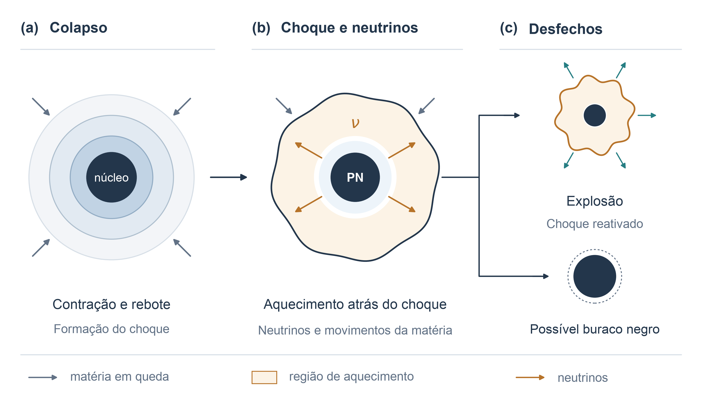
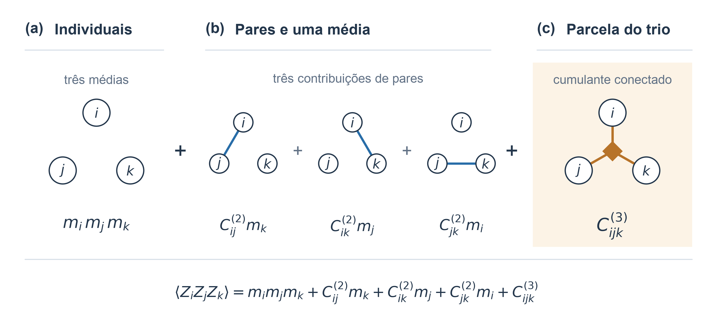
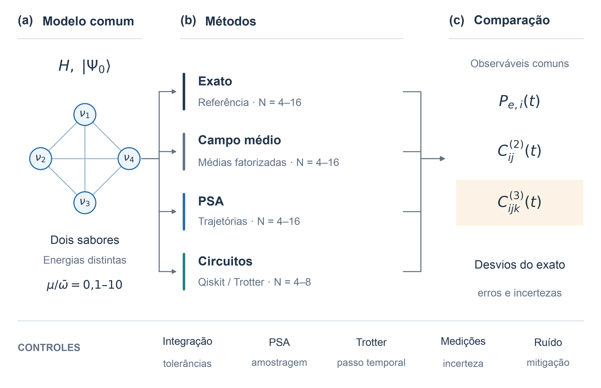

# Além do campo médio: aproximações de baixo custo capturam as correlações entre neutrinos em supernovas?

_Beyond mean field: can low-cost approximations capture neutrino correlations in supernovae?_

## Problema de pesquisa

A evolução do sabor dos neutrinos influencia o aquecimento da matéria em supernovas de colapso de núcleo, as condições de nucleossíntese e a interpretação do sinal em detectores terrestres (JANKA, 2012; COWAN et al., 2021; BAUM; CAPOZZI; HORIUCHI, 2022). Em modelos simplificados de ambientes densos, a interação entre neutrinos pode gerar correlações e emaranhamento, associado à não separabilidade do estado quântico conjunto, enquanto a representação geral do estado quântico completo apresenta custo exponencial com o número de partículas (CERVIA et al., 2019). A aproximação de campo médio substitui as interações por uma influência média e pode apresentar desvios dependentes das condições iniciais; a aproximação de espaço de fase (PSA, do inglês *phase-space approximation*) busca incorporar parte dos efeitos além dessa descrição (LACROIX et al., 2022). As validações da PSA já incluem probabilidades de sabor, entropias reduzidas, calculadas a partir das matrizes densidade de subsistemas de um ou dois neutrinos, e correlações coletivas de dois corpos, o que exige delimitar a questão ainda investigada nos cumulantes conectados de terceira ordem, isto é, a parcela da correlação de um trio que resta após descontar as contribuições individuais e dos pares (LACROIX et al., 2022, 2024). Na hierarquia de Bogoliubov-Born-Green-Kirkwood-Yvon (BBGKY), um fechamento de segunda ordem considerado na literatura despreza esses cumulantes para fechar as equações, condição que não se aplica à hierarquia completa (RICCIO; BALANTEKIN, 2026). Nesse contexto, é necessário avaliar em quais regimes a PSA reproduz as correlações conectadas de dois e três corpos e com que precisão circuitos quânticos conseguem distinguir seus desvios em relação ao cálculo exato.

## Pergunta de pesquisa

A aproximação de espaço de fase reproduz as correlações conectadas de dois e três corpos em oscilações coletivas de neutrinos e, quando há desvios, circuitos quânticos conseguem distinguir as previsões da PSA dos resultados exatos nas condições de ruído avaliadas?

## Objetivos

### Geral

Avaliar a precisão da aproximação de espaço de fase nas correlações conectadas de dois e três corpos em oscilações coletivas de neutrinos, usando cálculos exatos como referência, e verificar se circuitos quânticos conseguem distinguir suas previsões das soluções exatas nas condições de ruído avaliadas.

### Específicos

1. Implementar em Python um modelo de dois sabores, com energias distintas e interações entre todos os pares de neutrinos, e calcular sua evolução exata, por campo médio e pela aproximação de espaço de fase, empregando o mesmo Hamiltoniano e os mesmos estados iniciais físicos.
2. Quantificar erros absolutos e normalizados nas probabilidades individuais de sabor e nos cumulantes conectados de dois e três corpos, variando a razão $\mu/\bar{\omega}$ entre 0,1 e 10. Nessa razão, $\mu$ representa a escala de acoplamento neutrino-neutrino, expressa nas mesmas unidades de $\bar{\omega}$, a frequência média de oscilação no vácuo adotada como referência.
3. Verificar a dependência desses erros com o tamanho do sistema, de quatro até cerca de dezesseis neutrinos, e avaliar a convergência da integração numérica e da amostragem da PSA.
4. Construir circuitos trotterizados em Qiskit para quatro a oito neutrinos, validar sua evolução em simulador ideal contra a solução exata e estimar o erro causado pela discretização temporal. A trotterização aproxima a evolução completa por uma sequência de operações associadas aos termos do Hamiltoniano em pequenos passos de tempo.
5. Investigar o efeito do ruído e do número de medições sobre a resolução das diferenças entre PSA e solução exata, comparar estimativas com e sem mitigação de erros e, havendo acesso, executar os circuitos em hardware IBM. A mitigação emprega técnicas para reduzir os efeitos do ruído nas estimativas dos observáveis.

## Hipóteses

### H1

A PSA reproduz com maior precisão as probabilidades individuais de sabor e os cumulantes de dois corpos do que os de três corpos. Nos casos em que a referência permite normalização, o erro normalizado nos trios tende a crescer com a intensidade da interação.

_Refutação: o erro normalizado nos trios não supera sistematicamente o dos pares dentro das incertezas avaliadas, ou a tendência de crescimento com a interação não é observada._

### H2

Nas configurações investigadas, a distinção entre a PSA e a solução exata nos cumulantes de três corpos requer mitigação de erros para os níveis de ruído e o orçamento de medições considerados.

_Refutação: os circuitos sem mitigação distinguem as previsões da PSA dos resultados exatos pelo critério estabelecido, nas mesmas condições de ruído e número de medições._

Os níveis de ruído, o orçamento de medições e o critério estatístico serão fixados antes da comparação entre métodos. As amplitudes dos cumulantes serão determinadas pelos cálculos.

## Resumo

As oscilações coletivas de neutrinos em supernovas de colapso de núcleo motivam o desenvolvimento de métodos computacionais capazes de descrever efeitos quânticos de muitos corpos. A evolução exata apresenta custo exponencial na representação geral, enquanto a aproximação de campo médio despreza correlações conectadas entre partículas. A aproximação de espaço de fase oferece uma alternativa de menor custo computacional, mas sua precisão para correlações de três corpos requer avaliação específica. Este projeto tem como objetivo avaliar se essa aproximação reproduz com precisão as correlações de dois e três corpos em oscilações coletivas de neutrinos, usando cálculos exatos como referência, e verificar se simulações quânticas conseguem medir as diferenças entre os métodos. Será estudado um modelo de dois sabores, com interações entre todos os pares e energias distintas para os neutrinos. Serão comparadas a evolução exata, a de campo médio e a aproximação de espaço de fase para sistemas de até dezesseis neutrinos, variando a razão entre intensidade de interação e frequência média de oscilação no vácuo de 0,1 a 10. Circuitos trotterizados implementados em Qiskit serão avaliados para quatro a oito neutrinos, em condições ideais e com ruído simulado, com execução em hardware IBM condicionada à disponibilidade. Serão quantificados erros absolutos e normalizados nas probabilidades de sabor e nos cumulantes conectados de dois e três corpos, controlando incertezas de amostragem, integração numérica e trotterização. Espera-se delimitar, no modelo estudado, o domínio de validade da aproximação e a precisão necessária para que circuitos quânticos distingam suas previsões dos resultados exatos.

**Palavras-chave:** Neutrinos. Oscilações coletivas. Correlações de três corpos. Computação quântica. Aproximação de espaço de fase.

## Abstract

Collective neutrino oscillations in core-collapse supernovae motivate the development of computational methods capable of describing quantum many-body effects. Exact evolution has an exponential cost in the general representation, whereas the mean-field approximation neglects connected correlations between particles. The phase-space approximation offers a computationally cheaper alternative, but its accuracy for three-body correlations requires specific assessment. This project aims to evaluate whether this approximation accurately reproduces two- and three-body correlations in collective neutrino oscillations, using exact calculations as benchmarks, and to determine whether quantum simulations can measure discrepancies between the methods. A two-flavor model with all-to-all interactions and distinct neutrino energies will be studied. Exact evolution, mean-field evolution, and the phase-space approximation will be compared for systems of up to sixteen neutrinos, varying the ratio of interaction strength to mean vacuum oscillation frequency from 0.1 to 10. Trotterized circuits implemented in Qiskit will be assessed for four to eight neutrinos under ideal conditions and simulated noise, with execution on IBM hardware subject to availability. Absolute and normalized errors in flavor probabilities and connected two- and three-body cumulants will be quantified, controlling for sampling uncertainty, numerical integration, and Trotterization. The expected contribution is to establish the approximation's range of validity for the model studied and the precision required for quantum circuits to distinguish its predictions from exact results.

**Keywords:** Neutrinos. Collective oscillations. Three-body correlations. Quantum computing. Phase-space approximation.

## Introdução

### Contexto astrofísico e motivação

Estrelas com massa inicial acima de aproximadamente oito massas solares podem sofrer colapso gravitacional do núcleo. No cenário típico, um núcleo rico em ferro, cercado por camadas de queima nuclear, perde sustentação, contrai-se até densidades próximas às nucleares e sofre um rebote, originando um choque (JANKA, 2012; ABI et al., 2020).

O choque pode estagnar por perdas com dissociação nuclear e emissão de neutrinos. A absorção de neutrinos e os movimentos da matéria podem reativá-lo durante a acreção, isto é, a queda de matéria sobre o remanescente. A estrutura estelar e a acreção influenciam a explosão ou a formação de um buraco negro se o remanescente ultrapassar sua massa de sustentação (JANKA, 2012; Figura 1).

*Figura 1 - Colapso estelar, sem escala física. (a) Contração e rebote do núcleo. (b) Choque estagnado e aquecimento por neutrinos ao redor da protoestrela de nêutrons (PN). (c) Explosão ou formação de buraco negro, inclusive após uma explosão. Fonte: elaboração própria com base em Janka (2012).*

Neutrinos são partículas elementares eletricamente neutras que interagem fracamente com a matéria, podendo ficar temporariamente aprisionados no núcleo denso. Uma supernova típica emite cerca de $10^{58}$ neutrinos, com energias características de $10\,\mathrm{MeV}$, em aproximadamente dez segundos, transportando mais de 99% da energia gravitacional liberada pelo núcleo colapsado (ABI et al., 2020).

Na supernova SN 1987A, na Grande Nuvem de Magalhães, Kamiokande-II, IMB e Baksan registraram poucas dezenas de eventos associados ao pulso de neutrinos, permitindo sondar o interior da estrela em colapso (VISSANI et al., 2010).

Os sabores eletrônico, muônico e tauônico correspondem aos respectivos léptons carregados nas interações fracas. Os estados de sabor são superposições dos estados de massa, cujas fases de propagação alteram as probabilidades de detecção, produzindo oscilações. A descoberta, reconhecida pelo Nobel de Física de 2015, estabeleceu massas não nulas. Aqui, os sabores eletrônico e efetivo não eletrônico são representados pelos estados de um qubit, unidade básica da informação quântica (DUAN; FULLER; QIAN, 2010; NOBEL PRIZE, 2015).

A absorção de neutrinos eletrônicos em nêutrons ou de antineutrinos eletrônicos em prótons aquece a matéria atrás do choque e interconverte nêutrons e prótons. Nagakura (2023) encontrou uma redução de aproximadamente 40% nesse aquecimento com conversão de sabor, na configuração esfericamente simétrica estudada. Em modelos multidimensionais, Akaho et al. (2026) observaram efeitos favoráveis ou desfavoráveis à explosão, dependendo da progenitora e da acreção.

A composição de nêutrons e prótons também afeta a nucleossíntese, ou formação de núcleos atômicos. O processo-r, captura rápida de nêutrons, produz parte dos elementos mais pesados que o ferro em matéria rica em nêutrons, como em fusões de estrelas de nêutrons e explosões raras (COWAN et al., 2021).

DUNE é especialmente sensível a neutrinos eletrônicos; Hyper-Kamiokande e JUNO têm importantes canais para antineutrinos eletrônicos, fornecendo informações complementares sobre supernovas (BAUM; CAPOZZI; HORIUCHI, 2022; SARMAH et al., 2026). Interpretar esses sinais requer prever os sabores. Perto do núcleo, a interação coerente entre neutrinos acopla a evolução de sabor, gerando oscilações coletivas e o problema de muitos corpos discutido a seguir (DUAN; FULLER; QIAN, 2010).

### Estado da arte e lacuna de pesquisa

A dinâmica coletiva descrita acima constitui um problema quântico de muitos corpos, no qual podem surgir correlações e emaranhamento entre neutrinos, associado à não separabilidade do estado quântico conjunto. Na representação geral de dois sabores, um estado puro de $N$ neutrinos possui $2^N$ amplitudes complexas. Esse crescimento limita a evolução exata de sistemas grandes em computadores clássicos quando não se exploram simetrias ou compressões específicas ([DUAN; FULLER; QIAN, 2010](https://doi.org/10.1146/annurev.nucl.012809.104524); [CERVIA et al., 2019](https://doi.org/10.1103/PhysRevD.100.083001)).

Uma estratégia para reduzir esse custo é a aproximação de campo médio, que substitui os efeitos das outras partículas por um campo efetivo determinado por suas médias. Ao fatorizar os valores esperados de operadores de partículas distintas, essa descrição despreza suas correlações conectadas e, para estados inicialmente fatorizados, não acompanha a formação de emaranhamento entre neutrinos. [Cervia et al. (2019)](https://doi.org/10.1103/PhysRevD.100.083001) relacionaram diferenças entre a evolução exata e a de campo médio ao desenvolvimento de emaranhamento, com dependência das condições iniciais. Em um modelo de três sabores, [Mangin-Brinet, Bauge e Lacroix (2026)](https://doi.org/10.1103/yr2g-1g2g) também observaram desvios em tempos curtos nas configurações examinadas. A validade da aproximação deve, portanto, ser avaliada em função do modelo, das condições iniciais e do regime dinâmico.

A aproximação de espaço de fase, denominada *phase-space approximation* (PSA), procura incorporar efeitos além do campo médio mediante um conjunto de trajetórias independentes. As condições iniciais são amostradas para reproduzir momentos quânticos selecionados, e cada trajetória evolui segundo equações de campo médio; os observáveis são estimados por médias estatísticas sobre o conjunto. [Lacroix et al. (2022)](https://doi.org/10.1103/PhysRevD.106.123006) obtiveram boa concordância com valores médios e entropias dos estados reduzidos de um e dois neutrinos, calculadas a partir das respectivas matrizes densidade, em um modelo de dois feixes, embora não reproduzissem oscilações de longo tempo das flutuações. A extensão para múltiplos feixes também incluiu comparações de correlações coletivas de dois corpos por meio do observável $C_{ZZ}$, construído a partir de covariâncias. Essa validação coletiva não equivale à avaliação individual de todos os pares nem estabelece a precisão dos cumulantes de terceira ordem ([LACROIX et al., 2024](https://doi.org/10.1103/PhysRevD.110.103027)). Posteriormente, a extensão para três sabores foi comparada com soluções exatas de até oito neutrinos ([MANGIN-BRINET; BAUGE; LACROIX, 2026](https://doi.org/10.1103/yr2g-1g2g)).

Outra abordagem além do campo médio consiste em truncar a hierarquia de Bogoliubov–Born–Green–Kirkwood–Yvon (BBGKY), que relaciona a evolução de observáveis de uma partícula a correlações de ordens superiores. No preprint de [Riccio e Balantekin (2026)](https://arxiv.org/abs/2607.28619), o fechamento de segunda ordem mantém contribuições de pares e anula os cumulantes conectados de três corpos para fechar as equações. Essa condição não anula necessariamente o valor esperado de um produto de três operadores, pois permanecem contribuições construídas a partir de médias individuais e de pares. A PSA, por sua vez, incorpora momentos superiores sem impor esse mesmo fechamento; sua precisão para cumulantes de terceira ordem precisa ser examinada diretamente ([LACROIX et al., 2022](https://doi.org/10.1103/PhysRevD.106.123006)).

As simulações quânticas oferecem uma via complementar para investigar essas correlações. [Hall et al. (2021)](https://doi.org/10.1103/PhysRevD.104.063009) demonstraram a simulação de pequenos sistemas de neutrinos em dispositivos ruidosos, empregando mitigação de erros, isto é, técnicas para reduzir os efeitos do ruído nas estimativas dos observáveis, para extrair medidas de emaranhamento. [Illa e Savage (2023)](https://doi.org/10.1103/PhysRevLett.130.221003) investigaram sistemas de até doze neutrinos no processador de íons aprisionados Quantinuum H1-1, incluindo correlações de dois e três corpos e indicadores de emaranhamento multipartite. Em escala maior, [Kiss et al. (2026)](https://doi.org/10.1038/s42005-026-02697-2) estudaram a termalização com circuitos aleatórios em processadores IBM com mais de cem qubits. Nesse estudo, o desempenho foi avaliado por observáveis de termalização; a fidelidade de cumulantes específicos durante a evolução demanda validação própria.

Na literatura explorada, não foi identificada uma comparação sistemática dos cumulantes de três corpos da PSA com a solução exata que controle tamanho do sistema, intensidade da interação e incertezas computacionais e de medição. Também é necessário estabelecer se circuitos quânticos conseguem distinguir essas previsões. A concordância em médias de sabor, correlações coletivas de pares ou entropias reduzidas não garante a precisão dos cumulantes de terceira ordem. Essa lacuna exige observáveis consistentes e a separação entre erro da aproximação, amostragem finita, discretização temporal e ruído.

Neste trabalho, propõe-se avaliar os cumulantes conectados de dois e três corpos da PSA frente ao cálculo exato, com o campo médio como referência adicional. Serão usados Python para sistemas clássicos de até dezesseis neutrinos e Qiskit para circuitos de quatro a oito neutrinos, controlando incertezas numéricas, amostragem e ruído. Pretende-se delimitar a validade da PSA e as condições de teste de suas previsões por circuitos. O desenvolvimento apresentará modelo, métodos, resultados, limitações e conclusões.

## Estratégia de avaliação proposta

### Observáveis e correlações conectadas

Para explicitar o significado das correlações, considere o operador de sabor $Z_i = |\nu_e\rangle_i\langle\nu_e| - |\nu_x\rangle_i\langle\nu_x|$, equivalente à matriz de Pauli $\sigma_z$ no qubit $i$, em que $\nu_x$ representa o sabor efetivo não eletrônico. Sua média é $m_i(t)=\langle Z_i\rangle_t$, e a probabilidade de sabor eletrônico é $P_{e,i}(t)=[1+m_i(t)]/2$. Para partículas distintas, os operadores comutam, e os cumulantes de segunda e terceira ordens são definidos por

$$
C^{(2)}_{ij}(t)=\langle Z_i Z_j\rangle_t-m_i(t)m_j(t)
$$

e

$$
\begin{aligned}
C^{(3)}_{ijk}(t)={}&\langle Z_i Z_j Z_k\rangle_t-m_i(t)m_j(t)m_k(t)\\
&-C^{(2)}_{ij}(t)m_k(t)-C^{(2)}_{ik}(t)m_j(t)-C^{(2)}_{jk}(t)m_i(t).
\end{aligned}
$$

A Figura 2 representa essa decomposição: um momento de três partículas reúne produtos de médias, contribuições de pares e uma parcela conectada do trio. Assim, desprezar $C^{(3)}_{ijk}$ em um fechamento não equivale a desprezar $\langle Z_i Z_j Z_k\rangle$. Essa identidade particulariza a expansão em cumulantes discutida por Riccio e Balantekin (2026). A seleção de partículas e componentes de Pauli a serem avaliadas será fixada no protocolo; a componente $Z$ ilustra aqui a convenção de sabor.

*Figura 2 - Decomposição do momento $\langle Z_iZ_jZ_k\rangle$. (a) Produto das médias individuais $m_i m_j m_k$. (b) Três contribuições de cumulante de par vezes média da partícula restante. (c) Cumulante conectado $C^{(3)}_{ijk}$, destacado como a parcela que resta após subtrair os termos anteriores. Os círculos identificam as partículas distintas $i$, $j$ e $k$; uma ligação representa a contribuição de um par, e o losango com três conexões representa o cumulante do trio, sem indicar outra partícula. Essa notação estatística não representa interações adicionais no Hamiltoniano nem certifica emaranhamento. Todos os termos são avaliados no mesmo instante. Fonte: elaboração própria com base na expansão em cumulantes de Riccio e Balantekin (2026).*

### Critérios de comparação

Os mesmos observáveis, na mesma base de sabor e normalização, serão utilizados em todos os métodos. As correlações conectadas serão descritas por cumulantes de operadores de partículas distintas; um cumulante não nulo, isoladamente, não certifica emaranhamento genuíno. O erro absoluto será reportado ao longo do tempo e resumido pela raiz da média dos quadrados dos desvios. O erro normalizado será a razão entre essa medida e a raiz da média dos quadrados da referência exata, calculadas sobre a mesma malha temporal e o mesmo conjunto de observáveis. Quando a referência for compatível com zero dentro da precisão numérica, será reportado o erro absoluto, evitando percentuais sem denominador resolvido. Para a avaliação dos circuitos, uma diferença será considerada resolvida quando a estimativa for compatível com o cálculo exato e incompatível com a PSA dentro das incertezas estabelecidas no protocolo. Amostragem finita, integração numérica, trotterização e ruído serão avaliados separadamente.

### Comparação dos métodos e controle de erros

A Figura 3 organiza o protocolo proposto. Para cada tamanho, intensidade de interação e estado inicial, serão mantidas as mesmas definições do Hamiltoniano e dos observáveis nas evoluções exata, de campo médio, PSA e por circuitos. As condições iniciais amostradas pela PSA deverão reproduzir os momentos prescritos pelo método para o estado físico escolhido. Os sistemas de quatro a oito neutrinos formarão o conjunto comum aos quatro métodos; a comparação clássica será estendida até cerca de dezesseis neutrinos. A organização combina a comparação sistemática com referências exatas de Lacroix et al. (2024) com a distinção entre evolução exata, trotterização e medições utilizada por Hall et al. (2021) e Illa e Savage (2023).

*Figura 3 - Protocolo proposto de comparação. (a) Hamiltoniano $H$ e estado inicial $|\Psi_0\rangle$ comuns aos métodos, no modelo de dois sabores com energias distintas e $\mu/\bar{\omega}$ entre 0,1 e 10. A rede de quatro vértices apenas ilustra interações entre todos os pares; não representa a conectividade de um processador nem limita o tamanho do estudo. (b) Evolução exata, campo médio e PSA para quatro até cerca de dezesseis neutrinos; circuitos para o subconjunto de quatro a oito, em condições ideais e com ruído. (c) Comparação de probabilidades e cumulantes com a referência exata, com destaque para $C^{(3)}_{ijk}$. A faixa inferior reúne os controles de integração, amostragem, Trotter, medições e ruído. A comparação com e sem mitigação usará o mesmo orçamento total de medições; a execução em hardware dependerá da disponibilidade. Fonte: elaboração própria, orientada pelas comparações de Lacroix et al. (2024), Hall et al. (2021) e Illa e Savage (2023).*

Antes de interpretar diferenças físicas, serão verificados o refinamento da integração temporal, o aumento do número de trajetórias da PSA e a redução do passo de Trotter em simulação ideal. A análise com ruído será feita após essa validação. As incertezas dos cumulantes deverão considerar que médias e produtos podem ser estimados a partir das mesmas medições ou trajetórias, preservando suas covariâncias na propagação de erros ou na reamostragem. Para cada configuração serão registrados os parâmetros do modelo, o estado inicial, a malha e o intervalo temporal, as tolerâncias numéricas, as sementes e o número de trajetórias, os passos de Trotter, o modelo de ruído, o número de medições e o procedimento de mitigação.

### Apresentação dos resultados

Os resultados serão apresentados em painéis separados para probabilidades, cumulantes de pares e cumulantes de trios. Cada painel manterá o mesmo significado para as linhas e os símbolos: referência exata em linha preta contínua, campo médio em linha cinza pontilhada, PSA em linha azul tracejada e estimativas dos circuitos como símbolos acompanhados de barras de incerteza. Círculos e quadrados distinguirão estimativas sem e com mitigação, sem depender apenas da cor. As legendas informarão o estado inicial, $N$, $\mu/\bar{\omega}$, o tempo adimensional $\bar{\omega}t$, os recursos de amostragem e o significado estatístico das barras. Painéis de desvios e erros normalizados complementarão as curvas, seguindo os critérios já definidos; tabelas ou mapas de erro resumirão a dependência com o tamanho e a interação quando houver dados suficientes. Diagramas de portas serão apresentados com o circuito efetivamente implementado e sua ordem de Trotter.

## Declaração de uso de inteligência artificial

Foi utilizada assistência de inteligência artificial generativa para apoiar a revisão da redação, a tradução e a produção do código dos diagramas conceituais.

## Referências

ABI, B. et al. **Deep Underground Neutrino Experiment (DUNE), Far Detector Technical Design Report, Volume II: DUNE Physics**. Relatório técnico, 2020. arXiv:2002.03005. Disponível em: https://arxiv.org/abs/2002.03005. Acesso em: 23 out. 2026.

AKAHO, R. et al. Bifurcated impact of neutrino fast flavor conversion on core-collapse supernovae informed by multiangle neutrino radiation hydrodynamics. **Physical Review Letters**, v. 136, art. 191002, 2026. DOI: [10.1103/fksy-1jtw](https://doi.org/10.1103/fksy-1jtw).

BAUM, S.; CAPOZZI, F.; HORIUCHI, S. Rocks, water, and noble liquids: unfolding the flavor contents of supernova neutrinos. **Physical Review D**, v. 106, art. 123008, 2022. DOI: [10.1103/PhysRevD.106.123008](https://doi.org/10.1103/PhysRevD.106.123008).

CERVIA, M. J.; PATWARDHAN, A. V.; BALANTEKIN, A. B.; COPPERSMITH, S. N.; JOHNSON, C. W. Entanglement and collective flavor oscillations in a dense neutrino gas. **Physical Review D**, v. 100, art. 083001, 2019. DOI: [10.1103/PhysRevD.100.083001](https://doi.org/10.1103/PhysRevD.100.083001).

COWAN, J. J. et al. Origin of the heaviest elements: the rapid neutron-capture process. **Reviews of Modern Physics**, v. 93, art. 015002, 2021. DOI: [10.1103/RevModPhys.93.015002](https://doi.org/10.1103/RevModPhys.93.015002).

DUAN, H.; FULLER, G. M.; QIAN, Y.-Z. Collective neutrino oscillations. **Annual Review of Nuclear and Particle Science**, v. 60, p. 569-594, 2010. DOI: [10.1146/annurev.nucl.012809.104524](https://doi.org/10.1146/annurev.nucl.012809.104524).

HALL, B.; ROGGERO, A.; BARONI, A.; CARLSON, J. Simulation of collective neutrino oscillations on a quantum computer. **Physical Review D**, v. 104, art. 063009, 2021. DOI: [10.1103/PhysRevD.104.063009](https://doi.org/10.1103/PhysRevD.104.063009).

ILLA, M.; SAVAGE, M. J. Multi-neutrino entanglement and correlations in dense neutrino systems. **Physical Review Letters**, v. 130, art. 221003, 2023. DOI: [10.1103/PhysRevLett.130.221003](https://doi.org/10.1103/PhysRevLett.130.221003).

JANKA, H.-T. Explosion mechanisms of core-collapse supernovae. **Annual Review of Nuclear and Particle Science**, v. 62, p. 407-451, 2012. DOI: [10.1146/annurev-nucl-102711-094901](https://doi.org/10.1146/annurev-nucl-102711-094901).

KISS, O.; TAVERNELLI, I.; TACCHINO, F.; LACROIX, D.; ROGGERO, A. Neutrino thermalization via randomization on a quantum processor. **Communications Physics**, v. 9, art. 282, 2026. DOI: [10.1038/s42005-026-02697-2](https://doi.org/10.1038/s42005-026-02697-2).

LACROIX, D.; BALANTEKIN, A. B.; CERVIA, M. J.; PATWARDHAN, A. V.; SIWACH, P. Role of non-gaussian quantum fluctuations in neutrino entanglement. **Physical Review D**, v. 106, art. 123006, 2022. DOI: [10.1103/PhysRevD.106.123006](https://doi.org/10.1103/PhysRevD.106.123006).

LACROIX, D.; BAUGE, A.; YILMAZ, B.; MANGIN-BRINET, M.; ROGGERO, A.; BALANTEKIN, A. B. Phase-space methods for neutrino oscillations: extension to multibeams. **Physical Review D**, v. 110, art. 103027, 2024. DOI: [10.1103/PhysRevD.110.103027](https://doi.org/10.1103/PhysRevD.110.103027).

MANGIN-BRINET, M.; BAUGE, A.; LACROIX, D. Three-flavor neutrino oscillations using the phase space approach. **Physical Review D**, v. 113, art. 036026, 2026. DOI: [10.1103/yr2g-1g2g](https://doi.org/10.1103/yr2g-1g2g).

NAGAKURA, H. Roles of fast neutrino-flavor conversion on the neutrino-heating mechanism of core-collapse supernova. **Physical Review Letters**, v. 130, art. 211401, 2023. DOI: [10.1103/PhysRevLett.130.211401](https://doi.org/10.1103/PhysRevLett.130.211401).

NOBEL PRIZE. **The Nobel Prize in Physics 2015: press release**. 6 out. 2015. Disponível em: https://www.nobelprize.org/prizes/physics/2015/press-release/. Acesso em: 23 out. 2026.

RICCIO, M.; BALANTEKIN, A. B. Improved approximations for collective neutrino oscillations. **arXiv**, 2026. Preprint, arXiv:2607.28619, versão 2. DOI: [10.48550/arXiv.2607.28619](https://doi.org/10.48550/arXiv.2607.28619). Disponível em: [arXiv](https://arxiv.org/abs/2607.28619). Acesso em: 23 out. 2026.

SARMAH, P. et al. **Neutrino mass ordering from the next Galactic supernova at DUNE, HK, and JUNO**. Preprint, 2026. arXiv:2606.06580. Disponível em: https://arxiv.org/abs/2606.06580. Acesso em: 23 out. 2026.

VISSANI, F.; COSTANTINI, M. L.; FULGIONE, W.; IANNI, A.; PAGLIAROLI, G. **What is the issue with SN1987A neutrinos?** Preprint, 2010. arXiv:1008.4726. Disponível em: https://arxiv.org/abs/1008.4726. Acesso em: 23 out. 2026.
