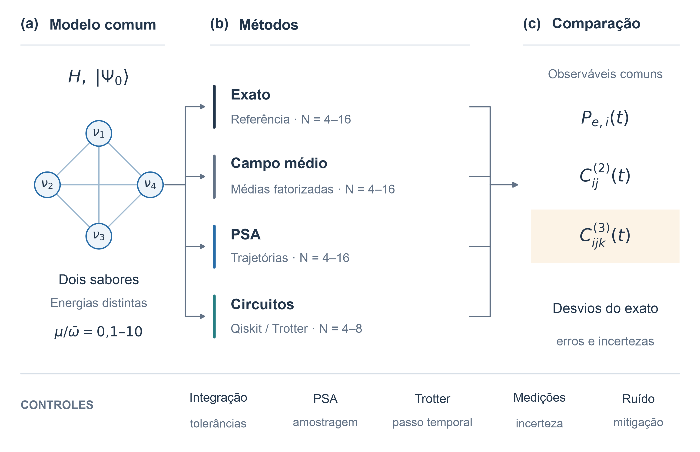
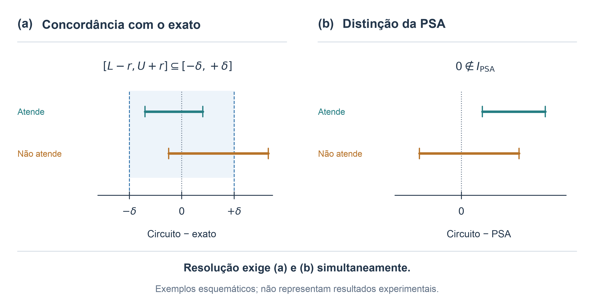

# Além do campo médio: aproximações de baixo custo capturam as correlações entre neutrinos em supernovas?

## Abstract

This study proposes evaluating the phase-space approximation for connected two- and three-body cumulants in a two-flavor neutrino model. Exact, mean-field, and phase-space evolution will be compared, controlling numerical and sampling errors. Quantum circuits will be assessed for their ability to resolve the approximation’s deviations, with and without mitigation at equal measurement budgets. The paper presents the experimental design, parameters, evaluation metrics, and reproducibility materials. Conclusions about validity regimes and noise thresholds depend on the consolidation of results.

## Resumo

Este estudo propõe avaliar a aproximação de espaço de fase para cumulantes conectados de dois e três corpos em um modelo de neutrinos com dois sabores. Serão comparadas evoluções exata, de campo médio e de espaço de fase, controlando erros numéricos e de amostragem. Circuitos quânticos serão avaliados quanto à resolução dos desvios da aproximação, com e sem mitigação e sob igual orçamento de medições. O artigo apresenta o desenho experimental, os parâmetros, as métricas e os materiais de reprodução. As conclusões sobre os regimes de validade e os limiares de ruído dependem da consolidação dos resultados.

## Introdução

### Contexto astrofísico e motivação

Estrelas com massa inicial acima de aproximadamente oito massas solares podem sofrer colapso gravitacional do núcleo. No cenário típico, um núcleo rico em ferro, cercado por camadas de queima nuclear, perde sustentação, contrai-se até densidades próximas às nucleares e sofre um rebote, originando um choque (JANKA, 2012; ABI et al., 2020).

O choque pode estagnar por perdas com dissociação nuclear e emissão de neutrinos. A absorção de neutrinos e os movimentos da matéria podem reativá-lo durante a acreção, isto é, a queda de matéria sobre o remanescente. A estrutura estelar e a acreção influenciam a explosão ou a formação de um buraco negro se o remanescente ultrapassar sua massa de sustentação (JANKA, 2012; Figura 1).

*Figura 1 - Colapso estelar, sem escala física. (a) Contração e rebote do núcleo. (b) Choque estagnado e aquecimento por neutrinos ao redor da protoestrela de nêutrons (PN). (c) Explosão ou formação de buraco negro, inclusive após uma explosão. Fonte: elaboração própria com base em Janka (2012).*

Neutrinos são partículas elementares eletricamente neutras que interagem fracamente com a matéria, podendo ficar temporariamente aprisionados no núcleo denso. Uma supernova típica emite cerca de $10^{58}$ neutrinos, com energias características de $10\,\mathrm{MeV}$, em aproximadamente dez segundos, transportando mais de 99% da energia gravitacional liberada pelo núcleo colapsado (ABI et al., 2020).

Na supernova SN 1987A, na Grande Nuvem de Magalhães, Kamiokande-II, IMB e Baksan registraram poucas dezenas de eventos associados ao pulso de neutrinos, permitindo sondar o interior da estrela em colapso (VISSANI et al., 2010).

Os sabores eletrônico, muônico e tauônico correspondem aos respectivos léptons carregados nas interações fracas. Os estados de sabor são superposições dos estados de massa, cujas fases de propagação alteram as probabilidades de detecção, produzindo oscilações. A descoberta, reconhecida pelo Nobel de Física de 2015, estabeleceu massas não nulas. Aqui, os sabores eletrônico e efetivo não eletrônico são representados pelos estados de um qubit, unidade básica da informação quântica (DUAN; FULLER; QIAN, 2010; NOBEL PRIZE, 2015).

A absorção de neutrinos eletrônicos em nêutrons ou de antineutrinos eletrônicos em prótons aquece a matéria atrás do choque e interconverte nêutrons e prótons. Nagakura (2023) encontrou uma redução de aproximadamente 40% nesse aquecimento com conversão de sabor, na configuração esfericamente simétrica estudada. Em modelos multidimensionais, Akaho et al. (2026) observaram efeitos favoráveis ou desfavoráveis à explosão, dependendo da progenitora e da acreção.

A composição de nêutrons e prótons também afeta a nucleossíntese, ou formação de núcleos atômicos. O processo-r, captura rápida de nêutrons, produz parte dos elementos mais pesados que o ferro em matéria rica em nêutrons, como em fusões de estrelas de nêutrons e explosões raras (COWAN et al., 2021).

DUNE é especialmente sensível a neutrinos eletrônicos; Hyper-Kamiokande e JUNO têm importantes canais para antineutrinos eletrônicos, fornecendo informações complementares sobre supernovas (BAUM; CAPOZZI; HORIUCHI, 2022; SARMAH et al., 2026). Interpretar esses sinais requer prever os sabores. Perto do núcleo, a interação coerente entre neutrinos acopla a evolução de sabor, gerando oscilações coletivas e o problema de muitos corpos discutido a seguir (DUAN; FULLER; QIAN, 2010).

### Estado da arte e lacuna de pesquisa

A dinâmica coletiva descrita acima constitui um problema quântico de muitos corpos, no qual podem surgir correlações e emaranhamento entre neutrinos, associado à não separabilidade do estado quântico conjunto. Na representação geral de dois sabores, um estado puro de $N$ neutrinos possui $2^N$ amplitudes complexas. Esse crescimento limita a evolução exata de sistemas grandes em computadores clássicos quando não se exploram simetrias ou compressões específicas ([DUAN; FULLER; QIAN, 2010](https://doi.org/10.1146/annurev.nucl.012809.104524); [CERVIA et al., 2019](https://doi.org/10.1103/PhysRevD.100.083001)).

Uma estratégia para reduzir esse custo é a aproximação de campo médio, que substitui os efeitos das outras partículas por um campo efetivo determinado por suas médias. Ao fatorizar os valores esperados de operadores de partículas distintas, essa descrição despreza suas correlações conectadas e, para estados inicialmente fatorizados, não acompanha a formação de emaranhamento entre neutrinos. [Cervia et al. (2019)](https://doi.org/10.1103/PhysRevD.100.083001) relacionaram diferenças entre a evolução exata e a de campo médio ao desenvolvimento de emaranhamento, com dependência das condições iniciais. Em um modelo de três sabores, [Mangin-Brinet, Bauge e Lacroix (2026)](https://doi.org/10.1103/yr2g-1g2g) também observaram desvios em tempos curtos nas configurações examinadas. A validade da aproximação deve, portanto, ser avaliada em função do modelo, das condições iniciais e do regime dinâmico.

A aproximação de espaço de fase, denominada *phase-space approximation* (PSA), procura incorporar efeitos além do campo médio mediante um conjunto de trajetórias independentes. As condições iniciais são amostradas para reproduzir momentos quânticos selecionados, e cada trajetória evolui segundo equações de campo médio; os observáveis são estimados por médias estatísticas sobre o conjunto. [Lacroix et al. (2022)](https://doi.org/10.1103/PhysRevD.106.123006) obtiveram boa concordância com valores médios e entropias dos estados reduzidos de um e dois neutrinos, calculadas a partir das respectivas matrizes densidade, em um modelo de dois feixes, embora não reproduzissem oscilações de longo tempo das flutuações. A extensão para múltiplos feixes também incluiu comparações de correlações coletivas de dois corpos por meio do observável $C_{ZZ}$, construído a partir de covariâncias. Essa validação coletiva não equivale à avaliação individual de todos os pares nem estabelece a precisão dos cumulantes de terceira ordem ([LACROIX et al., 2024](https://doi.org/10.1103/PhysRevD.110.103027)). Posteriormente, a extensão para três sabores foi comparada com soluções exatas de até oito neutrinos ([MANGIN-BRINET; BAUGE; LACROIX, 2026](https://doi.org/10.1103/yr2g-1g2g)).

Outra abordagem além do campo médio consiste em truncar a hierarquia de Bogoliubov–Born–Green–Kirkwood–Yvon (BBGKY), que relaciona a evolução de observáveis de uma partícula a correlações de ordens superiores. No preprint de [Riccio e Balantekin (2026)](https://arxiv.org/abs/2607.28619), o fechamento de segunda ordem mantém contribuições de pares e anula os cumulantes conectados de três corpos para fechar as equações. Essa condição não anula necessariamente o valor esperado de um produto de três operadores, pois permanecem contribuições construídas a partir de médias individuais e de pares. A PSA, por sua vez, incorpora momentos superiores sem impor esse mesmo fechamento; sua precisão para cumulantes de terceira ordem precisa ser examinada diretamente ([LACROIX et al., 2022](https://doi.org/10.1103/PhysRevD.106.123006)).

As simulações quânticas oferecem uma via complementar para investigar essas correlações. [Hall et al. (2021)](https://doi.org/10.1103/PhysRevD.104.063009) demonstraram a simulação de pequenos sistemas de neutrinos em dispositivos ruidosos, empregando mitigação de erros, isto é, técnicas para reduzir os efeitos do ruído nas estimativas dos observáveis, para extrair medidas de emaranhamento. [Illa e Savage (2023)](https://doi.org/10.1103/PhysRevLett.130.221003) investigaram sistemas de até doze neutrinos no processador de íons aprisionados Quantinuum H1-1, incluindo correlações de dois e três corpos e indicadores de emaranhamento multipartite. Em escala maior, [Kiss et al. (2026)](https://doi.org/10.1038/s42005-026-02697-2) estudaram a termalização com circuitos aleatórios em processadores IBM com mais de cem qubits. Nesse estudo, o desempenho foi avaliado por observáveis de termalização; a fidelidade de cumulantes específicos durante a evolução demanda validação própria.

A relevância dos cumulantes de terceira ordem decorre também da hierarquia de evolução. Em um Hamiltoniano com interações entre pares, a dinâmica dos observáveis de uma partícula depende de correlações de dois corpos, cujas equações se acoplam a momentos de terceira ordem ([LACROIX et al., 2024](https://doi.org/10.1103/PhysRevD.110.103027); [RICCIO; BALANTEKIN, 2026](https://arxiv.org/abs/2607.28619)). Desvios na descrição dessas contribuições podem, portanto, afetar observáveis de ordens inferiores ao longo da evolução. Esse acoplamento motiva a investigação dos trios, mas a análise de uma componente de sabor, isoladamente, não estabelece a origem de todos os desvios nas probabilidades.

Na literatura explorada, não foi identificada uma comparação sistemática dos cumulantes de três corpos da PSA com a solução exata que controle tamanho do sistema, intensidade da interação e incertezas computacionais e de medição. A concordância em médias de sabor, correlações coletivas de pares ou entropias reduzidas não garante a precisão dos cumulantes de terceira ordem. Essa lacuna exige delimitar os regimes de validade da aproximação e separar seu erro dos efeitos de amostragem finita, discretização temporal e ruído.

Nos sistemas de quatro a oito neutrinos considerados para os circuitos, a solução exata é acessível classicamente e será utilizada como referência controlada. A etapa quântica busca determinar a precisão e os recursos necessários para resolver discrepâncias entre a PSA e essa referência. A trotterização aproxima a evolução completa por uma sequência de operações associadas aos termos do Hamiltoniano em pequenos passos de tempo. A disponibilidade do cálculo exato permite avaliar separadamente os efeitos dessa discretização, do ruído e do número de medições; não se pretende demonstrar vantagem computacional nesses tamanhos. O contexto astrofísico motiva o modelo, mas as conclusões ficarão restritas às configurações simplificadas investigadas.

### Pergunta, objetivo e hipóteses

A pergunta central é: em quais regimes de intensidade de interação, tamanho do sistema e tempo de evolução, para os estados iniciais considerados, a PSA reproduz os cumulantes conectados de dois e três corpos dentro de tolerâncias predefinidas? Complementarmente, nos regimes em que seus desvios em relação à solução exata são resolvidos, quais condições de ruído e orçamento de medições permitem aos circuitos quânticos distinguir essas previsões?

O objetivo geral é delimitar o domínio de validade da PSA e quantificar as condições de resolução de seus desvios por circuitos quânticos. Para isso, serão comparadas a evolução exata, a de campo médio e a PSA em um modelo de dois sabores, com energias distintas e interações entre todos os pares. Serão usados Python para sistemas de quatro até cerca de dezesseis neutrinos e Qiskit para circuitos de quatro a oito neutrinos, variando $\mu/\bar{\omega}$ entre 0,1 e 10. Nessa razão, $\mu$ representa a escala de interação neutrino-neutrino e $\bar{\omega}$, a frequência média de oscilação no vácuo. A avaliação compreenderá probabilidades de sabor, cumulantes de pares e trios, convergência numérica e incertezas de amostragem, seguida da comparação de circuitos com e sem mitigação.

A amostragem da PSA é construída para reproduzir momentos iniciais selecionados, e sua evolução por trajetórias de campo médio não garante a reprodução dos cumulantes conectados de terceira ordem. Esses cumulantes resultam da subtração de contribuições individuais e de pares do momento de três corpos; desvios nessas contribuições podem produzir erros relativos elevados quando a parcela conectada é pequena, ainda que numericamente resolvida. As limitações na reprodução das oscilações de longo tempo das flutuações, observadas por Lacroix et al. (2022), também motivam examinar sua precisão em diferentes janelas temporais. Esses argumentos orientam a hipótese **H1**: nos estados iniciais e nas janelas temporais previamente especificados, o erro normalizado da PSA nos cumulantes de três corpos é sistematicamente maior que nos cumulantes de dois corpos, quando as referências permitem normalização. As probabilidades individuais de sabor serão mantidas como referência adicional de desempenho.

_Refutação de H1: a comparação entre os cenários, segundo a regra de agregação e a margem de diferença fixadas no protocolo, estabelece que o erro dos trios não supera o dos pares pela margem prevista. Se as incertezas não permitirem distinguir essas possibilidades, o resultado será considerado inconclusivo._

A dependência do erro com a intensidade da interação será examinada como análise secundária. O aumento de $\mu$ amplia os coeficientes dos termos de interação que acoplam as ordens da hierarquia, o que motiva investigar o crescimento dos desvios. Esse argumento, contudo, não estabelece crescimento monotônico do erro normalizado, que também depende do estado inicial, do tempo de evolução e da amplitude da referência. A tendência será avaliada nos regimes definidos, sem ser pressuposta para todo o intervalo estudado.

A etapa quântica examinará a hipótese **H2**: nos cenários previamente selecionados, a técnica de mitigação adotada amplia o limiar de ruído para o qual os cumulantes de três corpos permitem distinguir a PSA da solução exata, mantendo fixo o orçamento total de medições. A hipótese expressa uma comparação de desempenho para um modelo de ruído e um procedimento de mitigação definidos, sem pressupor que a mitigação seja necessária em todas as condições.

_Refutação de H2: a comparação estabelece que o limiar com mitigação não supera o obtido sem mitigação pela margem prevista no protocolo, sob o mesmo orçamento total de medições. Se a diferença entre os limiares não puder ser determinada com a precisão requerida, o resultado será considerado inconclusivo._

O desenho experimental e suas emendas registram os estados iniciais, as janelas temporais, as tolerâncias, o modelo de ruído e a técnica de mitigação. As seções seguintes apresentam essas definições e distinguem as análises implementadas dos critérios ainda necessários para as conclusões confirmatórias de H1 e H2.

## Metodologia

O estudo compara campo médio, PSA e circuitos quânticos com a evolução exata de sistemas finitos. O foco são os cumulantes conectados de três corpos; probabilidades de sabor e cumulantes de pares complementam a análise. O [protocolo experimental](PROTOCOLO_EXPERIMENTOS.md) registra as configurações, os controles e as emendas descritos a seguir, sem pressupor a conclusão da coleta.

### Modelo físico e convenções

Cada neutrino corresponde a um qubit, com $|\nu_e\rangle=|0\rangle$ e $|\nu_x\rangle=|1\rangle$. Em unidades de $\hbar=1$ e tempo $\tau=\bar{\omega}t$, utiliza-se o Hamiltoniano

$$
\frac{H}{\bar{\omega}}=\frac{1}{2}\sum_{i=0}^{N-1}\widetilde{\omega}_i\,\mathbf{B}\cdot\boldsymbol{\sigma}_i
+\frac{\lambda}{4N}\sum_{i<j}g_{ij}\,\boldsymbol{\sigma}_i\cdot\boldsymbol{\sigma}_j,
\qquad
\lambda=\frac{\mu}{\bar{\omega}},\quad
\widetilde{\omega}_i=\frac{\omega_i}{\bar{\omega}},
$$

em que $\mathbf{B}=(\sin 2\theta,0,-\cos 2\theta)$, $\boldsymbol{\sigma}_i$ reúne os operadores de Pauli e $g_{ij}$ define o acoplamento. Cada par aparece uma única vez na soma. Nos arquivos de configuração, `mu` representa $\lambda$.

O modelo usa acoplamentos uniformes, frequências distintas e um estado produto de sabor, sem transporte espacial, colisões ou hidrodinâmica. As conclusões ficam restritas a essas condições. A janela comum em $\tau$ corresponde a diferentes escalas $\mu t=\lambda\tau$ quando a interação varia.

### Métodos de evolução

A evolução exata utiliza a ação da exponencial do Hamiltoniano esparso sobre o estado inicial, calculada por `expm_multiply`, da SciPy. Sua precisão é verificada em um sistema pequeno por uma construção independente com produtos de Kronecker e exponenciação densa.

No campo médio, os vetores de polarização evoluem sob o campo de vácuo e as médias das demais partículas, com integração Runge–Kutta de quarta ordem (RK4). A fatorização dos momentos fornece uma referência sem correlações conectadas para o estado produto considerado.

Na PSA, as componentes transversais iniciais assumem valores $\pm1$ independentemente, e a longitudinal corresponde ao sabor inicial. As trajetórias seguem as equações de campo médio, conforme Lacroix et al. (2024). Seus momentos são agregados antes do cálculo dos cumulantes, preservando os blocos de sementes para estimar a incerteza.

Os circuitos usam uma decomposição simétrica de Trotter de segunda ordem. A comparação entre o emulador local e o Qiskit verifica sua implementação; a comparação com o exato mede o erro de Trotter. A análise separa esse erro dos efeitos de medições finitas e do ruído simulado no Qiskit Aer.

### Observáveis e correlações conectadas

O operador de sabor é $Z_i=|\nu_e\rangle_i\langle\nu_e|-|\nu_x\rangle_i\langle\nu_x|$, com média $m_i(t)=\langle Z_i\rangle_t$ e probabilidade de sabor eletrônico $P_{e,i}(t)=[1+m_i(t)]/2$. Para partículas distintas, os cumulantes são

$$
C^{(2)}_{ij}(t)=\langle Z_i Z_j\rangle_t-m_i(t)m_j(t)
$$

e

$$
\begin{aligned}
C^{(3)}_{ijk}(t)={}&\langle Z_i Z_j Z_k\rangle_t-m_i(t)m_j(t)m_k(t)\\
&-C^{(2)}_{ij}(t)m_k(t)-C^{(2)}_{ik}(t)m_j(t)-C^{(2)}_{jk}(t)m_i(t).
\end{aligned}
$$

A Figura 2 distingue o momento de três partículas de sua parcela conectada, conforme a expansão em cumulantes de Riccio e Balantekin (2026). A análise considera as componentes $Z$, $ZZ$ e $ZZZ$; suas conclusões não se estendem automaticamente a outras componentes de Pauli.

*Figura 2 - Decomposição de $\langle Z_iZ_jZ_k\rangle$ em (a) produto de médias, (b) contribuições de pares e (c) cumulante conectado do trio, no mesmo instante. Círculos representam partículas; ligações e losango representam contribuições estatísticas, sem indicar novas interações ou certificar emaranhamento. Fonte: elaboração própria com base em Riccio e Balantekin (2026).*

Nos dados, $C^{(3)}_{ijk}$ também é identificado como `c3` ou $K^{zzz}_{ijk}$.

### Sequência de validação

A execução começa pela reprodução publicada e pelos controles sem interação, de integração, amostragem e Trotter. Seguem-se a coleta clássica e as etapas de medições, ruído e mitigação (Figura 3). A extensão para sistemas maiores depende dos recursos disponíveis.

*Figura 3 - Comparação dos métodos: (a) modelo e estado inicial comuns; (b) exato, campo médio e PSA para $N=4$–16 e circuitos para $N=4$–8; (c) observáveis e controles de erro. A rede ilustra o acoplamento físico, não a conectividade do processador. Fonte: elaboração própria com base em Lacroix et al. (2024), Hall et al. (2021) e Illa e Savage (2023).*

Falhas nos controles interrompem a coleta e exigem registro de eventual emenda. Resultados desfavoráveis às hipóteses, por sua vez, não justificam alterar critérios ou excluir configurações.

## Descrição dos experimentos e parâmetros experimentais

### Grade própria e recursos de amostragem

A Tabela 1 reúne os parâmetros da grade clássica. A associação entre frequência e sabor inicial é fixa para cada tamanho; esta versão não inclui uma varredura de estados iniciais.

*Tabela 1 - Parâmetros da grade clássica original.*

| Parâmetro | Definição |
| --- | --- |
| Tamanhos principais | $N=4,6,8$. |
| Extensão clássica | $N=12,16$, condicionada aos recursos disponíveis. |
| Intensidade de interação | $\lambda=0,1;\ 0,3;\ 1;\ 3;\ 10$. |
| Frequências | $\widetilde{\omega}_i=0,7+0,6i/(N-1)$, para $i=0,\ldots,N-1$; média igual a 1. |
| Ângulo de mistura | $\theta=0,2$ rad. |
| Acoplamentos | $g_{ij}=1$ para $i\ne j$; $g_{ii}=0$. |
| Estado inicial | Primeira metade dos índices em $\nu_e$; segunda metade em $\nu_x$. |
| Tempo | $0\leq\tau\leq10$, com 201 instantes e espaçamento $0,05$. |
| Observáveis | Todos os indivíduos, os $\binom{N}{2}$ pares e os $\binom{N}{3}$ trios distintos. |
| PSA | 20 blocos de 4.096 trajetórias por configuração, totalizando 81.920 trajetórias. |
| Sementes da coleta clássica | 10.001 a 10.020. |
| Integração original | 12 subpassos RK4 por intervalo entre saídas. |

São 15 configurações físicas e 300 blocos PSA no conjunto principal, além de dez configurações e 200 blocos na extensão. As referências determinísticas podem ser reutilizadas entre sementes, preservando a independência dos blocos PSA.

### Reprodução publicada e controles de convergência

A reprodução utiliza a Figura 2(c) de Lacroix et al. (2024): oito neutrinos, um por feixe, $\theta=0,195$, frequências unitárias, $g_{ij}=1-\cos[|i-j|\arccos(0,9)/7]$ e `mu=16`. A conversão $\tau=t_{\text{publicação}}/4$ leva o intervalo publicado de 0–200 para 0–50. Esse controle possui configuração distinta da grade própria.

As coordenadas foram extraídas dos vetores da figura e não são dados brutos dos autores. Compara-se $\langle Z_i\rangle$ usando 10.000 trajetórias, semente 50.001 e 20 subpassos RK4, com $\Delta\tau=0,0125$. As tolerâncias máximas são 0,02 para o exato e 0,06 para a PSA. A [documentação da referência](data/benchmarks/lacroix2024/README.md) registra origem, conversões e incertezas. Esse controle não valida, isoladamente, cumulantes de terceira ordem.

Os controles próprios usam $\lambda=0$ para $N=4,6,8$. A convergência usa $N=4,8$, $\lambda=0,1;1;10$ e cinco sementes, comparando 2, 4, 8 e 12 subpassos RK4 e 512, 1.024, 2.048 e 4.096 trajetórias. A aceitação considera a diferença entre 8 e 12 subpassos e o maior erro-padrão entre sementes. Trotter é refinado com 1, 2, 4, 8 e 16 passos por intervalo; a verificação em Qiskit abrange também $\tau=1,2,4$.

### Medições, ruído e mitigação

Sem ruído, usam-se $N=4,6,8$, a grade da Tabela 1 e vinte repetições de 1.024, 4.096 ou 16.384 medições por instante. A análise de ruído e mitigação restringe-se a $N=4$, ao trio $(0,1,2)$ e a $\tau=1,2,4$, mantendo as cinco interações e os três orçamentos.

A discretização original dessa etapa contém oito pontos e 16 passos de Trotter por intervalo, totalizando 112 passos, sujeitos a validação contra o exato. As sementes de medições, ruído e mitigação estão fixadas nos protocolos.

*Tabela 2 - Perfis de ruído definidos para o simulador Aer.*

| Perfil | Despolarização: um qubit | Despolarização: dois qubits | Erro de leitura |
| --- | ---: | ---: | ---: |
| Ideal | 0 | 0 | 0 |
| Leve | 0,0001 | 0,001 | 0,01 |
| Moderado | 0,001 | 0,01 | 0,03 |

Os circuitos são compilados na base `rz`, `sx`, `x` e `cx`, com otimização de nível 1, e simulados por matriz densidade no Aer. A despolarização atua em `sx`, `x` e `cx`; a leitura sofre inversões simétricas e independentes por qubit. Os perfis da Tabela 2 não reproduzem uma calibração específica de hardware. A mitigação é avaliada nos perfis leve e moderado.

A mitigação de leitura inverte o produto tensorial das matrizes de resposta de cada qubit, estimadas com $|0000\rangle$ e $|1111\rangle$, preservando quasiprobabilidades negativas. Do orçamento $m$ por repetição, $3m/4$ são destinados ao sinal e $m/8$ a cada calibração; o método bruto usa $m$ para sinal. Com vinte repetições, ambos recebem $M=20m$ medições. A correção não elimina erros de portas.

O ponto principal original é $N=4$, $\lambda=3$, trio $(0,1,2)$, $\tau=2$, ruído moderado e $m=16.384$, totalizando $M=327.680$ medições por método. Os demais casos são análises de sensibilidade.

### Emendas e extensão em hardware

A emenda v3 registra a omissão do controle de amostragem por uma falha de encaminhamento e sua posterior reprovação em três das seis células. O suplemento mantém o limite de precisão e prevê vinte novos blocos de 4.096 trajetórias em cada célula, com sementes 70.001–70.020. Os dados clássicos coletados antes da detecção da falha dependem dessa validação e de reanálise; o controle original permanece registrado como reprovado.

A emenda v4 refina a condição $N=4$, $\lambda=10$, $\tau=4$ para 29 pontos e 448 passos de Trotter após reprovação do controle ideal. Em $\lambda=10$, $\tau=2$, a PSA passa de 12 para 24 subpassos RK4, preservando as contagens de ruído. O ponto principal permanece inalterado. As emendas efetivamente usadas devem constar da coleta; o aumento da profundidade impede atribuir diferenças apenas à interação física.

A extensão em hardware IBM depende da disponibilidade e da viabilidade do circuito compilado. Serão registrados dispositivo, calibração, layout, profundidade, portas, medições e identificadores dos trabalhos. Alterações de discretização deverão ser declaradas e validadas.

## Métricas de avaliação

### Erros absolutos e normalizados

Para $T$ instantes e $n_q$ conjuntos de partículas, sejam $O^{\mathrm{ex}}_{q,\alpha}$ a referência exata e $\widehat O_{q,\alpha}$ sua estimativa. Usam-se $P_e$, $C^{(2)}$ e $C^{(3)}$ para indivíduos, pares e trios, respectivamente. O erro e a amplitude RMS são

$$
E_q=\sqrt{\frac{1}{Tn_q}\sum_{\ell=1}^{T}\sum_{\alpha=1}^{n_q}
\left[\widehat{O}_{q,\alpha}(\tau_\ell)-O^{\mathrm{ex}}_{q,\alpha}(\tau_\ell)\right]^2},
\qquad
S_q=\sqrt{\frac{1}{Tn_q}\sum_{\ell=1}^{T}\sum_{\alpha=1}^{n_q}
\left[O^{\mathrm{ex}}_{q,\alpha}(\tau_\ell)\right]^2}.
$$

Define-se $R_q=E_q/S_q$ para $S_q\geq10^{-4}$; abaixo desse piso, reportam-se apenas erros absolutos. Também são calculados o desvio máximo e as métricas por trio. Os quadrados evitam cancelamentos entre sinais opostos. A coleta principal usa $0\leq\tau\leq10$; os testes pontuais usam o instante e o trio especificados.

### Incerteza e comparação entre pares e trios

H1 é examinada por $D=R_3-R_2$ em cada configuração elegível. São geradas 2.000 réplicas bootstrap de blocos independentes de sementes, preservando a dependência entre momentos e tempos. Os cumulantes são recalculados a partir dos momentos agregados; os percentis 2,5 e 97,5 definem o intervalo de 95%.

Um intervalo inteiramente acima de zero indica maior erro normalizado dos trios naquela configuração; incluir zero não demonstra igualdade. A tendência de $D$ com $\log_{10}\lambda$ é exploratória, com sementes pareadas entre interações para cada $N$. A conclusão conjunta sobre H1 ainda exige uma regra de agregação e uma margem de relevância, formalizadas em emenda que declare o conhecimento prévio dos dados.

### Resolução dos circuitos e delimitação de H2

Para os circuitos, reamostram-se as contagens agregadas por distribuições multinomiais, reestimando a calibração e reamostrando independentemente os blocos PSA em cada réplica. Isso preserva a dependência entre os momentos do cumulante. Utilizam-se 2.000 réplicas e intervalos percentis de 95%, sem correção de viés.

Sejam $I_{\mathrm{PSA}}$ o intervalo de circuito menos PSA e $[L,U]$ o de circuito menos exato, para $C^{(3)}$. A diferença é resolvida quando

$$
0\notin I_{\mathrm{PSA}}
\quad\text{e}\quad
[L-r,U+r]\subseteq[-\delta,\delta],
\qquad \delta=0,01,
$$

em que $r$ soma o desvio absoluto ideal–exato naquele ponto à tolerância numérica de $10^{-5}$. A margem permanece fixa; é o intervalo que se amplia. Calibrações com número de condição superior a 10 ou não finito, em qualquer bloco ou réplica, tornam o caso não resolvido, sem descarte seletivo.

As duas condições devem ser satisfeitas para a mesma configuração e orçamento (Figura 4).

*Figura 4 - Critério de resolução: (a) intervalo circuito–exato, ampliado pelo resíduo, contido em $[-\delta,+\delta]$; (b) intervalo circuito–PSA excluindo zero. Ambos devem ser satisfeitos. Cada painel mostra exemplos independentes e esquemáticos, sem resultados experimentais. Fonte: elaboração própria.*

Para H2, $p_{\max}(M)$ é o maior nível avaliado de uma família de ruído que satisfaz esse critério sob orçamento $M$. Compara-se

$$
\Delta p_{\max}(M)=p_{\max}^{\mathrm{mitigado}}(M)-p_{\max}^{\mathrm{bruto}}(M).
$$

O protocolo atual compara perfis discretos e a necessidade de mitigação em um ponto. Essa decisão não testa $\Delta p_{\max}$: o método bruto resolver um ponto não impede que a mitigação amplie o limiar. Seus rótulos de apoio ou refutação não serão usados como conclusão da H2 reformulada.

O teste confirmatório requer uma emenda que fixe a família de ruído, a varredura, a margem relevante e a propagação das incertezas. Até lá, a comparação é descritiva. Serão reportados limites se a transição não for localizada e regiões em $(p,M)$ se o comportamento não for monotônico, mantendo a calibração no orçamento.

### Tolerâncias numéricas e recursos

*Tabela 3 - Metas operacionais de precisão do estudo.*

| Controle | Critério |
| --- | --- |
| Referência exata independente | Diferença absoluta máxima de $10^{-10}$. |
| Qiskit e emulador do mesmo circuito | Diferença máxima de probabilidades de $10^{-10}$. |
| Refinamento RK4 de $P_e$ | Diferença absoluta máxima de $10^{-6}$. |
| Refinamento RK4 de $C^{(2)}$ e $C^{(3)}$ | Diferença absoluta máxima de $10^{-5}$. |
| Amostragem PSA | Maior erro-padrão entre sementes de $C^{(3)}$, em todos os tempos e trios, de até $0,01$. |
| Trotter ideal | Erro absoluto máximo de $C^{(3)}$ de até $10^{-3}$. |
| Normalização | Amplitude RMS exata de pelo menos $10^{-4}$. |
| Equivalência dos circuitos | Intervalo ampliado pelo resíduo contido em $[-0,01;0,01]$. |
| Calibração de leitura | Número de condição da matriz de resposta de até 10. |

As metas da Tabela 3 são escolhas de resolução do estudo; o teto de Trotter equivale a 10% da margem de equivalência. A avaliação de custo incluirá tempo, memória, armazenamento, trajetórias, medições e recursos dos circuitos.

O [repositório do projeto](https://github.com/leonardovbf/correlacoes-tres-neutrinos) reúne os códigos de simulação e análise, os protocolos, os workloads e as instruções de reprodução. Inclui o dataset de referência extraído de Lacroix et al. (2024), com origem e conversões documentadas. Os dados completos da coleta serão vinculados após consolidação e validação.

## Referências

Abi, B. et al. (2020). Deep Underground Neutrino Experiment (DUNE), Far Detector Technical Design Report, Volume II: DUNE Physics. Technical Report FERMILAB-PUB-20-025-ND, DUNE Collaboration. <https://arxiv.org/abs/2002.03005>.

Akaho, R., Nagakura, H., Iwakami, W., Furusawa, S., Harada, A., Okawa, H., Matsufuru, H., Sumiyoshi, K., and Yamada, S. (2026). Bifurcated Impact of Neutrino Fast Flavor Conversion on Core-Collapse Supernovae Informed by Multiangle Neutrino Radiation Hydrodynamics. *Physical Review Letters*, 136(19):191002. <https://doi.org/10.1103/fksy-1jtw>.

Baum, S., Capozzi, F., and Horiuchi, S. (2022). Rocks, water, and noble liquids: Unfolding the flavor contents of supernova neutrinos. *Physical Review D*, 106(12):123008. <https://doi.org/10.1103/PhysRevD.106.123008>.

Cervia, M. J., Patwardhan, A. V., Balantekin, A. B., Coppersmith, S. N., and Johnson, C. W. (2019). Entanglement and collective flavor oscillations in a dense neutrino gas. *Physical Review D*, 100(8):083001. <https://doi.org/10.1103/PhysRevD.100.083001>.

Cowan, J. J., Sneden, C., Lawler, J. E., Aprahamian, A., Wiescher, M., Langanke, K., Martínez-Pinedo, G., and Thielemann, F.-K. (2021). Origin of the heaviest elements: The rapid neutron-capture process. *Reviews of Modern Physics*, 93(1):015002. <https://doi.org/10.1103/RevModPhys.93.015002>.

Duan, H., Fuller, G. M., and Qian, Y.-Z. (2010). Collective Neutrino Oscillations. *Annual Review of Nuclear and Particle Science*, 60(1):569--594. <https://doi.org/10.1146/annurev.nucl.012809.104524>.

Hall, B., Roggero, A., Baroni, A., and Carlson, J. (2021). Simulation of collective neutrino oscillations on a quantum computer. *Physical Review D*, 104(6):063009. <https://doi.org/10.1103/PhysRevD.104.063009>.

Illa, M. and Savage, M. J. (2023). Multi-Neutrino Entanglement and Correlations in Dense Neutrino Systems. *Physical Review Letters*, 130:221003. <https://doi.org/10.1103/PhysRevLett.130.221003>.

Janka, H.-T. (2012). Explosion Mechanisms of Core-Collapse Supernovae. *Annual Review of Nuclear and Particle Science*, 62:407--451. <https://doi.org/10.1146/annurev-nucl-102711-094901>.

Kiss, O., Tavernelli, I., Tacchino, F., Lacroix, D., and Roggero, A. (2026). Neutrino thermalization via randomization on a quantum processor. *Communications Physics*, 9(1):282. <https://doi.org/10.1038/s42005-026-02697-2>.

Lacroix, D., Balantekin, A. B., Cervia, M. J., Patwardhan, A. V., and Siwach, P. (2022). Role of non-Gaussian quantum fluctuations in neutrino entanglement. *Physical Review D*, 106(12):123006. <https://doi.org/10.1103/PhysRevD.106.123006>.

Lacroix, D., Bauge, A., Yilmaz, B., Mangin-Brinet, M., Roggero, A., and Balantekin, A. B. (2024). Phase-space methods for neutrino oscillations: Extension to multibeams. *Physical Review D*, 110:103027. <https://doi.org/10.1103/PhysRevD.110.103027>.

Mangin-Brinet, M., Bauge, A., and Lacroix, D. (2026). Three-flavor neutrino oscillations using the phase space approach. *Physical Review D*, 113:036026. <https://doi.org/10.1103/yr2g-1g2g>.

Nagakura, H. (2023). Roles of Fast Neutrino-Flavor Conversion on the Neutrino-Heating Mechanism of Core-Collapse Supernova. *Physical Review Letters*, 130(21):211401. <https://doi.org/10.1103/PhysRevLett.130.211401>.

Nobel Prize (2015). The Nobel Prize in Physics 2015: Press release. <https://www.nobelprize.org/prizes/physics/2015/press-release/>.

Riccio, M. and Balantekin, A. B. (2026). Improved Approximations for Collective Neutrino Oscillations. Preprint, version 2. <https://doi.org/10.48550/arXiv.2607.28619>.

Sarmah, P., Chakraborty, S., Medhi, A., Bose, D., and Devi, M. M. (2026). Neutrino mass ordering from the next Galactic supernova at DUNE, HK, and JUNO. Preprint. <https://arxiv.org/abs/2606.06580>.

Vissani, F., Costantini, M. L., Fulgione, W., Ianni, A., and Pagliaroli, G. (2010). What is the issue with SN1987A neutrinos? Preprint. <https://arxiv.org/abs/1008.4726>.
